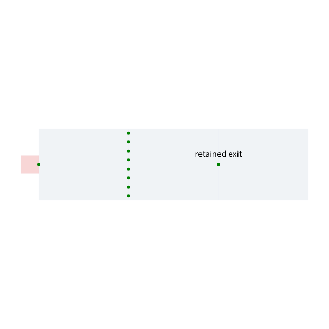

# Cramped-port candidate search

The parent expands a shared region's entire port list again for every incoming
port, repeatedly allocating neighbor arrays and discarded candidates. The fix
expands each node/depth state only when its prefix cost improves, keeps the first
equal-cost parent, and allocates candidates only after the visited-cost check.
An indexed queue preserves BFS order without shifting its backing array.

This native search graph retains the same exit. Exact ordered candidates,
depths, cramped costs and parent chains match the unmodified parent on 192
generated cyclic cases; input graphs remain unchanged. Blacksmith compares
64/4096/16384 parallel-port graphs, exact hashes, adjacency work, timing and
memory, alongside the full 85-case native routing/DRC benchmark. The graph
control measures candidate search; whole-board routing requires separate checks.
