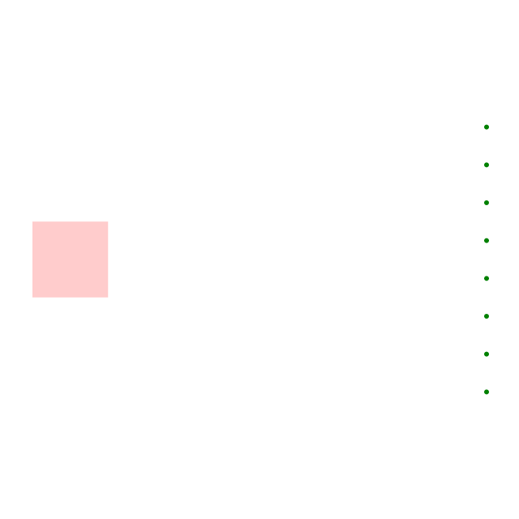

# Build cramped-port adjacency once

This stage initializes in its constructor for callers that use `_step`
directly. BaseSolver also invokes `_setup` on its first `step`, duplicating
the adjacency lists. Each insertion additionally copies the growing array.

The fix initializes this immutable graph once and appends in place to its
private arrays, retaining input order and duplicate entries declared by input.

The generated control checks one initialization across construction and native
stepping, unchanged input, and unchanged solved output. Blacksmith compares
64/4096/16384-port controls with exact hashes, timing, memory and setup reads,
plus the full 85-case routing/DRC suite. This complements the earlier single-
target BFS fix; actual board OOM avoidance still needs native validation.
