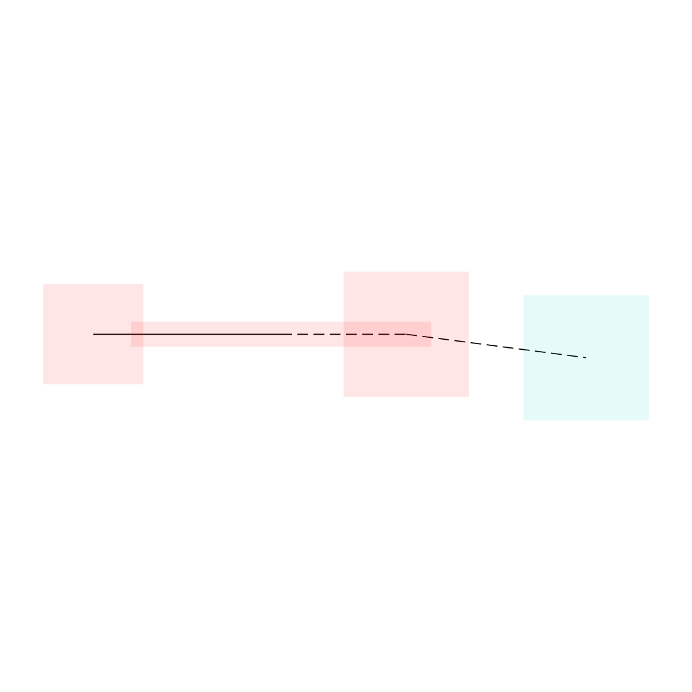

# Routing access through owned targets

A target fragment need not border free space directly: its physical pad or
existing escape can connect it to a free region through other same-net target
regions. Direct-only validation aborts a valid native multiphase handoff.

The generated four-node regression uses a top pad and stub, a full-layer via,
and a bottom-only free exit. Validation follows only existing graph edges,
shared layers and explicit ownership labels/contact aliases. Foreign, unowned,
disconnected, sealed and wrong-layer paths still fail. Six focused graph tests
pass with 42 assertions; original inputs and emitted edges remain unchanged.
Blacksmith compares identical 1/128-escape cases, exact edge hashes, the existing
large-target controls and the full 85-case native routing/DRC suite. Report
paired results on both PRs before merge.
