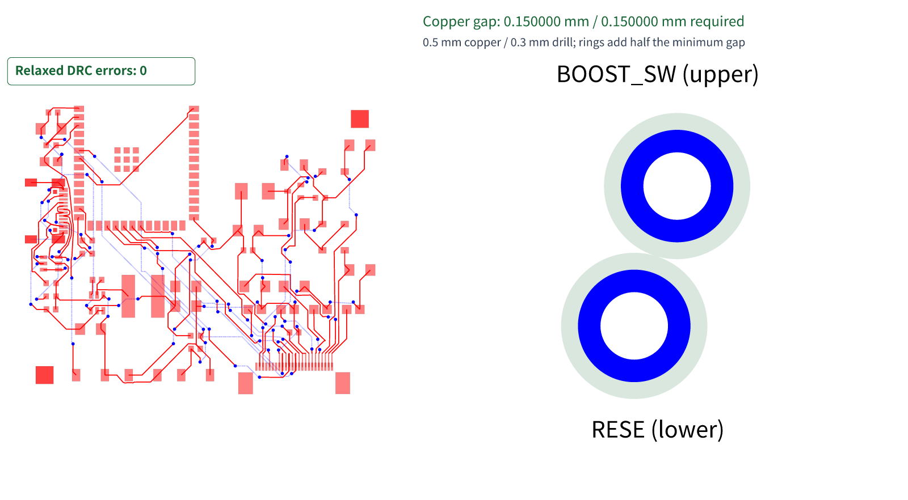

# Preserve clipping during target restoration

A generated global via (blue, four layers) overlaps the corner of a component
pad (orange, top only). The sweep correctly clips the pad, but restoration
previously expanded it back over the authoritative via and failed validation.
Restore source bounds only when retained target area covers every original
layer; retain clipped cells otherwise. Input copper and overlap validation
remain unchanged. The pad retains 0.1575 mm², rather than regaining 0.0025 mm²
masked by the via.

The generated regression fails on the parent and passes with the fix. All 14
focused topology tests pass with 68 assertions. Canonical coordinate rounding
retains fully covered target bounds; the exact T113 regression and both Muse
clearance controls pass without changing their snapshots. Blacksmith compares identical
1/128-pair cases, completion, input hashes and target areas; the existing full
85-sample native routing comparison remains enabled. Hosted results must be
reported on both PRs before merge. No full-board success or speed claim yet.

Final Blacksmith comparison: 85/85 completion and relaxed DRC on both revisions,
zero timeouts and unchanged per-sample trace/via/DRC counts. Median 1.665→1.650 s,
P95 5.129→5.220 s, mean 2.103→2.101 s. Median peak RSS 338.1→347.3 MiB; P90
523.4→510.3 MiB. This correctness fix does not establish a universal speedup.
Generated 1/128-pair cases abort on the parent and complete with 3/384 regions
on the fix, preserving input hashes and retained pad areas. Hosted run
40239587505 contains the complete paired results.

