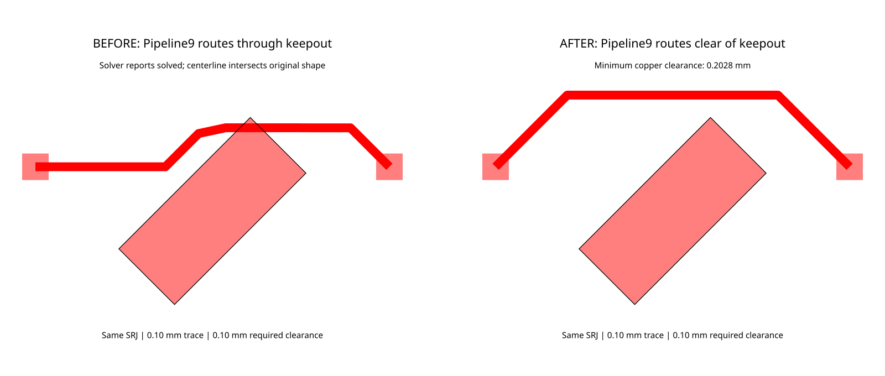

# Pipeline9 routes through an unconnected rotated keepout

Related fix: [#3054](https://github.com/tscircuit/tscircuit-autorouter/pull/3054).

The full `AutoroutingPipelineSolver9_PreloadedTraceGraph` pipeline can return
`solved: true` while its emitted trace intersects the original rotated keepout.
The reproduction calls `solver.solve()` with `cacheProvider: null`, default
effort, and every normal pipeline stage enabled.

## Input

- One top layer on a 6 by 6 mm board.
- One unconnected 2.1 by 0.89 mm keepout, centered at the origin and rotated
  45 degrees counterclockwise.
- Two 0.3 by 0.3 mm connected pads centered at `(-2, 0.5)` and `(2, 0.5)`.
- One connection, 0.1 mm trace width, and 0.1 mm obstacle/trace-to-pad clearance.

Files:

- [Input SRJ](../../fixtures/bug-reports/pipeline9-rotated-keepout/pipeline9-rotated-keepout.srj.json)
- [Interactive Pipeline9 fixture](../../fixtures/bug-reports/pipeline9-rotated-keepout/pipeline9-rotated-keepout.fixture.tsx)
- [Regression test](../../tests/bugs/pipeline9-rotated-keepout.test.ts)
- [Fixed routed-board snapshot](../../tests/bugs/__snapshots__/pipeline9-rotated-keepout.snap.svg)

## Actual and expected behavior

Before the fix, preprocessing replaces the keepout with three 0.7 mm centerline
squares. The final trace includes a horizontal span from `(0.15, 0.941)` to
`(0.9, 0.941)`. Its centerline crosses the original keepout, whose uppermost
corner is approximately `(0.427800, 1.057125)`.

The expected behavior is a connected route whose copper stays outside the
original keepout and satisfies the declared clearance. With #3054, the final
route goes above the keepout and has 0.202787 mm minimum copper clearance.



Both panels show emitted Pipeline9 routes and the original input geometry.
The black outline is the original keepout boundary.

## Why this exercises Pipeline9

`AutoroutingPipelineSolver9_PreloadedTraceGraph.pipelineDef` runs
`PreprocessSimpleRouteJsonWithoutTraceObstaclesSolver` as its first stage.
That stage calls `addApproximatingRectsToSrj`, the helper changed by #3054.
This test continues through the complete pipeline and measures the final
emitted copper; it does not call the helper directly or stop at preprocessing.

The geometry assertion transforms trace segments into the original keepout's
local coordinates, checks segment containment/intersection and minimum distance
to its four edges, and subtracts the trace half-width. It does not use the
approximating rectangles as its clearance reference. The test also checks
connected endpoints, trace width, successful completion, relaxed DRC, and an SVG
snapshot.

## Controlled before/after validation

Measured with Bun 1.3.14 on macOS arm64 using PR head `c7f35d654bfabf8abec134ba2ad4e3f2c450c84e`.
For the baseline, only `lib/utils/addApproximatingRectsToSrj.ts` was restored
from PR base `500b44b096f4103bea71ba99b214cdec9eafde05`. The input, dependencies,
full pipeline, and options were identical in both runs.

| Measurement | Base helper | Fixed helper |
| --- | ---: | ---: |
| Pipeline solved | Yes | Yes |
| Final trace centerline intersects original keepout | Yes | No |
| Minimum centerline distance to original keepout | 0 mm | 0.252787 mm |
| Minimum copper clearance | Intersecting | 0.202787 mm |
| Keepout approximation rectangles | 3 | 3 |
| Routed trace length | 4.344772 mm | 4.670953 mm |

The conservative approximation blocks more area around the original shape.
For this reproduction it adds about 0.326 mm of trace length without increasing
the rectangle count. These are measurements of this input, not a dataset-wide
performance claim.

Run the fixed regression:

```sh
bun test tests/bugs/pipeline9-rotated-keepout.test.ts --timeout 9999999
```

To verify the failing baseline in a disposable checkout of this PR branch:

```sh
git show 500b44b096f4103bea71ba99b214cdec9eafde05:lib/utils/addApproximatingRectsToSrj.ts > lib/utils/addApproximatingRectsToSrj.ts
bun test tests/bugs/pipeline9-rotated-keepout.test.ts --timeout 9999999
git restore --source=HEAD -- lib/utils/addApproximatingRectsToSrj.ts
```

The baseline fails the copper-clearance assertion with `-0.05` versus the
required `0.099999` (including numerical tolerance). Here `-0.05` means zero
centerline-to-rectangle distance minus a 0.05 mm trace radius; it is not a
measurement of penetration depth. The fixed regression passes and reports
zero relaxed DRC errors.

Additional validation: `bun test tests/bugs/pipeline9-rotated-keepout.test.ts
tests/utils --timeout 9999999` passed 51 tests with one existing skip. The
repository TypeScript check passed with a 6 GiB Node heap. The comparison and
snapshot SVGs were rendered to PNG and visually inspected.
