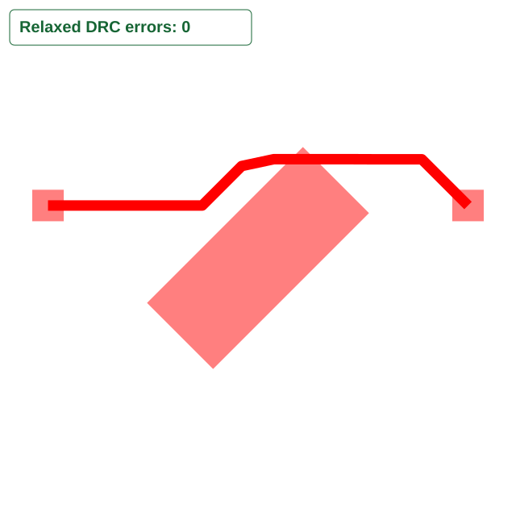

# Pipeline9 routes through an unconnected rotated keepout

Bug report: [#3094](https://github.com/tscircuit/tscircuit-autorouter/issues/3094).
Reproduction PR: [#3055](https://github.com/tscircuit/tscircuit-autorouter/pull/3055).
Stacked fix: [#3054](https://github.com/tscircuit/tscircuit-autorouter/pull/3054).

The full `AutoroutingPipelineSolver9_PreloadedTraceGraph` pipeline can return
`solved: true` while its emitted trace intersects the original rotated keepout.
The reproduction calls `solver.solve()` with `cacheProvider: null`, default
effort, and every normal pipeline stage enabled.

## Input

- One top layer on a 6 by 6 mm board.
- One unconnected 2.1 by 0.89 mm keepout, centered at the origin and rotated
  45 degrees counterclockwise.
- Two 0.3 by 0.3 mm connected pads centered at `(-2, 0.5)` and `(2, 0.5)`.
- One connection, 0.1 mm trace width, and 0.1 mm obstacle/trace-to-pad clearance.

Files:

- [Input SRJ](../../fixtures/bug-reports/pipeline9-rotated-keepout/pipeline9-rotated-keepout.srj.json)
- [Interactive Pipeline9 fixture](../../fixtures/bug-reports/pipeline9-rotated-keepout/pipeline9-rotated-keepout.fixture.tsx)
- [Reproduction test](../../tests/bugs/pipeline9-rotated-keepout.test.ts)

## Current behavior

Preprocessing replaces the keepout with three 0.7 mm centerline squares. The
final trace includes a horizontal span from `(0.15, 0.941)` to `(0.9, 0.941)`.
Its centerline crosses the original keepout, whose uppermost corner is
approximately `(0.427800, 1.057125)`, even though the full pipeline reports solved.



The test deliberately records the current bug by asserting negative copper
clearance. The expected behavior is a connected route whose copper stays outside
the original keepout and satisfies the declared 0.1 mm clearance. PR #3054 is
stacked on this reproduction and changes this assertion and the same snapshot
to demonstrate the fix. PR #3055 changes no production code.

## Why this exercises Pipeline9

`AutoroutingPipelineSolver9_PreloadedTraceGraph.pipelineDef` runs
`PreprocessSimpleRouteJsonWithoutTraceObstaclesSolver` as its first stage.
That stage calls `addApproximatingRectsToSrj`, the helper changed by #3054.
The test continues through the complete pipeline and measures the final emitted
copper; it does not call the helper directly or stop at preprocessing.

The geometry assertion transforms trace segments into the original keepout's
local coordinates, checks segment containment/intersection and minimum distance
to its four edges, and subtracts the trace half-width. It does not use the
approximating rectangles as its clearance reference. The snapshot's relaxed DRC
count is generated by the repository's usual evaluator; the independent
original-geometry assertion establishes the keepout overlap.

## Reproduce

On the `repro/techmannih-rotated-keepout-svg` branch, run:

```sh
bun test tests/bugs/pipeline9-rotated-keepout.test.ts --timeout 9999999
```

The test passes by reproducing the bug and matching the before snapshot. Its
clearance measurement is `-0.05`: zero centerline-to-rectangle distance minus
a 0.05 mm trace radius. This value indicates overlap, not penetration depth.

To inspect the routing stages interactively, run `bun run start` and open the
`pipeline9-rotated-keepout` bug-report fixture. The SRJ and solver options remain
identical in the stacked fix; that branch updates this same test and snapshot
to require a clear route.

Validated with Bun 1.3.14 on macOS arm64. The snapshot was rendered to PNG and
visually inspected.
