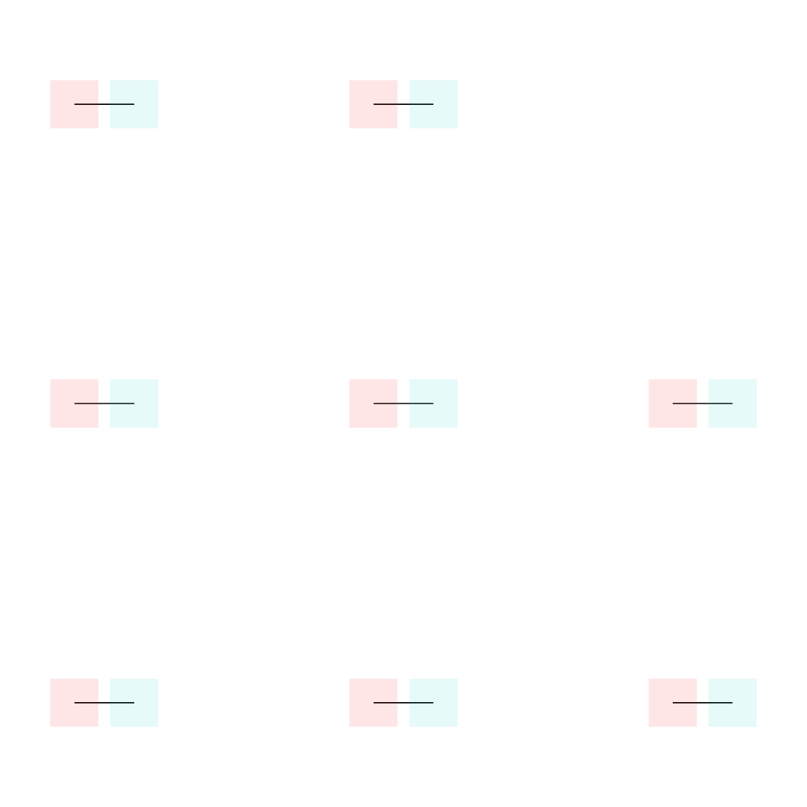

# Index target-edge completion

The optimized neighbor sweep still finishes with an all-pairs target scan,
linear duplicate-edge searches and full-edge scans for every named target.
Large fixed-copper meshes spend substantial time in this final synchronous
step. The generated regression has 256 independent target/free pairs. All 256
routing edges are correct, but 32,668 target-overlap checks exceed the 5,120
budget (including the eight-pair visual control).

The fix uses only broad-phase and incident-edge indexes. It retains the
existing overlap epsilon, shared-layer test, first-error order, edge IDs and
edge order. Blacksmith must compare identical generated inputs and exact edge
hashes, plus the full native 85-case routing/DRC benchmark, before merge.
