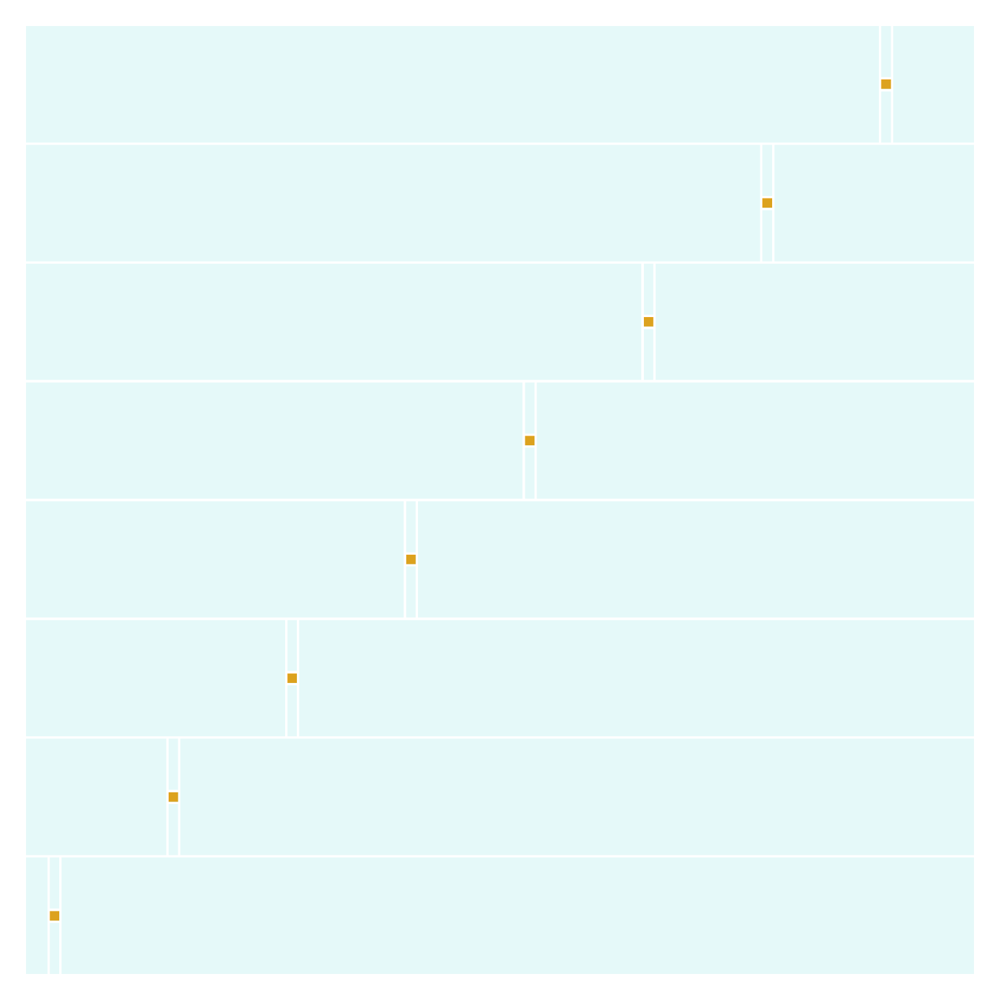

# Repeated coverage work during topology merging

The AM3352 support phase reaches a dense fixed-copper mesh after accepting all
46 DDR signals. Its next setup stage spends minutes merging overlapping
component and global topology. This reproduction reuses the generated striped
fixture: it contains no captured board data.

Every artificial X/Y cell currently re-queries the full rectangle index and
recomputes layer topology even when its covering source nodes are unchanged.
The regression bounds point-coverage queries by X slab count while preserving
the same completed native mesh and input. The stacked fix sweeps Y coverage and
reuses topology from adjacent slabs, without changing geometry or routing rules.

Local paired measurements (Bun 1.4.0, shared 4-CPU host while the board runs,
single trial; identical input and output SHA-256 in both cases):

- 160 rows: 0.348 → 0.188 s; 960 completed output nodes on both; retained regions 960 → 960; RSS 83.7 → 74.2 MB.
- 640 rows: 5.018 → 2.568 s; 3840 completed output nodes on both; retained regions 3840 → 3840; RSS 98.7 → 97.8 MB.

The original reproduction makes 152 point coverage queries across 17 X slabs.
The fix removes repeated per-cell index queries and retains only two slabs of
layer-topology results. All 12 focused topology tests pass, 60 assertions, with
no changed existing snapshots. This is stage-cost evidence, not a board solve
or whole-board speed claim. Every-PR Blacksmith compares both synthetic sizes
and the complete canonical dataset01 routing benchmark; hosted results pending.
