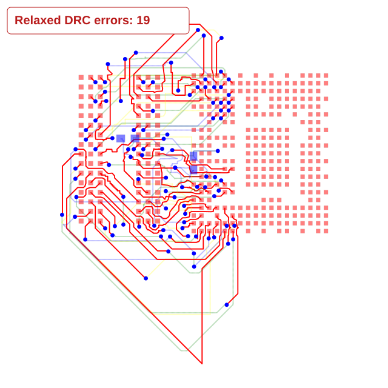

# Latest board analysis

Runtime: tscircuit **0.0.3278**, core **0.0.2459**, capacity-autorouter **0.0.1153**, fanout-solver **0.0.103**. All 19 original TSX boards run with default routing, without copper pours or plane-specific handling. Original TSX/render/observer hashes are in `source-integrity.json`.

The first candidate was too broad and caused real autorouter CI regressions. It is superseded by the fixed-copper-only correction below. The old `fix-*` artifacts and `paired-comparison.json` describe that superseded candidate, not the current fix.

| Corrected candidate | Before | After |
| --- | ---: | ---: |
| Captured subcircuit: crossings of immutable copper | 1 | 0 |
| Full captured graph: crossings of immutable copper | 6 | 0 |
| Full captured graph routes completed | 75/75 | 75/75 |
| Existing real routed PCB sample: relaxed DRC errors | 0 | 0 |

## Root cause and correction

The greedy finishing pass intentionally allows logical crossings of movable routes so downstream unraveling can resolve them. The original broad change forwarded every infinite cost from ordinary routing, suppressing these candidates and causing search exhaustion in previously working circuits. Restricting the greedy check to immutable copper preserves that recovery behavior. The existing crossing predicate is shared by moving it to the base class; no new search strategy, heuristic, or budget is introduced. Final-goal guards remain.

The six fixed-copper crossings are verified with the existing crossing predicate, which excludes shared-angle boundary aliases. The previous 26-to-zero count included movable-route intersections and is not used as the corrected fixed-copper improvement claim. The replay and crossing pairs are in `fixed-copper-graph-replay.json`.

The actual captured fragment keeps 18 regions and 19 ports from the observed before/after paths, retains fixed copper, seals the cut boundary, renames IDs, and translates the coordinate origin. Its native graph SVG changes from crossing the immutable wire to taking the real available detour.

## Real PCB snapshots

The integration also updates the existing routed-circuit repro snapshot using `getBugReportSnapshotSvg`. Both actual PCB images were visually inspected. Both retain zero relaxed DRC errors; the different legal copper paths are a snapshot change, not a claimed reduction below zero errors.

| Before | After |
| --- | --- |
|  |  |

## CI regression checks

All six originally failing cases now pass locally: pedometer high-density routing, pedometer low-effort graph routing, OV9281 regional repair, canonical preloaded-port duplication, native fixed-trace routing, and the full-board DDR clearance snapshot. Only the changed native fixed-trace PCB snapshot needed updating. The private local dependency overlay initially held stale B01/A13 checkouts; after aligning to the repo pins and regenerating, the local snapshot is byte-identical to CI’s received SVG. Its functional routing assertions already pass and it retains zero relaxed DRC errors. The full-board clearance snapshot remains unchanged.

A focused regression test ensures that greedy finishing still accepts movable-route crossings. Source CI tests pass. Fresh full autorouter CI is running at https://github.com/tscircuit/tscircuit-autorouter/actions/runs/45027269618. The original failure inventory is in `initial-ci-regressions.json`.

## All-board benchmark

Blacksmith Ubuntu 24.04 ARM, Bun 1.4.3, 32 vCPUs, 19 concurrent boards, 600-second wall budget each. Every candidate uses the baseline's exact frozen lockfile. Only the source-equivalent graph solver change is patched into the release bundle; source roles, bundle hashes, and unchanged Bun/Node worker hashes are checked.

The baseline completed zero of 19 boards: 17 settled with routing errors and two bus cases hit the wall budget. Its first blocking stages were high-density routing (7 variants), fanout (6), graph routing (4), and bus solving (2 budget cases). Native fanout counts remain 79/91, 83/95, 123/174, 13/32, 8/32, and 139/273 for the six circuit families. The latest release preserves exact copper in all 16 cases comparable to the prior release; all 187 common captured inputs are identical.

The corrected run is complete: https://github.com/tscircuit/tscircuit-autorouter/actions/runs/45025676977. It still completes zero of 19 boards. All 16 comparable emitted outputs retain identical copper and error counts. There are three budget cases versus two at baseline: the two bus variants, plus imx6-local. That extra case reaches exactly the same high-density failure after 8,236,657 iterations at 599.25 seconds, then hits the render deadline before publishing CJSON. Baseline reached that failure at 571.98 seconds and published CJSON at 588.24 seconds. All 14 input captures for this variant are byte-identical. Graph time is about 36.9 seconds in both; high-density time is 279.1 seconds after versus 280.7 seconds before. Its roughly 29-second shift accumulated upstream. This is an observed budget-limit difference, not grounds for a blanket no-regressions claim.

All 187 common captured inputs remain available; only two differ, both the changed global routing plan feeding port distribution/high-density routing in imx6-spaced. Its original immutable-copper failure disappears and another high-density bottleneck remains. Final emitted copper and error counts are unchanged. The baseline/fixed locks and runtime hashes are captured; the two worker bundles remain byte-identical.

The previous broad candidate also preserved final copper in comparable boards but missed CI regressions outside this matrix. The full CI suite is therefore checked separately.

Remaining major issues are incomplete native fanout, graph search exhaustion under refined fixed-copper topology, unresolved high-density routes, and bus lane search budgets. The initial graph can include invalid through-via sites that subsequent mesh refinement removes; accepting the earlier invalid plan is not a fix.

## Every board, corrected candidate

Counts are emitted partial/preloaded copper, not successful board completion.

| Variant | Before traces / vias | After traces / vias | Before stop | After stop |
| --- | ---: | ---: | --- | --- |
| butterstick-local | budget | budget | 600-second render budget | 600-second render budget |
| butterstick-native | 0 / 0 | 0 / 0 | settled | settled |
| butterstick-spaced | budget | budget | 600-second render budget | 600-second render budget |
| glider-local | 53 / 97 | 53 / 97 | settled | settled |
| glider-native | 0 / 0 | 0 / 0 | settled | settled |
| glider-spaced | 53 / 92 | 53 / 92 | settled | settled |
| h616-default-order-local | 16 / 32 | 16 / 32 | settled | settled |
| h616-local | 16 / 32 | 16 / 32 | settled | settled |
| h616-native | 0 / 0 | 0 / 0 | settled | settled |
| h616-spaced | 16 / 32 | 16 / 32 | settled | settled |
| icepi-local | 16 / 30 | 16 / 30 | settled | settled |
| icepi-native | 0 / 0 | 0 / 0 | settled | settled |
| icepi-spaced | 52 / 98 | 52 / 98 | settled | settled |
| imx6-local | 17 / 30 | budget | settled | 600-second render budget |
| imx6-native | 0 / 0 | 0 / 0 | settled | settled |
| imx6-spaced | 17 / 30 | 17 / 30 | settled | settled |
| orangecrab-local | 52 / 97 | 52 / 97 | settled | settled |
| orangecrab-native | 0 / 0 | 0 / 0 | settled | settled |
| orangecrab-spaced | 52 / 103 | 52 / 103 | settled | settled |

## PR stack

- Source repro: https://github.com/tscircuit/tiny-hypergraph/pull/338
- Source fix: https://github.com/tscircuit/tiny-hypergraph/pull/339
- Autorouter repro: https://github.com/tscircuit/tscircuit-autorouter/pull/4111
- Autorouter integration: https://github.com/tscircuit/tscircuit-autorouter/pull/4112

No tscircuit main-package PR was created.
