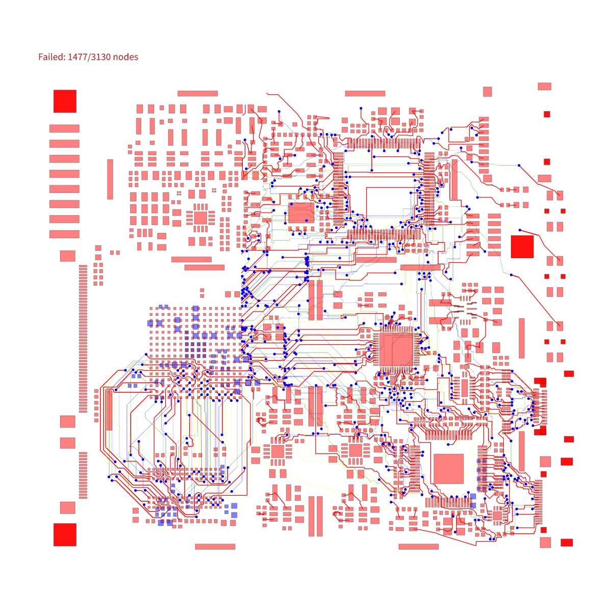
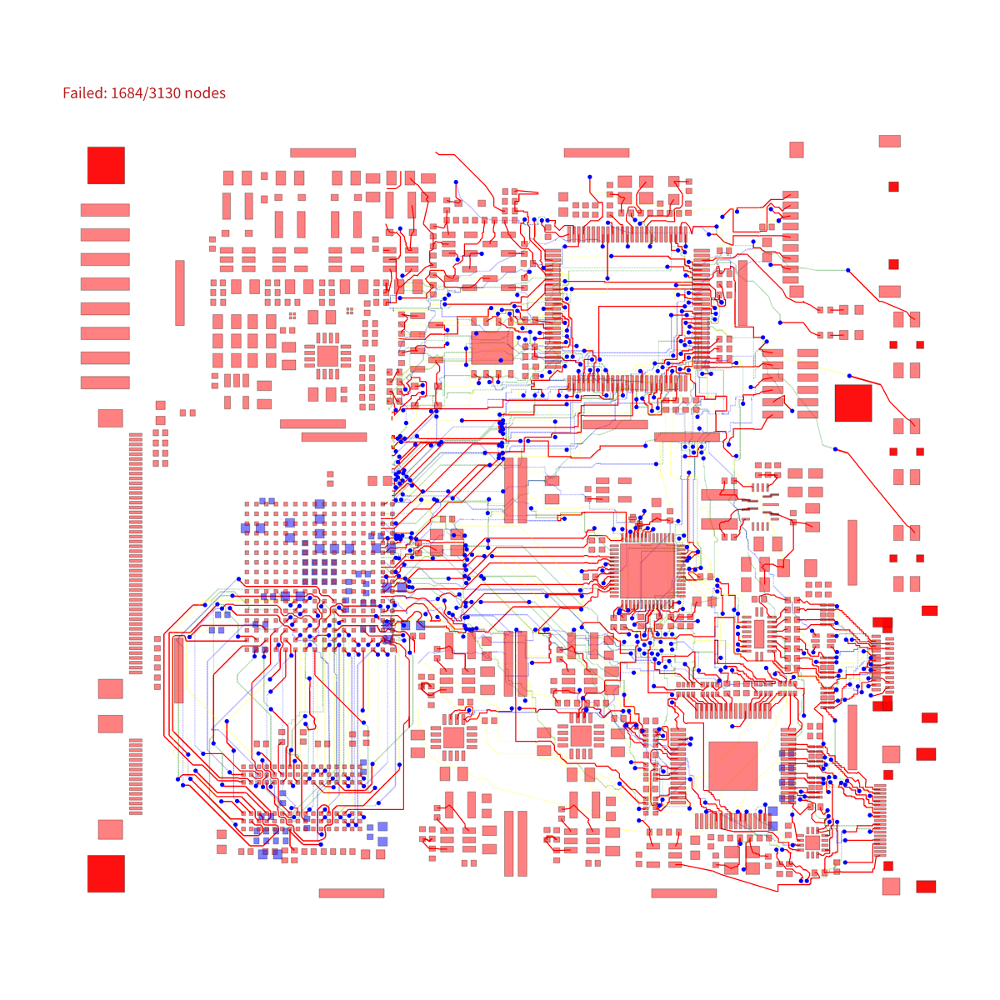
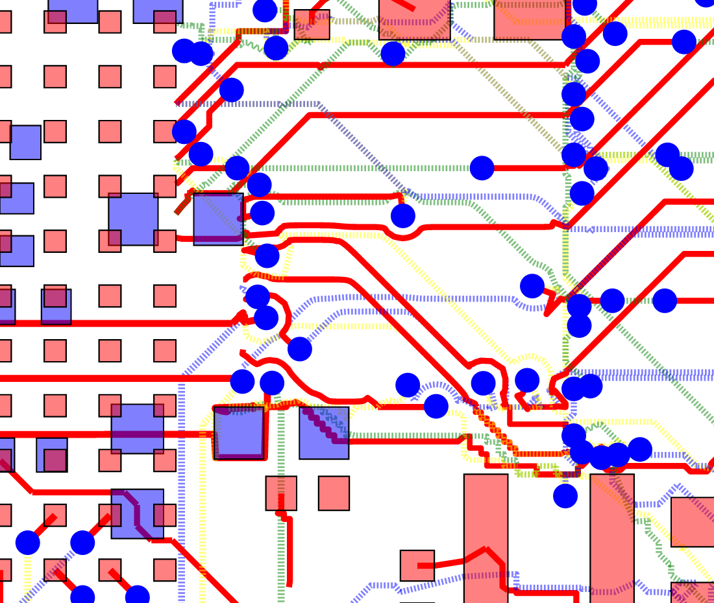
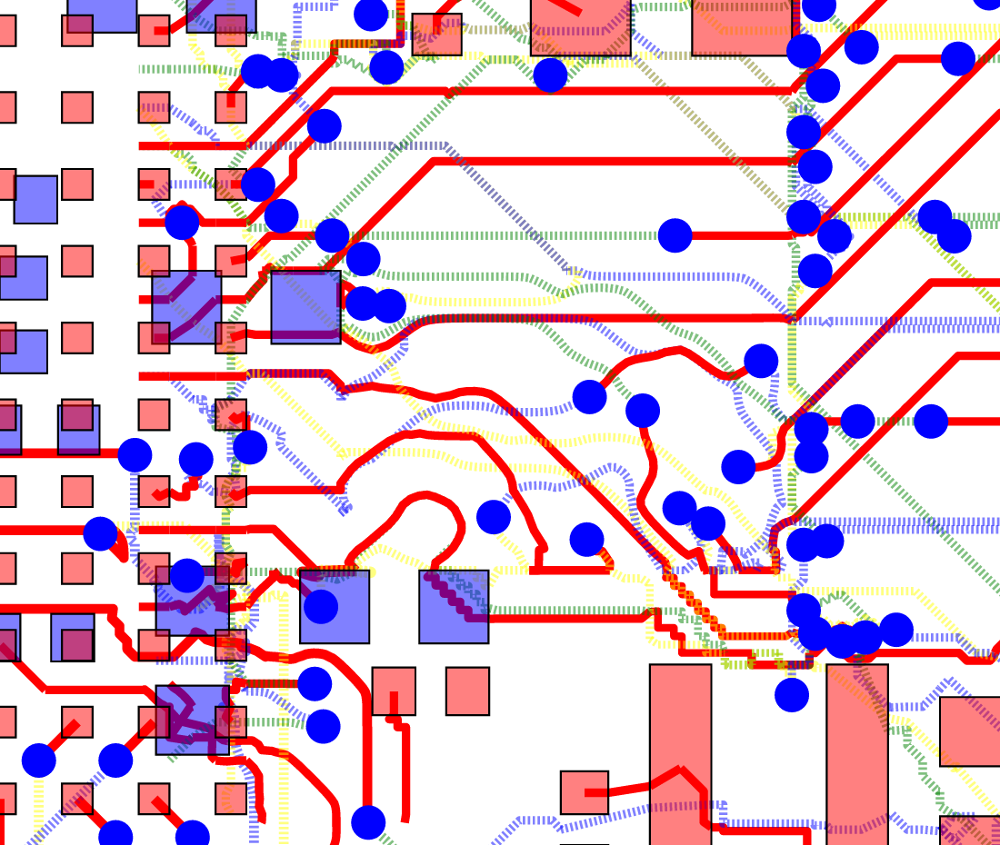

# Latest board analysis

Runtime at the start: **tscircuit 0.0.3279**, **core 0.0.2460**, **capacity-autorouter 0.0.1154**, bundled **fanout-solver 0.0.103**. All 19 original TSX boards run through default tscircuit routing with copper pours disabled. The board, render and observer files are unchanged from the previous run; candidate dependencies use the baseline frozen lockfile.

The latest baseline still completes **0/19** boards. Sixteen emit partial results; three hit the 600-second render budget. Compared with the previous corrected 0.0.3278 run, all 16 comparable emitted copper/error counts and all 187 captured pipeline inputs are unchanged.

## Chosen fix

A regional repair accepted a replacement via connecting signal layers 0–2 whose through barrel covered a foreign terminal on layer 3. The next detailed-routing cell could not escape that terminal. Intercepting the candidate and repaired output showed the via-to-terminal distance was 0.27281 mm, below their 0.28 mm combined copper radius and the 0.39 mm required distance including clearance.

The fix adds an optional via-to-port distance predicate to the existing A01 search (26 changed production lines). The consumer enables it only for physical regional repairs that reconstruct movable preloaded copper (16 added adapter lines). All vias in that joint repair must leave the fixed terminals usable. Routing strategies, ordering, costs, budgets, general board-model propagation and final repair behavior are unchanged.

A smaller final-output-only check was tested: it rejected the unsafe candidate but stopped at 1,421 cells. Checking only preloaded via connections or only other endpoint layers also stopped at 1,421. Applying the complete geometric constraint during A01 selection produces a valid escape and reaches 1,684 cells. The source change extends the existing search rather than adding a routing strategy. Grid-mapping and rectangle-layer-filter alternatives recovered none of 556 captured failed leaf cases.

| Captured real input | Before | After |
| --- | ---: | ---: |
| Isolated captured A01 candidate: terminal pairs routed | 26/26 | 26/26 |
| Isolated captured A01 candidate: foreign terminals inside via clearance | 4 | 0 |
| Full detailed-routing input: cells completed | 1,477 | 1,684 |
| Internal route pieces | 3,312 | 3,605 |
| Detailed-routing iterations before stopping | 432,804 | 278,385 |
| Complete original boards | 0/19 | 0/19 |

The old failure at `cmn_248 / source_net_186` disappears. Routing later stops at `topology_merge_6579 / source_net_3_mst7`. The emitted circuit still has 53 traces and 97 vias: core publishes newly routed copper only when the entire routing phase succeeds. Additional internal cells are not published board connections.

## Direct parent reproduction

The consumer repro now runs the complete unmodified captured high-density parent constructor: 3,130 nodes, 1,714 pad obstacles and 1,013 preloaded route pieces. Its gzip is byte-identical to the observed constructor (SHA-256 `87134c75e21f6225e90a27dcb20010b4f3ce061a1d7de1e6f7423176b70b005a`). Only the serialized ConnectivityMap is rehydrated. The test executes one parent solver and snapshots that instance; it loads no saved output copper and applies no coordinate scaling.

The previous consumer example combined an isolated captured A01 candidate with two separately captured neighboring traces. Those coordinates were real, but the example was manually assembled. Calling it restored native parent output was inaccurate. That consumer fixture and its derived regional DRC claims (15 → 10) are withdrawn. The source A01 test remains an explicitly isolated captured-unit replay. Historical adjacent-copper and cut-terminal evidence files describe that superseded constructed example.

The separate visualization PR adds `visualize({ showAcceptedRoutes: true })`. It renders the actual parent’s accepted routes, `getUpdatedFixedHdRoutes()` and its pad obstacles, with its failed/solved progress. Default child/candidate visualization is unchanged. This is a native routing-state diagnostic, not a completed-board rendering; unfinished routing can have open ends.

| Native parent state | Before | After |
| --- | --- | --- |
| Overview |  |  |
| Same viewport around the original failure |  |  |

The zoom changes only the native SVG viewport and white background extent. Every native copper and pad element is retained unchanged; `native-parent-camera-proof.json` records the camera and geometry check. Both overviews and zooms were visually inspected. These zooms show surrounding pads and retained neighboring copper from the same execution, without stitching in other outputs.

The checked-in SVG path is identical before and after, giving a regular GitHub snapshot diff: [before](https://github.com/tscircuit/tscircuit-autorouter/blob/032c787145e92955b1ff8b1495455429d58d31dd/tests/repro/__snapshots__/through-via-terminal-window.snap.svg), [after](https://github.com/tscircuit/tscircuit-autorouter/blob/63ef0f5251a03d53c0e1f310f0a7e85626274835/tests/repro/__snapshots__/through-via-terminal-window.snap.svg). `native-parent-replay.json` records the input and snapshot hashes and exact parent progress. The original failing cell has zero accepted routes before and nine after, including `source_net_186`; the later failure remains.

## All 19 boards

The final paired run has the same 16 emitted copper arrays, the same error counts, and identical non-autorouting error elements on all 16 outputs. All 187 captured constructor/SRJ inputs are identical, with no added or removed inputs. The same three cases hit the render budget. Only the affected detailed-routing failure moves later. No new emitted-board regression was observed.

| Blocking stage | Before | After |
| --- | ---: | ---: |
| Native fanout | 6 | 6 |
| Graph pathfinding | 4 | 4 |
| Bus lanes | 2 | 2 |
| Detailed routing | 7 | 7 |

Counts below are emitted PCB traces/vias, not the internal fanout or detailed-routing progress. Wall times are one paired run with concurrent workers; they do not establish a performance trend.

| Board | Blocking stage | Emitted traces/vias, before = after | Seconds before → after |
| --- | --- | ---: | ---: |
| butterstick-local | Bus budget | No circuit emitted | 600.1 → 600.1 |
| butterstick-native | Fanout | 0/0 | 199.7 → 201.0 |
| butterstick-spaced | Bus budget | No circuit emitted | 600.2 → 600.2 |
| glider-local | Detailed routing | 53/97 | 353.6 → 345.3 |
| glider-native | Fanout | 0/0 | 165.7 → 165.7 |
| glider-spaced | Graph pathfinding | 53/92 | 357.2 → 362.4 |
| h616-default-order-local | Graph pathfinding | 16/32 | 31.3 → 31.7 |
| h616-local | Graph pathfinding | 16/32 | 53.6 → 52.0 |
| h616-native | Fanout | 0/0 | 335.3 → 342.4 |
| h616-spaced | Graph pathfinding | 16/32 | 30.7 → 31.1 |
| icepi-local | Detailed routing | 16/30 | 167.7 → 169.0 |
| icepi-native | Fanout | 0/0 | 74.9 → 67.1 |
| icepi-spaced | Detailed routing | 52/98 | 393.2 → 398.9 |
| imx6-local | Detailed routing (budget) | No circuit emitted | 600.9 → 600.9 |
| imx6-native | Fanout | 0/0 | 94.1 → 95.3 |
| imx6-spaced | Detailed routing | 17/30 | 553.4 → 512.2 |
| orangecrab-local | Detailed routing | 52/97 | 178.6 → 176.5 |
| orangecrab-native | Fanout | 0/0 | 558.8 → 555.0 |
| orangecrab-spaced | Detailed routing | 52/103 | 252.8 → 254.9 |

The six native fanout cases remain at 79/91, 83/95, 123/174, 13/32, 8/32 and 139/273 connections after 256 assignment attempts each. Graph and bus failures occur before the changed routing stage. Their inputs are retained for separate investigation; this fix does not report them as complete.

## Older failing capture and snapshot

One existing native partial-routing SVG changes. Its functional assertions pass. This older 0.0.3257 capture already failed before the fix and still fails afterward; its internal completed cells decrease from 463 to 204, and route pieces from 802 to 353. Inspecting its repaired output identified the reason: an accepted replacement via left **0.06838 mm** clearance at a foreign terminal against a **0.089 mm** routing requirement (`0.252829 − 0.28/2 − 0.0889/2`). A separate final-output-only validator rejects the same candidate and also stops at 204 cells. The extra old prefix depended on accepting that clearance violation. This is recorded explicitly rather than treating every internal progress count as unchanged.

The updated regular SVG was regenerated locally, visually inspected, and is byte-identical to CI’s received SVG (`b4bd741258695a432c943dfe236f370c86b5edc7e006c119a9698dbe3b7d9c18`). The two native DDR regression samples remain solved and DRC-clean with their original snapshots. The optional retained-parent view is a separate visualization change; default graphics snapshots retain their existing rendering.

## Pipeline and runtime verification

Preloaded copper remains in the SRJ trace list. In the observed local phases, trace counts grow from 0 to 8 to 16 while obstacle counts lacking Circuit JSON metadata remain constant at 10, 12 or 4 by circuit family. Detailed routing receives native fixed-route primitives and real pad obstacles.

Blacksmith 32-vCPU ARM Ubuntu 24.04, Bun 1.4.3, 19 concurrent renders, 600 seconds each. Baseline run: https://github.com/tscircuit/tscircuit-autorouter/actions/runs/45049784828 . Final paired run: https://github.com/tscircuit/tscircuit-autorouter/actions/runs/45061903558 . Candidate artifact 14770376506 has SHA-256 `e16bcfe69a7bc0d8dcdc196ca40a83e6b03435f932109da0e2a2525df5baeebb`.

The source-equivalent change is applied to the release entry and decoded/re-serialized Bun and Node worker sources. Per-bundle hashes are retained. All three outer bundles and both embedded worker bodies pass parser checks. Source and patched release have equal constructor inputs and complete route geometry with protection enabled and disabled, plus four equal regional activation cases. `source-equivalence.json` records the hashes. The final PR’s production files equal the verified production commit; later changes repair test typing/formatting and update the native SVG.

Broader prototypes are superseded. Unconditional activation, general board-model forwarding, extra final fixed-route repair context, and changing the deferred contact guard did not pass regression checks and are not included.

## PRs and checks

- Source repro: https://github.com/tscircuit/high-density-a01/pull/153
- Source fix: https://github.com/tscircuit/high-density-a01/pull/154
- Autorouter real PCB repro: https://github.com/tscircuit/tscircuit-autorouter/pull/4121
- Autorouter visualization: https://github.com/tscircuit/tscircuit-autorouter/pull/4127
- Autorouter integration: https://github.com/tscircuit/tscircuit-autorouter/pull/4122

The source starts from the A01 commit already pinned by the latest autorouter (existing source PR #151). No tscircuit main-package PR was created. The consumer stack is repro #4121 → visualization #4127 → routing fix #4122. The visualization PR adds an opt-in retained-state view to the parent’s native visualization. The earlier generic PCB snapshot-helper extension is removed. The routing production files are unchanged from the benchmarked fix.

The source fix passes Bun CI: https://github.com/tscircuit/high-density-a01/actions/runs/45072506932 . Source production code and the 19-board routing change are unchanged. The new direct parent snapshot replay and focused type checks pass locally before and after. Current consumer heads are repro `fb8c55d4`, visualization `032c7871`, and fix `63ef0f52`; their final CI results will be recorded in validation.json. One initial visualization shard stopped during dependency installation because Sharp’s unchanged libvips download returned HTTP 403; it did not execute tests.
