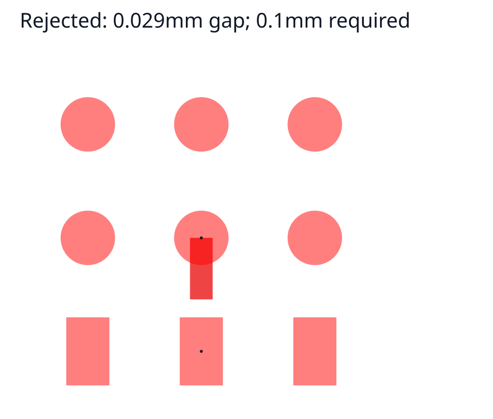

# Ten supplied full circuits: intercepted pipeline analysis

All ten circuits from the uploaded ZIP were run with the agreed **fanout → DDR bus lanes → remaining routing** workflow. **0/10 complete.** No production routing fix is claimed in this report.

The strongest finding is upstream of fanout: **91 of 241 captured signal breakout exits in the five original boards (37.8%) lie inside foreign copper-pour obstacles.** These synthesized endpoints are constraints supplied to fanout; the consumer cannot safely route to them while respecting that fixed copper.

| Circuit | Best partial fanout escapes | Generated exits inside foreign pours | Run outcome | Native SVGs |
| --- | ---: | ---: | --- | --- |
| ButterStick original | 60/91 | 8/53 | 256 assignments; fanout failed | [PCB](butterstick-original/pcb.svg) · [partial fanout](butterstick-original/partial-fanout.svg) |
| ButterStick spaced | 70/91 | 0/91 | 256 assignments; 900s diagnostic budget | [PCB](butterstick-spaced/pcb.svg) · [partial fanout](butterstick-spaced/partial-fanout.svg) |
| Glider original | 69/95 | 16/52 | Fanout reached 600s budget | [PCB](glider-original/pcb.svg) · [partial fanout](glider-original/partial-fanout.svg) |
| Glider spaced | Not reached | Not reached | Placement failed; bus routing timed out | [PCB](glider-spaced/pcb.svg) |
| H616 original | 101/174 | 53/112 | Fanout reached 600s budget | [PCB](h616-original/pcb.svg) · [partial fanout](h616-original/partial-fanout.svg) |
| H616 spaced | 96/174 | 0/174 | Fanout reached 600s budget | [PCB](h616-spaced/pcb.svg) · [partial fanout](h616-spaced/partial-fanout.svg) |
| iCE/Pi original | 9/32 | 6/12 | 256 assignments; fanout failed | [PCB](icepi-original/pcb.svg) · [partial fanout](icepi-original/partial-fanout.svg) |
| iCE/Pi spaced | 76/92 | 0/92 | 256 assignments; fanout failed | [PCB](icepi-spaced/pcb.svg) · [partial fanout](icepi-spaced/partial-fanout.svg) |
| i.MX6 original | 9/32 | 8/12 | 256 assignments; fanout failed | [PCB](imx6-original/pcb.svg) · [partial fanout](imx6-original/partial-fanout.svg) |
| i.MX6 spaced | 7/32 | 0/32 | 256 assignments; fanout failed | [PCB](imx6-spaced/pcb.svg) · [partial fanout](imx6-spaced/partial-fanout.svg) |

“Fanout escapes” are chip-to-breakout branches or plane drops in a diagnostic partial attempt. They are not completed board nets. “Generated exits” counts boundary terminals, excluding plane drops, so its denominator differs. The original circuits retain pours; the spaced variants omit them and change the handoff representation, so these are not spacing-only comparisons.

The initial run uses a 600-second routing budget and 660-second process limit. ButterStick spaced reached the process limit before finalization; its original incomplete report is retained. A separate 900-second diagnostic run completed all 256 assignments, still only 70/91 escapes, and supplies its PCB snapshot. Instrumentation adds overhead; the lower budgeted H616 partial counts are not presented as a routing regression or a performance comparison.

82 winding-placement calls were intercepted: 76 solved and six failed in GatePlacementSolver. The failures occur in ButterStick spaced, Glider spaced twice, iCE/Pi spaced and both i.MX6 variants. Glider spaced nevertheless proceeds into bus-lane routing after placement fails. This handoff is recorded as a failure; it is not successful fanout-first routing. No remaining-net Pipeline 9 solve starts in these attempts.

The completed final snapshots contain no newly emitted routed traces or vias. The 19 already-connected nets in the original-board audits are joined by existing pours. Partial fanout views are labelled as diagnostic copper, not committed PCB routing.

## What the interception establishes

**1. Automatic exit placement needs copper feasibility.** The five original captured fanout inputs contain these invalid endpoints: ButterStick 8/53, Glider 16/52, H616 53/112, iCE/Pi 6/12 and i.MX6 8/12. The spaced inputs have no foreign-pour conflicts because those samples omit pours.

For example, iCE/Pi U22.B5 is assigned the generated exit at approximately (1.8442, 10.4801) mm on inner1, inside foreign copper. The supplied inner1 GND zone is explicitly unbroken. The winding adapter passes regions, endpoints, layer preferences and spacing; it does not pass copper obstacles. A successful placement therefore does not establish a routable endpoint.

The relevant Core boundaries are [automatic layer-candidate creation](https://github.com/tscircuit/core/blob/351e73d665fad37577c47fcbff2e4c29eb377467/lib/components/primitive-components/Breakout/create-implicit-breakout-point-solver-input.ts#L821) and the [winding adapter](https://github.com/tscircuit/core/blob/351e73d665fad37577c47fcbff2e4c29eb377467/lib/components/primitive-components/Breakout/default-implicit-breakout-point-solver.ts#L19). Each sample has an exit-obstacle-audit.json with coordinates, layers and the original conflicting obstacles. These are routing-model conflicts; the audit does not silently erase or refill a pour.

**2. Some current candidates fail before congestion.** Native per-bus preflight, with no accepted escape routes, finds no successful layer for nine buses in iCE/Pi original and nine in i.MX6 original. The captured examples include U22.B5 approaching U22.A5 with only 0.029 mm gap against a 0.1 mm requirement, and U10.B2 approaching U10.A2 with 0.011 mm against 0.119 mm. The clearance rejections are correct.

These are native segments and pad geometry from the supplied circuit, not a newly constructed repro.

A separate hand-constructed source corridor for the actual U22.B5 pin passes the unchanged static-clearance predicate on bottom, with the same 0.1 mm trace, 0.1 mm clearance and 0.45 mm via. It does not reach the declared inner1 exit and is **not a completed connection or solver improvement**. It helps isolate the bad layer/endpoint constraint: [source-corridor check](icepi-original/source-corridor-check.json).

The i.MX6 U10.B2 case has another limitation. Its eight foreign 0.25 mm pads form a closed ring on a 0.5 mm grid under the captured 0.119 mm trace/clearance rules. The inflated forbidden radius for a trace centre is 0.3035 mm, so adjacent forbidden regions overlap. Under the captured baseline's via-in-pad and same-net policy, the 0.4 mm via also has no permitted escape inside the ring. This is a proof about those modeled rules, not an assertion that the real hardware is universally unroutable: [source enclosure proof](imx6-original/source-enclosure-proof.json).

**3. Same-net merging alone is not an acceptable fix.** An isolated replay of each actual captured fanout input, changing only the existing allowSameNetMerges option, produced:

| Actual fanout input | Baseline partial escapes | Merge experiment | Native copper validator | Independent via-in-pad findings |
| --- | ---: | ---: | --- | ---: |
| iCE/Pi original | 9/32 | 18/32 | Valid | 3 findings at 2 locations |
| i.MX6 original | 9/32 | 17/32 | Valid | 2 findings at 1 location |
| i.MX6 spaced | 7/32 | 9/32 | Valid | 0 |

All three remain failed fanout phases. The independent check uses the original full-circuit SMD pads and physical via holes. It finds drills overlapping C117/C118 pads in iCE/Pi and C82 in i.MX6; duplicate findings at shared via coordinates are not counted as separate physical holes. The apparent original-board gains are therefore rejected. Native electrical-copper validation alone is insufficient to establish manufacturing validity here.

## Fix priority and reproducibility

The first implementation target should be **legal automatic breakout exit placement/layer selection in Core**, respecting foreign fixed copper while preserving explicit user constraints. That directly addresses invalid synthesized inputs affecting all five originals. Then reassess source-escape candidates and the same-net via/pad exemption with independent checks. Increasing assignment limits, accepting partial output or weakening clearance checks does not resolve these constraints.

The circuits, widths, clearances, via sizes, pads and component positions were retained. Core is pinned to 351e73d (0.0.2434), fanout to 0.0.93, bus lanes to 0.0.62, and the shipped winding dependency to 202dbe9. The archive SHA-256 is 1991ad1891a953dcd660818aaceb73f7aa42dbf704e677e635753b9159f7a6b7.

Captured fanout constructor inputs and failed winding inputs are saved alongside each sample. analysis.json.gz contains per-bus preflight, missing escapes and rejection examples; pipeline-internals.json.gz records the original predicate source hashes, operation progress and candidate-check counters. Rejection counters count attempts, not failed nets. summary.json.gz and statistics.json retain the original run state and the extended ButterStick result.

Runs: [all ten instrumented circuits](https://github.com/tscircuit/tscircuit-autorouter/actions/runs/44778112884), [captured-input diagnosis](https://github.com/tscircuit/tscircuit-autorouter/actions/runs/44780661381), [extended ButterStick](https://github.com/tscircuit/tscircuit-autorouter/actions/runs/44780667160), [independent geometry and via checks](https://github.com/tscircuit/tscircuit-autorouter/actions/runs/44784761054), [all generated-exit audit](https://github.com/tscircuit/tscircuit-autorouter/actions/runs/44785685178). The first run is marked failed because the original ButterStick process timed out; that outcome is preserved, not relabelled as a successful benchmark.
