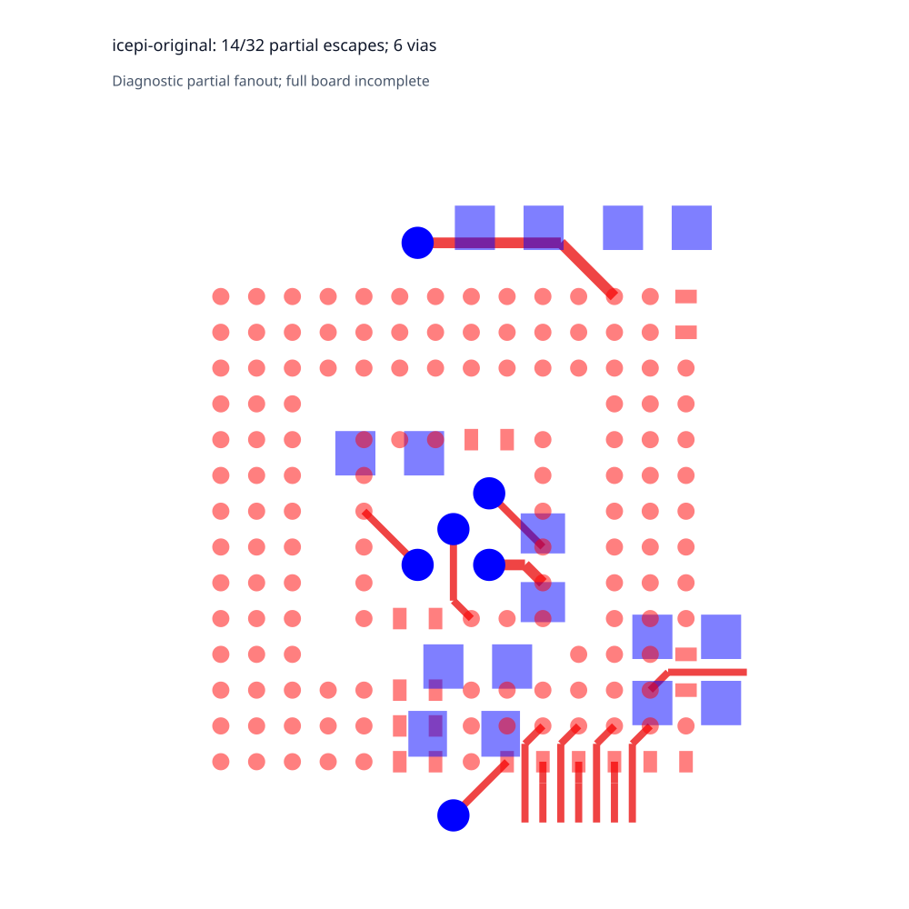
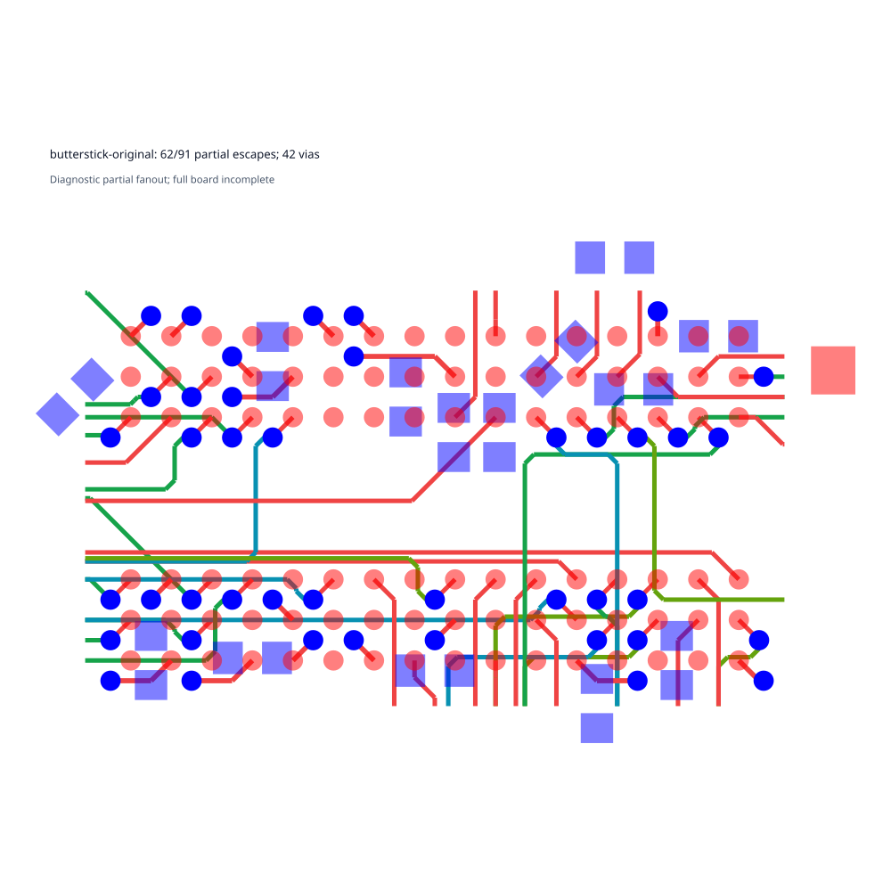
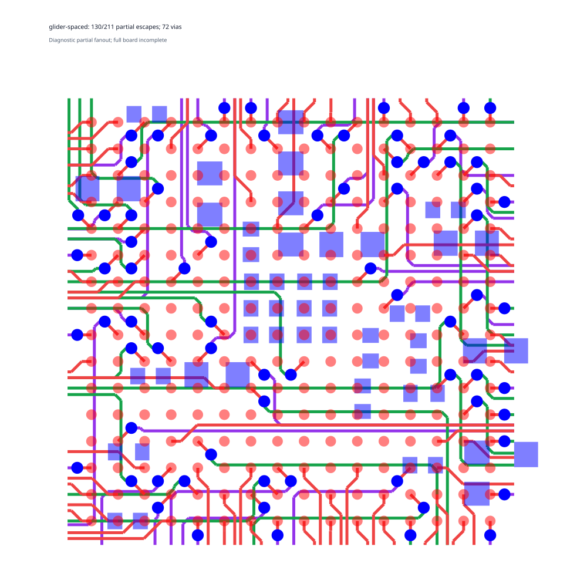
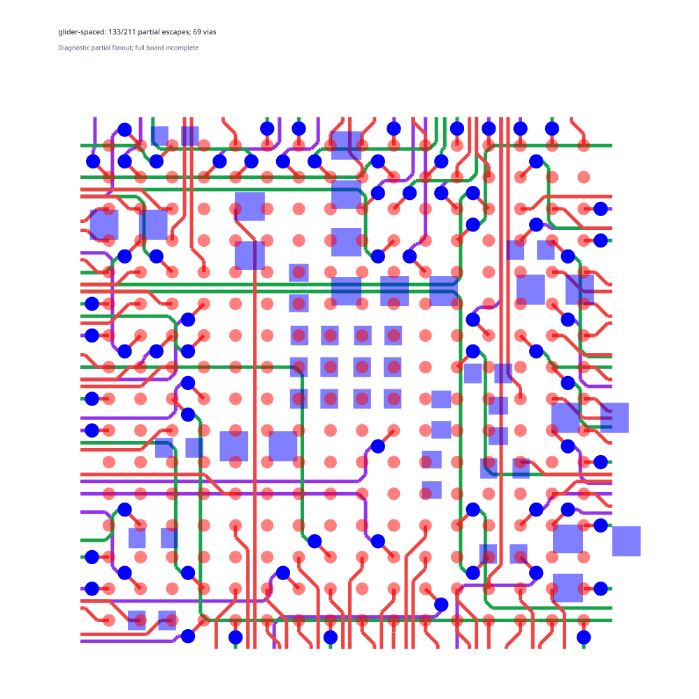

# Latest full-circuit routing analysis — 2026-11-21

The selected fix removes repeated construction of statically rejected boundary candidates. **Matched fanout search time falls 13.8%** across ButterStick, iCE/Pi and i.MX6 original captures, with identical plans, output SRJs, all 256 assignment summaries and via counts. The focused native U22 repro builds 1 candidate on a repeated search instead of 89: **98.9% fewer builds**. The production change is three added lines and one replaced line in one existing function.

Complete-board routing remains **0/10**. This improves the cost of fanout search; the unchanged routing failures remain visible.

## Current stack and workflow

The uploaded ZIP's ten original/spaced full circuits ran on tscircuit **0.0.3269**, Core **0.0.2447** (`91c208a`), capacity autorouter **0.0.1145**, fanout **0.0.97**, bus lanes **0.0.63**, and merged winding main `08d8da9`. Core's latest connectivity-map update uses published **0.0.36**. The winding fix is already present in this baseline; its earlier gains are not attributed to this PR.

The ZIP and every TSX member were hash-checked. Original traces and vias were removed. All components, pads, DDR placement, bus membership, widths, clearances, via spans and budgets remain fixed. The workflow remains **fanout → DDR bus lanes → remaining nets**. Both complete Core runs intercept winding stages, original clearance predicates and completed assignment summaries. Only the after run contains the hash-checked fanout change; Core is unmodified.

## Where routing stops

Winding placement succeeds in **87/88 calls**. The remaining spaced iCE/Pi call requests **17.43mm** of declared edge capacity with **14.64mm** available under its spacing rules. The subsequent fanout problem also remains incomplete. Every board stops during fanout, before its DDR bus-lane and general-routing phases.

The baseline records **24,085,020 accepted-copper rejection events**. These are rejected candidate checks, not distinct failed connections. The boundary search also rebuilds candidates whose static rejection is already cached. The fix checks that existing cache key before building a plan. Candidates with unknown or clear static results still receive the original geometry and mutual-copper checks; repair priorities and blocker counts remain unchanged.

| Full circuit | Diagnostic escape connections before → after | Diagnostic vias | Completed assignments |
| --- | ---: | ---: | ---: |
| butterstick-original | 62/91 → 62/91 | 42 → 42 | 256 → 256 |
| butterstick-spaced | 78/91 → 78/91 | 49 → 49 | 256 → 256 |
| glider-original | 86/95 → 86/95 | 58 → 58 | 256 → 256 |
| glider-spaced | 130/211 → 133/211 | 72 → 69 | 21 → 24 |
| h616-original | 108/174 → 108/174 | 72 → 72 | 145 → 187 |
| h616-spaced | 111/174 → 111/174 | 72 → 72 | 100 → 115 |
| icepi-original | 14/32 → 14/32 | 6 → 6 | 256 → 256 |
| icepi-spaced | 77/92 → 77/92 | 37 → 37 | 256 → 256 |
| imx6-original | 9/32 → 9/32 | 7 → 7 | 256 → 256 |
| imx6-spaced | 7/32 → 7/32 | 4 → 4 | 256 → 256 |

Glider spaced and both H616 cases are limited by the unchanged 600-second run budget, including preparation. Their partial counts depend on how far the search gets; all matched completed assignment prefixes agree. Seven baseline searches finish their 256 assignments. Diagnostic escapes never count as completed board nets or committed copper. Spaced Glider reaches 24 assignments instead of 21 and finds three additional partial escapes with three fewer diagnostic vias. This is progress within the fixed time budget; the geometric search decisions are unchanged. The 19 nets already joined through retained pours remain connected; no new route copper is committed.

## Measured benefit

Each timing uses the actual current native Core constructor capture on one Blacksmith worker. The before value is the mean of two original runs bracketing the change. Timing includes solving and reading the best partial SRJ; input preparation and DRC are outside the timer. The evidence workflow verifies deep equality of plans, output and every completed assignment.

| Full-circuit fanout capture | Before | After | Time reduction |
| --- | ---: | ---: | ---: |
| butterstick-original | 86.46s | 75.95s | 12.2% |
| icepi-original | 5.94s | 4.46s | 24.9% |
| imx6-original | 7.36s | 5.54s | 24.7% |
| Total | 99.75s | 85.95s | **13.8%** |

The existing focused fixture has the same connections, options and rule fields as the latest full iCE/Pi constructor capture. Every retained obstacle is unchanged; only obstacles outside the boundary and clearance halo are omitted.

| Focused native repro before | After |
| --- | --- |
|  |  |

The iCE/Pi and ButterStick completed-search examples below have identical copper and use the same native renderer, pad coordinates and viewport. The Glider example shows progress within the fixed time budget.

| iCE/Pi original before | After |
| --- | --- |
|  |  |

| ButterStick original before | After |
| --- | --- |
|  |  |

| Glider spaced before (same time budget) | After |
| --- | --- |
|  |  |

## Alternatives tested

| Experiment | Observed result | Decision |
| --- | --- | --- |
| Existing segment spatial index during route search | Same routes; ButterStick about 22% slower with shared indexes and 55% slower rebuilding indexes | Discarded |
| Hoist unchanged plane endpoint candidates | Same routes; no consistent ButterStick benefit | Discarded |
| Via/trace bounds check | Same routes; helps ButterStick, adds a helper and two checks | Kept the smaller, more beneficial cache change |
| Remove intermediate via arrays | Same routes; about 6% faster on ButterStick, smaller gains on the other two | Discarded for this fix |
| Continue diagonal plane candidates | No additional escapes across five captures | Discarded |
| Fully backtrack analytic bus tracks | H616 109 → 117 escapes and 74 → 79 vias, but 250.75s → 421.39s; ButterStick original times out at 660s after an 88.49s baseline; Glider unchanged | Discarded due to the runtime regression |
| Reuse boundary static rejections before plan construction | 13.8% lower total search time; identical decisions and copper; one small production edit | Selected |

## Validation and evidence

The focused tests, all eight native Mac regression shards, typecheck and format check pass. All ten constructor inputs, physical pad sets and matched completed assignment prefixes are identical. All 7 pairs of completed searches have identical output SRJs. All **20 captured partials pass native DRC and independent via-in-pad checks** against the full circuits. The older i.MX6 repro’s lookup counter changes from 28,491 to 29,117 because cache reads now precede plan construction. Its SVG is otherwise byte-identical; its routed control, failure state and 64 assignments are unchanged. Complete PCB SVGs are byte-identical.

[Repro PR #348](https://github.com/tscircuit/fanout-solver/pull/348), [stacked fix PR #349](https://github.com/tscircuit/fanout-solver/pull/349), [baseline captures and full PCB SVGs](https://github.com/tscircuit/tscircuit-autorouter/actions/runs/44904481212), [after captures and full PCB SVGs](https://github.com/tscircuit/tscircuit-autorouter/actions/runs/44906708885), [paired timings](https://github.com/tscircuit/tscircuit-autorouter/actions/runs/44906211806), [physical audit](https://github.com/tscircuit/tscircuit-autorouter/actions/runs/44907171099), [passing type and format checks](https://github.com/tscircuit/tscircuit-autorouter/actions/runs/44906893989), [native regression suite](https://github.com/tscircuit/fanout-solver/actions/runs/44907930443), and [machine-readable statistics](boundary-cache/summary-statistics.json).
