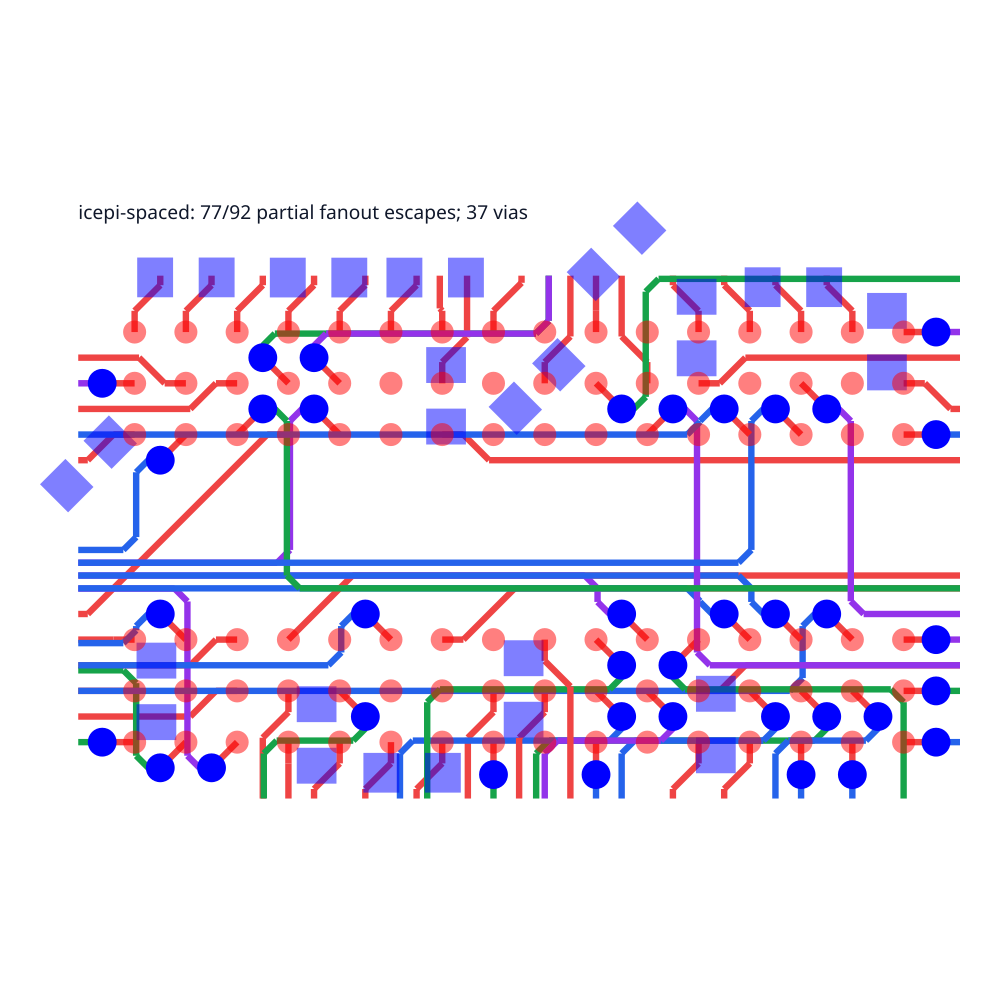
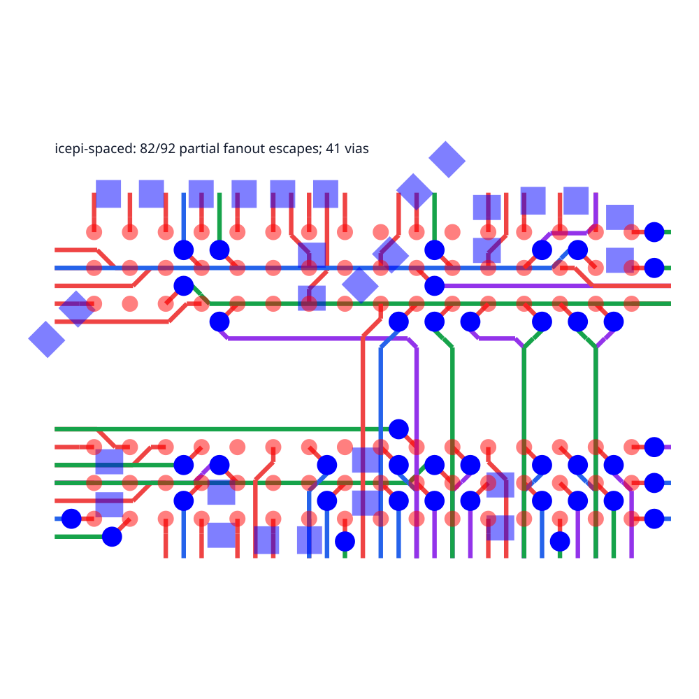

The previous via-sharing PR (#377) is closed. This round uses only the ten uploaded original/spaced full circuits, with fresh routing and their supplied geometry and manufacturing rules.

### Latest published stack: actual full Core pipeline

Raw partial first-region escapes: **723 → 768 (+6.2%)** of 1,024. Partial fanout vias: **429 → 473**. Full boards: **0/10 → 0/10**.

| Circuit | Pad escapes before → after | Vias before → after | Completed assignments | Same assignment prefix? | Best on common completed layer assignments |
|---|---:|---:|---:|---|---:|
| butterstick-original | 64 → 64 | 42 → 42 | 256 → 256 | True | 64 → 64 (256 shared) |
| butterstick-spaced | 78 → 80 | 49 → 50 | 256 → 256 | False | 77 → 77 (131 shared) |
| glider-original | 89 → 89 | 58 → 58 | 256 → 256 | True | 89 → 89 (256 shared) |
| glider-spaced | 135 → 161 | 67 → 95 | 33 → 43 | False | 108 → 145 (1 shared) |
| h616-original | 119 → 122 | 74 → 82 | 256 → 209 | False | 109 → 116 (19 shared) |
| h616-spaced | 111 → 119 | 72 → 76 | 192 → 175 | False | 108 → 115 (4 shared) |
| icepi-original | 23 → 23 | 11 → 11 | 256 → 256 | True | 23 → 23 (240 shared) |
| icepi-spaced | 77 → 82 | 37 → 41 | 256 → 256 | False | 76 → 81 (193 shared) |
| imx6-original | 20 → 20 | 15 → 15 | 256 → 256 | True | 20 → 20 (256 shared) |
| imx6-spaced | 7 → 8 | 4 → 3 | 256 → 256 | False | 7 → 8 (103 shared) |

Raw outcomes include the effect of the unchanged wall-clock budget. Common layer assignments are matched by the complete sorted bus-to-layer mapping, not by assignment index when histories differ. The dedicated-via control below completes 256 assignments on both sides and isolates the routing effect.

### Stacked on source-track candidates (#379): actual full Core pipeline

Raw partial first-region escapes: **734 → 768 (+4.6%)** of 1,024. Partial fanout vias: **455 → 473**. Full boards: **0/10 → 0/10**.

| Circuit | Pad escapes before → after | Vias before → after | Completed assignments | Same assignment prefix? | Best on common completed layer assignments |
|---|---:|---:|---:|---|---:|
| butterstick-original | 64 → 64 | 42 → 42 | 256 → 256 | True | 64 → 64 (256 shared) |
| butterstick-spaced | 78 → 80 | 49 → 50 | 256 → 256 | False | 77 → 77 (131 shared) |
| glider-original | 89 → 89 | 58 → 58 | 256 → 256 | True | 89 → 89 (256 shared) |
| glider-spaced | 137 → 161 | 77 → 95 | 31 → 43 | False | 108 → 145 (3 shared) |
| h616-original | 122 → 122 | 82 → 82 | 196 → 209 | True | 122 → 122 (196 shared) |
| h616-spaced | 117 → 119 | 80 → 76 | 161 → 175 | False | 116 → 118 (87 shared) |
| icepi-original | 23 → 23 | 11 → 11 | 256 → 256 | True | 23 → 23 (240 shared) |
| icepi-spaced | 77 → 82 | 37 → 41 | 256 → 256 | False | 76 → 81 (193 shared) |
| imx6-original | 20 → 20 | 15 → 15 | 256 → 256 | True | 20 → 20 (256 shared) |
| imx6-spaced | 7 → 8 | 4 → 3 | 256 → 256 | False | 7 → 8 (103 shared) |

Raw outcomes include the effect of the unchanged wall-clock budget. Common layer assignments are matched by the complete sorted bus-to-layer mapping, not by assignment index when histories differ. The dedicated-via control below completes 256 assignments on both sides and isolates the routing effect.

All full PCB SVGs remain unchanged because failed fanout copper is not committed. These are actual Core PCB outputs, not partial fanout drawings.

| Sample | Before PCB | After PCB | Partial fanout before/after |
|---|---|---|---|
| butterstick-original | [SVG](published/full-boards/before/butterstick-original.svg) | [SVG](published/full-boards/after/butterstick-original.svg) | [before](stacked/butterstick-original-before.svg) · [after](stacked/butterstick-original-after.svg) |
| butterstick-spaced | [SVG](published/full-boards/before/butterstick-spaced.svg) | [SVG](published/full-boards/after/butterstick-spaced.svg) | [before](stacked/butterstick-spaced-before.svg) · [after](stacked/butterstick-spaced-after.svg) |
| glider-original | [SVG](published/full-boards/before/glider-original.svg) | [SVG](published/full-boards/after/glider-original.svg) | [before](stacked/glider-original-before.svg) · [after](stacked/glider-original-after.svg) |
| glider-spaced | [SVG](published/full-boards/before/glider-spaced.svg) | [SVG](published/full-boards/after/glider-spaced.svg) | [before](stacked/glider-spaced-before.svg) · [after](stacked/glider-spaced-after.svg) |
| h616-original | [SVG](published/full-boards/before/h616-original.svg) | [SVG](published/full-boards/after/h616-original.svg) | [before](stacked/h616-original-before.svg) · [after](stacked/h616-original-after.svg) |
| h616-spaced | [SVG](published/full-boards/before/h616-spaced.svg) | [SVG](published/full-boards/after/h616-spaced.svg) | [before](stacked/h616-spaced-before.svg) · [after](stacked/h616-spaced-after.svg) |
| icepi-original | [SVG](published/full-boards/before/icepi-original.svg) | [SVG](published/full-boards/after/icepi-original.svg) | [before](stacked/icepi-original-before.svg) · [after](stacked/icepi-original-after.svg) |
| icepi-spaced | [SVG](published/full-boards/before/icepi-spaced.svg) | [SVG](published/full-boards/after/icepi-spaced.svg) | [before](stacked/icepi-spaced-before.svg) · [after](stacked/icepi-spaced-after.svg) |
| imx6-original | [SVG](published/full-boards/before/imx6-original.svg) | [SVG](published/full-boards/after/imx6-original.svg) | [before](stacked/imx6-original-before.svg) · [after](stacked/imx6-original-after.svg) |
| imx6-spaced | [SVG](published/full-boards/before/imx6-spaced.svg) | [SVG](published/full-boards/after/imx6-spaced.svg) | [before](stacked/imx6-spaced-before.svg) · [after](stacked/imx6-spaced-after.svg) |

| Native routed iCE/Pi region before | After |
|---|---|
|  |  |

The fix prefers existing source-aligned track candidates for compact automatic boundary-only regions. It extends #379's candidate generator in three production files, with 19 added and 3 removed lines. Regions containing local plane drops retain the previous candidate ordering. Explicit exit targets, winding/corner guides, fixed tracks, reservations, widths, clearances, via restrictions and search budgets retain their existing behavior.

Repro [#381](https://github.com/tscircuit/fanout-solver/pull/381) is stacked on #379; fix [#382](https://github.com/tscircuit/fanout-solver/pull/382) is stacked on the repro. The fix naturally updates the two native SVG snapshots.

### Exact publication and dataset

The measured publication is tscircuit **0.0.3280**, Core **0.0.2461** (`ce2683b98de40a7d4eaa4dc055ae105096c744d8`), fanout **0.0.104**, capacity autorouter **0.0.1156**, bus lanes **0.0.65**, winding **08d8da9d8dbb037eba332e7bfd685063f8805ed4**. Fanout's own capacity dependency remains **0.0.718**. Publication tarball/source hashes and checks against the actual bundled Core implementation are in [publication-verification.json](publication-verification.json).

This publication still contains the earlier automatic plane-via reuse implementation. Closing #377 does not remove code already shipped by the release workflow. The main comparison preserves that exact published behavior, and an independent dedicated-via control below demonstrates that the new gains do not require shared escape vias. This round does not publish, merge, bump or revert releases.

Source ZIP SHA-256: `1991ad1891a953dcd660818aaceb73f7aa42dbf704e677e635753b9159f7a6b7`. The harness verifies the archive, each TSX source, original components/pads/net membership, and fixed component geometry. The full original/spaced H616, ButterStick, Glider, i.MX6 and iCE/Pi samples include DDR, peripheral and power connections. In the uploaded spaced factories, the first failing regions have boundary terminations and no plane-drop requests; this is their original input, not a benchmark modification.

### What fails inside the pipeline

The requested order remains **fanout → DDR bus lanes → remaining routing**. All ten runs stop at the first failed fanout region, so DDR lanes and the remaining autorouter never run. Best-attempt copper stays diagnostic; it is not committed as a successful partial fanout. Completed full boards and newly connected full-board nets therefore remain zero.

The read-only observer records the actual candidate-layer discovery, three existing assignment strategies, completed assignment histories, clearance rejection counts and original rejection geometry. It changes no predicate result, candidate order or routing limit. The original 256-assignment cap, 600-second process budget, original preparation handling and 660-second external watchdog are retained. Timed results are reported as raw outcomes alongside comparable completed layer assignments.

In nine baseline cases, the largest rejection category is **accepted-plan-copper**: a candidate conflicts with copper that the same assignment already accepted. These are attempted candidate checks, not unique failed nets. For example, iCE/Pi spaced records 3,724,194 such checks, versus 18,846 pad/trace and 13,197 boundary checks. Its assignment routing consumes most solver time; candidate-layer discovery is a much smaller part.

The captured paths show the practical problem: target-aligned tracks can create long sideways jogs through neighboring escape channels. The same existing source/via-aligned candidates can leave those channels open when selected first. This is a candidate-ordering issue inside the current analytic router; a new parallel router or a larger search budget is unnecessary.

Blindly preferring those tracks everywhere loses local power-plane drops. The selected scope follows termination geometry: apply the preference when the region contains only boundary handoffs, retain the original ordering when plane drops are present. The source candidates are still checked by the same static and accepted-copper validators, and the original target candidates remain available.

There is also an upstream winding failure for the spaced iCE/Pi region: declared breakout edges need **17.43 mm** but expose **14.64 mm**. This is recorded separately from the fanout failure. The new ordering does not claim to repair that winding capacity problem.

### Isolated native control without shared vias

Both sides use the exact captured constructor inputs, dedicated-via source control, #379's existing candidates, and the original limits. Every case completes all **256 assignments**. This comparison isolates the new ordering from Core preparation time and from automatic via sharing.

| Sample | Requested pads | Escapes before → after | Vias before → after | Trace length, mm before → after |
|---|---:|---:|---:|---:|
| ButterStick original | 91 | 62 → 62 | 42 → 42 | 188.10 → 188.10 |
| ButterStick spaced | 91 | 78 → 80 | 49 → 50 | 322.27 → 203.60 |
| Glider original | 95 | 86 → 86 | 58 → 58 | 218.10 → 218.10 |
| Glider spaced | 211 | 137 → 164 | 78 → 89 | 516.70 → 564.22 |
| H616 original | 174 | 122 → 122 | 82 → 82 | 280.56 → 280.56 |
| H616 spaced | 174 | 117 → 119 | 80 → 76 | 530.57 → 444.21 |
| iCE/Pi original | 32 | 19 → 19 | 11 → 11 | 25.35 → 25.35 |
| iCE/Pi spaced | 92 | 77 → 82 | 37 → 41 | 276.33 → 211.86 |
| i.MX6 original | 32 | 16 → 16 | 14 → 14 | 18.16 → 18.16 |
| i.MX6 spaced | 32 | 7 → 8 | 4 → 3 | 6.97 → 7.75 |
| **Total** | **1,024** | **721 → 758 (+5.1%)** | **455 → 466 (+2.4%)** | **2,383.10 → 2,161.90 (−9.3%)** |

Boundary escapes increase **597 → 634**; plane drops stay **124 → 124**. All five spaced samples improve, while all five original mixed regions retain their counts. Native copper DRC, independent via/pad clearance and drilled-hole spacing pass in all ten cases. Full regions still fail and full boards remain **0/10**. These are pad escapes, not fully connected board nets.

Evidence: [control run](https://github.com/tscircuit/tscircuit-autorouter/actions/runs/45071220846), [selected candidate run](https://github.com/tscircuit/tscircuit-autorouter/actions/runs/45080009446), [experiment-results.json](experiment-results.json). The native controls are separate from the actual Core pipeline table above.

The H616 original tradeoff against the publication is inherited from #379: plane drops change 60 → 48 while boundary escapes rise, giving 119 → 122 total pad escapes. The new boundary-only preference leaves #379's mixed-region output unchanged, including its 48 plane drops. Review that dependency's tradeoff separately; the selected fix does not recover those twelve published-baseline plane drops.

### Physical limits identified independently

The source-net-aware geometry audit proves that **seven requested pads in each i.MX6 variant** are surrounded by closed foreign-pad trace-clearance barriers, while no configured through via fits inside the enclosed area. Same-net and unidentified pads are excluded from the foreign-pad proof. This remains a manufacturing restriction even if same-net electrical contact is allowed.

For i.MX6 spaced, the actual 0.5 mm pitch and 0.125 mm pad radius, with 0.119 mm trace width and clearance, produce a centerline keepout radius of **0.3035 mm**, greater than half the pitch. The configured 0.4 mm via plus 0.119 mm pad clearance needs **0.444 mm** from a pad center; every point in the enclosed square is within **0.3536 mm** of a pad. The original variant is audited with its own supplied rules.

Those two full circuits cannot complete under their current supplied restrictions. The audit finds no such impossibility proof for the other eight cases; it does not declare them unroutable. Per-pad source IDs, foreign pad IDs, coverage intervals and rule values are preserved in [geometry-audit](geometry-audit).

### Alternatives tested and rejected

The experiment archive retains all measured modes and their input hashes; partial or timed-out runs are not treated as equivalent work.

| Alternative | Measured outcome | Decision |
|---|---|---|
| Prefer source tracks globally | 721 → 755 escapes, but plane drops 124 → 105 | Reject the power-routing regressions |
| Prioritize all exact preferred tracks too | 751 escapes, 487 vias, 113 plane drops | More vias and fewer useful escapes than the selected scope |
| Apply preference only to grouped routing | 742 escapes, 115 plane drops | Still regresses mixed original regions |
| Direct source-layer singleton escape | 731 escapes, including two sample regressions | Less gain and worse consistency |
| Broaden candidate-layer heading retries | 704 → 689 on the dedicated control | Reject regressions |
| Search analytic backtracking exhaustively | Several cases exceed the original external watchdog | Reject runtime cost |
| Add existing adjacent dogbone candidates | Small gains with more vias and regressions elsewhere | Reject as the primary fix |
| Correct winding own-pad/prefix handling alone | 704 → 704 | A local correctness issue, but no sample completion gain |
| Combine boundary metadata and winding extensions | Four-case pilot regresses badly | Reject; do not mask the underlying constraints |

The selected change provides the largest verified completion gain among the tested variants that preserve the original regions' plane-drop counts and all physical restrictions. It is an incremental fanout improvement, not a claim that these full boards are now routed.

### Native visual repro and validation

The repro captures all 92 requests and the actual local component pads from spaced iCE/Pi. Obstacles omitted from the fixture are provably outside the shared boundary plus its copper-clearance halo; membership, rules and route budgets are preserved. One native test produces the whole routed region and a larger source-channel cut. The before-only repro is committed first; the stacked fix changes those same SVGs naturally.

Full pipeline runs: [published baseline 45070654984](https://github.com/tscircuit/tscircuit-autorouter/actions/runs/45070654984), [#379 control 45074125683](https://github.com/tscircuit/tscircuit-autorouter/actions/runs/45074125683), [new fix 45080675519](https://github.com/tscircuit/tscircuit-autorouter/actions/runs/45080675519). Independent audit: [all-ten audit job](https://github.com/tscircuit/tscircuit-autorouter/actions/runs/45081031013/job/137389015423). The initial source-check job in that run exposed the inherited endpoint type error, which is corrected and verified by the separate exact-head check linked below. Native macOS repro: [45078894060](https://github.com/tscircuit/fanout-solver/actions/runs/45078894060); final fix: [45081283722](https://github.com/tscircuit/fanout-solver/actions/runs/45081283722). Exact-head full typecheck and repository format check: [45081325490](https://github.com/tscircuit/tscircuit-autorouter/actions/runs/45081325490).

The audit checks constructor equality, original circuit geometry/net membership, components/pads, original source-net aliases, native copper DRC, independent drill spacing and via/pad clearance, bus atomicity/layer/direction/via consistency, and endpoint/route validation. Pre-existing structural issues, if any, remain visible in statistics; no new structural issue is accepted. Gained/lost route identities, route length, vias, assignment histories, PCB hashes, winding failures and actual rejected geometry are retained.

The separate two-line narrowing in the inherited AM3354 test checks that a boundary endpoint is a wire before accessing its coordinate; it repairs the upstream TypeScript error without altering routing. The AM3354 fixture is a repository regression check, not a substitute for the uploaded benchmark dataset.
