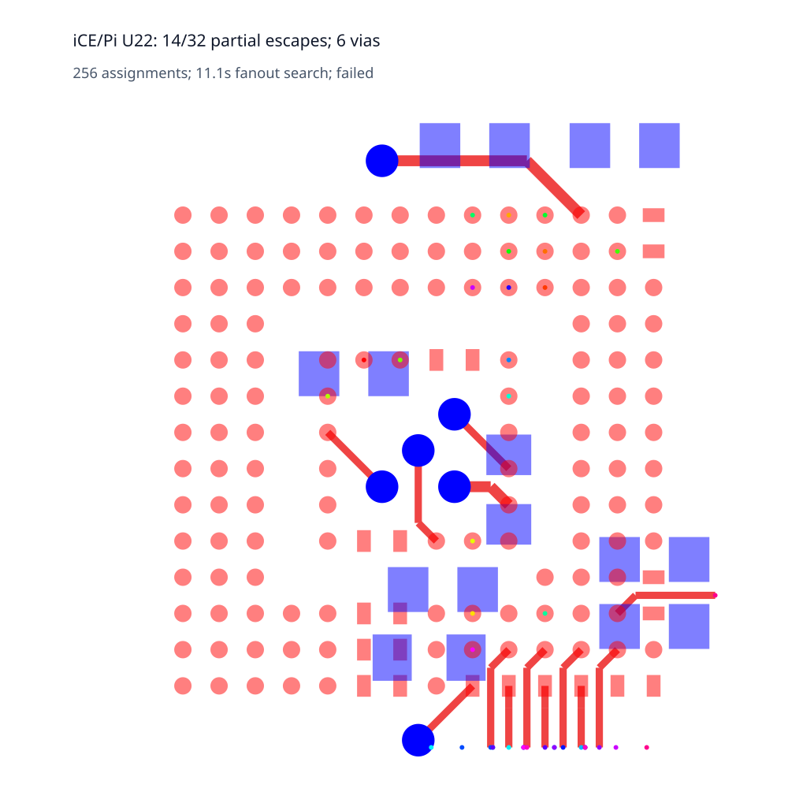
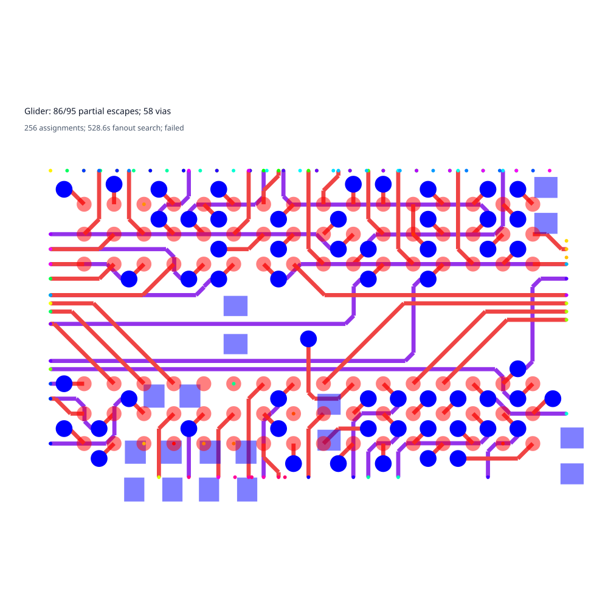

# Latest full-circuit refresh: defer unused fanout output conversion

All ten uploaded full circuits were rerun on **tscircuit 0.0.3266, Core 0.0.2443, autorouter 0.0.1143 and fanout 0.0.96**. The merged selector and fixed-DDR-copper changes are included. The workflow remains fanout → DDR bus lanes → remaining-net routing, with original geometry, widths, clearances, via rules, memberships and budgets.

**0/10 boards complete.** Baseline and fix both reach 552/813 diagnostic fanout escapes with 339 vias. The useful change is reduced conversion work: partial attempts construct an output SRJ only when inspected and cache it. Complete attempts are still converted and validated before scoring, and failed fanout still throws from getOutput().

| Measurement | Before | After | Change |
| --- | ---: | ---: | ---: |
| Instrumented fanout time, 7 comparable completed searches | 1489.5s | 1442.9s | 3.1% less |
| Paired replay time, three current captures | 108.6s | 97.2s | 10.5% less |
| Focused U22 output SRJs constructed | 768 | 1 | 99.9% fewer |
| Diagnostic partial escapes | 552/813 | 552/813 | Unchanged |
| Diagnostic vias | 339 | 339 | Unchanged |
| Complete boards | 0/10 | 0/10 | Unchanged |

The seven comparable searches finish all 256 assignments on both versions. Their final routed SRJs are identical. All 2,036 shared assignment summaries match, all nine captured fanout constructor inputs match and all ten full PCB SVGs are byte-identical. Partial escapes are not completed board nets or committed traces; 19 board nets were already joined by retained same-net pours in the original fixtures.

| Circuit | Diagnostic escapes, before → after | Vias | Completed assignments | Fanout seconds |
| --- | ---: | ---: | ---: | ---: |
| ButterStick original | 62/91 → 62/91 | 42 → 42 | 256 → 256 | 266.8 → 255.5 |
| ButterStick spaced | 78/91 → 78/91 | 41 → 41 | 256 → 256 | 342.0 → 330.4 |
| Glider original | 86/95 → 86/95 | 58 → 58 | 256 → 256 | 547.1 → 528.6 |
| Glider spaced | Not reached | — | — | Placement failed |
| H616 original | 108/174 → 108/174 | 72 → 72 | 146 → 149 | 591.7 → 591.9 |
| H616 spaced | 111/174 → 111/174 | 72 → 72 | 98 → 101 | 590.2 → 590.4 |
| iCE/Pi original | 14/32 → 14/32 | 6 → 6 | 256 → 256 | 11.6 → 11.1 |
| iCE/Pi spaced | 77/92 → 77/92 | 37 → 37 | 256 → 256 | 270.2 → 260.8 |
| i.MX6 original | 9/32 → 9/32 | 7 → 7 | 256 → 256 | 20.5 → 22.9 |
| i.MX6 spaced | 7/32 → 7/32 | 4 → 4 | 256 → 256 | 31.3 → 33.6 |

The instrumented run is a small improvement overall. Both i.MX6 variants are slower in this unpaired full-pipeline comparison (12.0% and 7.6%); these results are included rather than replaced by the larger replay gains. Same-worker paired replays below isolate the fanout solve and final partial inspection, excluding Core preparation and capture observers. Each variant runs in a fresh process on the same worker, using the latest intercepted constructor input. Full plans, output SRJs and all 256 assignment summaries match before/after, with native DRC valid in every replay.

| Current captured input | Paired before | Paired after | Time change | Output constructions |
| --- | ---: | ---: | ---: | ---: |
| icepi-original | 7.161s | 5.185s | 27.6% less | 768 → 1 |
| imx6-original | 11.544s | 6.989s | 39.5% less | 768 → 1 |
| butterstick-original | 89.930s | 85.045s | 5.4% less | 768 → 1 |

The fix avoids 767 unused output conversions in each replay. Those conversions clone obstacle metadata and net-alias arrays; the three current inputs contain 724,443, 1,450,005 and 1,785,132 obstacle-alias entries. This is an allocation and conversion improvement. There is no additional board connectivity gain in these ten samples.

Pipeline interception still finds six failed winding placements among 82 calls: ButterStick spaced U4, Glider spaced U1/U12, iCE/Pi spaced U1 and both i.MX6 U7 placements. Their declared edge capacities are insufficient. Nine boards reach the first fanout group and stop there. Spaced Glider never reaches fanout: Core continues into bus routing after placement errors and exhausts the execution budget. No remaining-net routing starts, so these runs do not yet exercise the latest fixed-DDR-copper changes downstream. Fanout rejection captures retain pad/trace, pad/via, boundary, missing-plane-contact and accepted-plan collision geometry. Some captured source pads have no legal local exit under the supplied rules; the fix preserves those failures.

The unchanged execution budget is 600 seconds including board preparation, with a 660-second process ceiling and at most 256 assignments. Assignment counts above include only completed assignments. Each original/spaced variant is compared against itself; the pairs also differ in pour and handoff representation.

The repro uses the existing native U22 cut and records 768 conversions across three strategies and 256 assignments. Its natural snapshot update changes that counter to one while retaining the same 14 escapes, six vias and copper. There is no new solver or routing strategy.

| Full-circuit U22 partial, before | After |
| --- | --- |
|  |  |

| Full-circuit Glider U12 partial, before | After |
| --- | --- |
|  |  |

All eight native regression shards pass on the final fix; typecheck, official format check, unchanged-copper comparisons, emitted-copper DRC and the independent via-in-pad audit pass. Native DRC and independent via-in-pad findings are zero for every captured partial. Expected component/pad counts and membership checks are preserved. The audit uses pinned standalone routing/checking dependencies after an unrelated Rollup tarball returned 404; the full Core board reruns had already completed successfully as capture jobs.

Pinned Core: 24a204d22f26d4d93bff0e82c4aa2a992bc8ba6e. The only after-side production patch is lib/fanout-solver.ts from 1dea8d29f27a4169ba50e3928844be88b9ea798f (identical file to the benchmark checkout be4fd9f867128de151c1dfc7b224fcfbacdf20b5). The ZIP SHA-256 remains 1991ad1891a953dcd660818aaceb73f7aa42dbf704e677e635753b9159f7a6b7.

Evidence: [latest baseline](https://github.com/tscircuit/tscircuit-autorouter/actions/runs/44876574547), [after captures and full PCB SVGs](https://github.com/tscircuit/tscircuit-autorouter/actions/runs/44877300802), [physical audit and source checks](https://github.com/tscircuit/tscircuit-autorouter/actions/runs/44878562543), [paired current-input replays](https://github.com/tscircuit/tscircuit-autorouter/actions/runs/44878572588), [native regression suite](https://github.com/tscircuit/fanout-solver/actions/runs/44877532972), [machine-readable statistics](deferred-output/statistics.json), [repro #344](https://github.com/tscircuit/fanout-solver/pull/344), [stacked fix #345](https://github.com/tscircuit/fanout-solver/pull/345).
