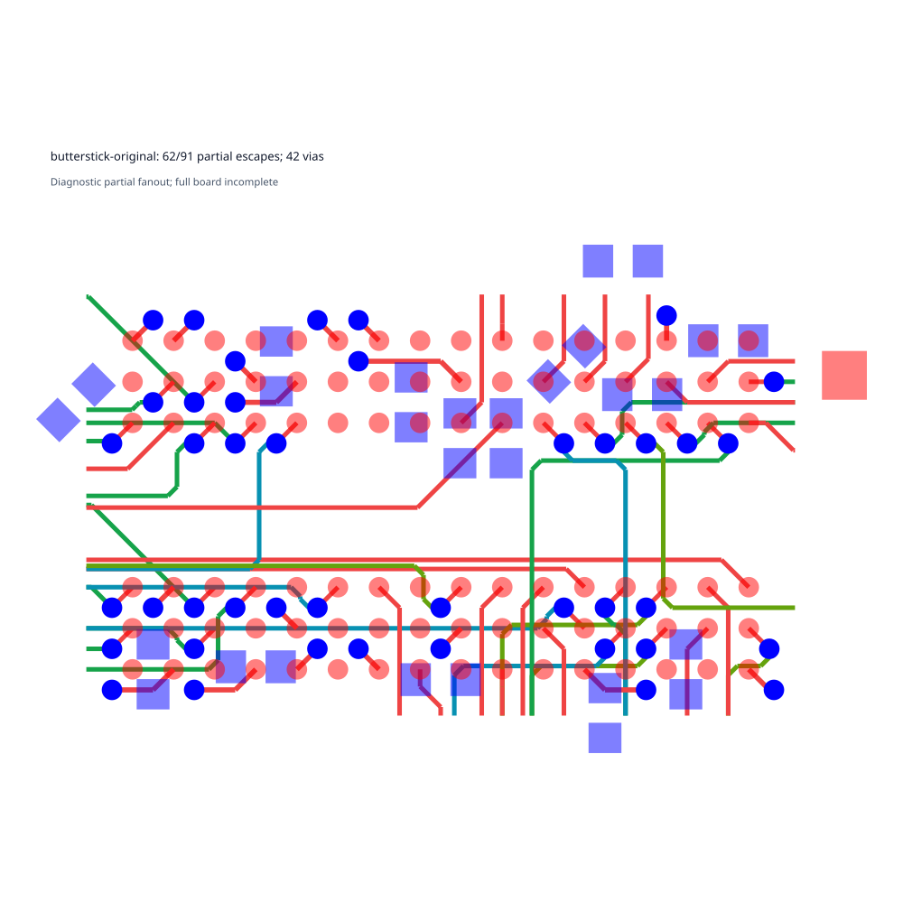
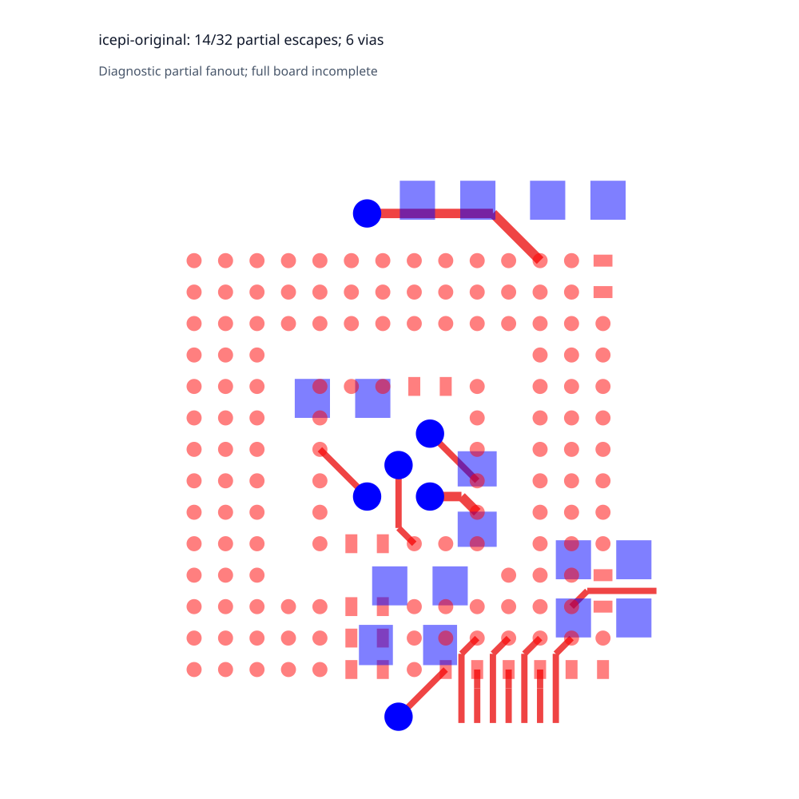
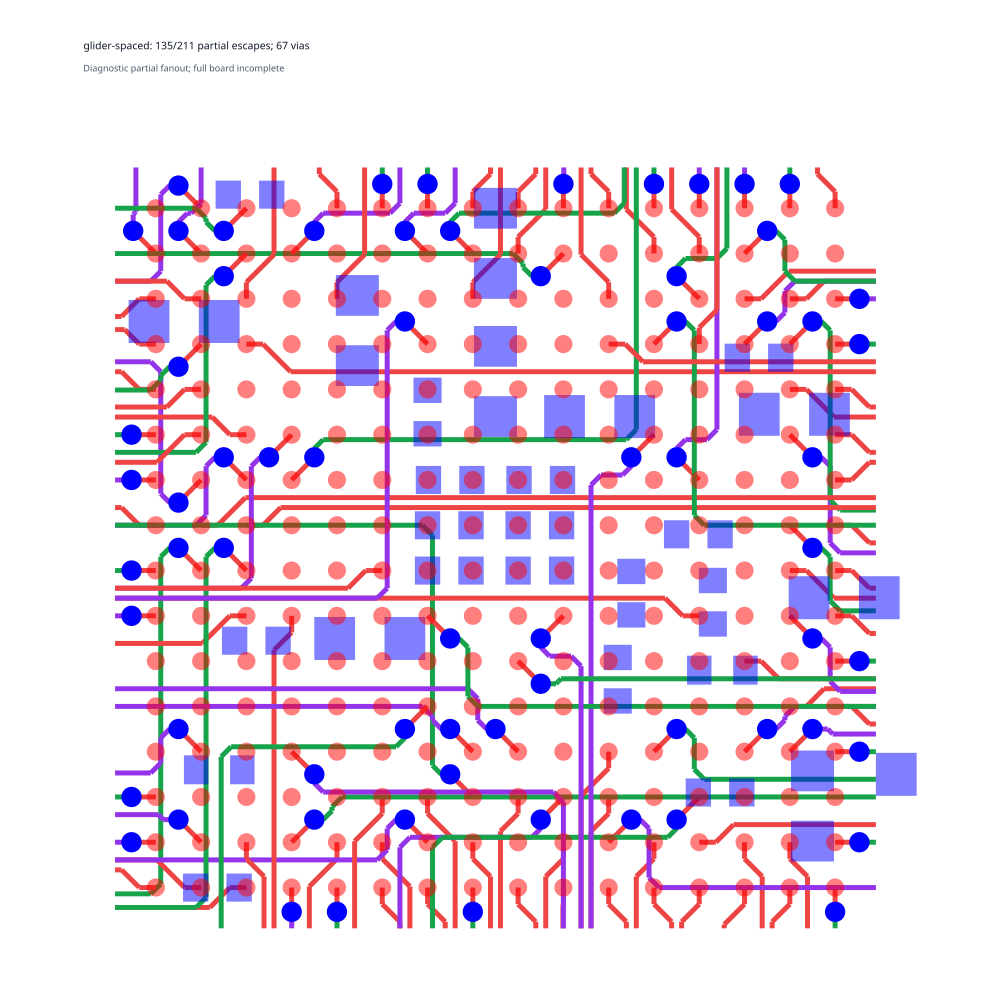
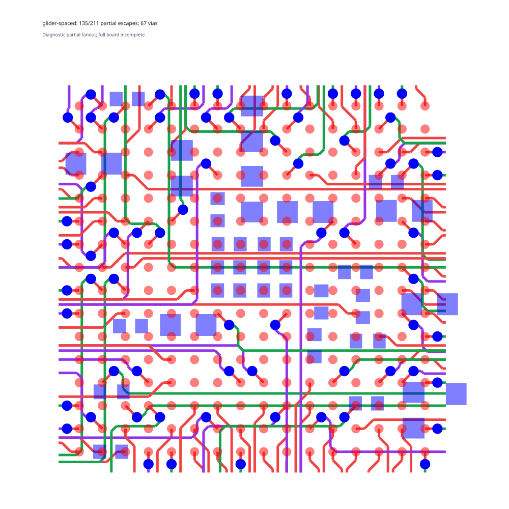

# Latest full-circuit routing analysis — 2026-11-21

The selected fix returns empty and single-via lists directly. It adds **three production lines** and reduces matched fanout search time **10.9%** across four fresh full-circuit captures. Plans, output SRJs, vias and all 256 assignment summaries remain identical in those controls. The native U22 SVG changes only its filter-pass count, **14 → 0**.

All ten uploaded circuits were rerun before and after the fix. Complete-board routing remains **0/10**. The pipeline still stops in fanout before DDR bus lanes and remaining-net routing.

## Latest stack and failure points

The baseline is tscircuit **0.0.3271**, Core **0.0.2450** (`e01d7fb`), fanout **0.0.99**, capacity autorouter **0.0.1147**, bus lanes **0.0.63**, and winding main `08d8da9`. It includes the previous via-to-trace bounds fix, selector lookup changes and updated via search. Their benefits are already in the baseline. Fanout is the blocking stage for evaluating the updated downstream autorouter on these circuits.

The ZIP and every TSX member are hash-checked. Original traces and vias are removed. Components, pads, DDR placement, peripheral spacing, bus membership, widths, clearances, via spans and configured budgets remain unchanged. The workflow is **fanout → DDR bus lanes → remaining nets**. Core stays unmodified; the after run replaces only the hash-checked via-collection module.

Interception records winding stages, original clearance rejection decisions and completed fanout assignments. Winding succeeds in **87/88 calls**. Spaced iCE/Pi retains one declared edge-capacity failure: **17.43mm needed, 14.64mm available** under its spacing rules.

The baseline records **28,363,996 accepted-copper rejection events**, plus 350,151 pad/trace, 97,611 pad/via and 123,907 boundary rejections. These count attempted candidate failures. Accepted copper is the dominant recorded rejection reason. The CPU profile identifies `getPlanVias` as the largest sampled function: every clearance check repeatedly builds and filters via lists, including empty and single-via plans.

| Full circuit | Diagnostic escape connections before → after | Diagnostic vias | Completed assignments |
| --- | ---: | ---: | ---: |
| butterstick-original | 62/91 → 62/91 | 42 → 42 | 256 → 256 |
| butterstick-spaced | 78/91 → 78/91 | 49 → 49 | 256 → 256 |
| glider-original | 86/95 → 86/95 | 58 → 58 | 256 → 256 |
| glider-spaced | 135/211 → 135/211 | 67 → 67 | 27 → 31 |
| h616-original | 109/174 → 109/174 | 74 → 74 | 230 → 256 |
| h616-spaced | 111/174 → 111/174 | 72 → 72 | 146 → 161 |
| icepi-original | 14/32 → 14/32 | 6 → 6 | 256 → 256 |
| icepi-spaced | 77/92 → 77/92 | 37 → 37 | 256 → 256 |
| imx6-original | 9/32 → 9/32 | 7 → 7 | 256 → 256 |
| imx6-spaced | 7/32 → 7/32 | 4 → 4 | 256 → 256 |

Spaced Glider and both H616 baseline searches reach the configured 600-second budget, including preparation. All matched completed assignment prefixes agree. 7 pairs of completed searches have identical outputs. Timed results reflect search progress under the same budget. These captures include instrumentation; quantitative performance comes from the independent matched replays below.

The 19 nets already connected through retained pours stay connected. Core commits no new PCB trace or via copper while fanout is incomplete. The escape counts above describe diagnostic partials.

## Matched performance and selection

Each case uses fresh Bun processes on the same Blacksmith worker. Before averages two original runs bracketing the change. Timing covers solving and reading the best partial SRJ; preparation and DRC are outside the timer. All four controls use the fresh Core 0.0.2450 constructor captures.

| Full-circuit fanout capture | Before | After | Time reduction |
| --- | ---: | ---: | ---: |
| butterstick-original | 80.17s | 69.71s | 13.0% |
| icepi-original | 4.27s | 4.32s | -1.2% |
| imx6-original | 5.82s | 5.63s | 3.3% |
| imx6-spaced | 8.25s | 8.07s | 2.2% |
| Total | 98.51s | 87.73s | **10.9%** |

ButterStick supplies most of the gain. iCE/Pi is 1.2% slower against its bracketing mean; both i.MX6 controls improve. The complete plans, output SRJs and all 256 assignment summaries match exactly in every case, and native DRC passes.

The broader push-based via-list rewrite measures 11.6% less total time in the same experiment. The selected three-line branch gives a similar benefit while retaining the existing collection path for plans with additional or plane-endpoint vias. Earlier via-pair bounds, via/pad bounds and zero-rotation experiments produced smaller gains; their measurements and input provenance are retained in the statistics.

The fast path keeps fresh-array ownership and via ordering. Empty plans return an empty array; single-via plans return a singleton array. Other plans continue through the existing implementation. No routing strategy or clearance rule changes.

## Before and after

The focused repro solves the existing native U22 fixture, validates the actual partial copper, and checks that failed fanout still throws from `getOutput()`. Filter counting is scoped to collecting its 14 plan lists. The copper remains byte-identical in the snapshot.

| Native U22 before | After |
| --- | --- |
|  |  |

Actual full-circuit partials below use native rendering, original pad coordinates and matching viewports. The timed Glider example shows its best partial at the configured budget.

| ButterStick original before | After |
| --- | --- |
|  |  |

| iCE/Pi original before | After |
| --- | --- |
|  |  |

| Glider spaced before | After |
| --- | --- |
|  |  |

## Validation and evidence

All ten constructor inputs, physical pad sets and matched completed assignment prefixes agree. All **20 diagnostic partials pass unmodified native DRC and independent via-in-pad checks** against the full circuits. Complete PCB SVGs are byte-identical. The focused SVG test and typecheck pass. Official repository typecheck and formatting checks pass; all eight native Mac regression shards pass.

[Repro #356](https://github.com/tscircuit/fanout-solver/pull/356), [stacked fix #357](https://github.com/tscircuit/fanout-solver/pull/357), [baseline captures and PCB SVGs](https://github.com/tscircuit/tscircuit-autorouter/actions/runs/44943960114), [after captures and PCB SVGs](https://github.com/tscircuit/tscircuit-autorouter/actions/runs/44945880146), [paired benchmark](https://github.com/tscircuit/tscircuit-autorouter/actions/runs/44945167490), [physical audit](https://github.com/tscircuit/tscircuit-autorouter/actions/runs/44946094562), [source checks](https://github.com/tscircuit/tscircuit-autorouter/actions/runs/44945987366), [native regression suite](https://github.com/tscircuit/fanout-solver/actions/runs/44945931975), and [machine-readable statistics](direct-via-lists/summary-statistics.json).
