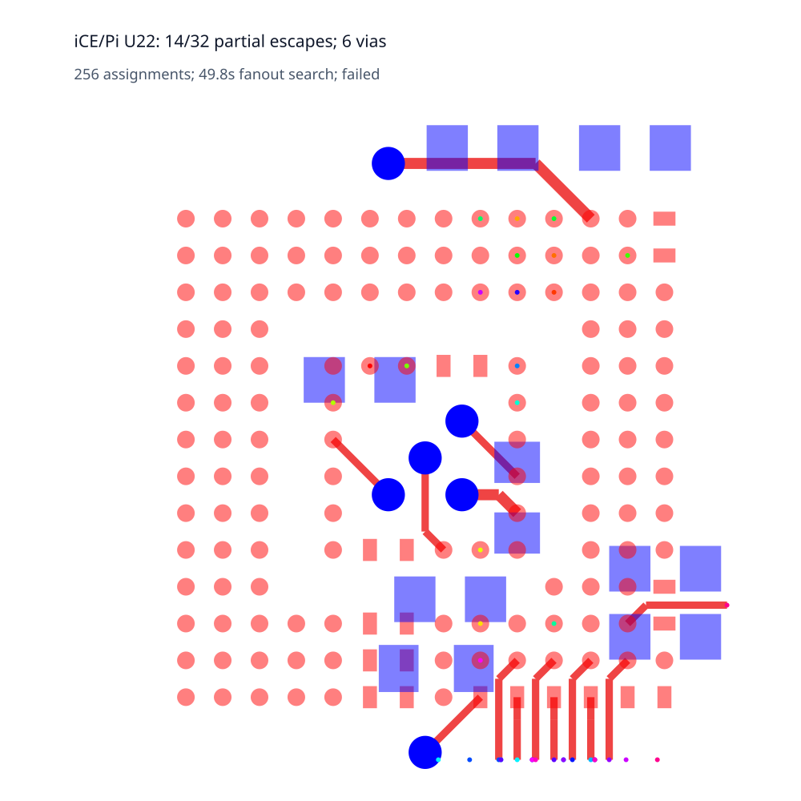

# Latest native-copper stack: ten full circuits and the failed-prefix cache fix

The ten full circuits from the supplied ZIP were rerun with Core **0.0.2436**, autorouter **0.0.1139** and fanout **0.0.94**, matching tscircuit **0.0.3257**. The workflow remains **fanout → DDR bus lanes → remaining routing**.

The latest unmodified stack reproduces the previous merged-fix result: **546/813 diagnostic partial fanout escapes, 331 vias, 0/10 complete boards**. Core #5748 and autorouter #3985 now preserve fixed copper as paths through later phases, with the dependency pins from #4021. These ten circuits stop earlier, so this cohort does not exercise the main Pipeline 9 improvements.

[Fix #337](https://github.com/tscircuit/fanout-solver/pull/337), stacked on [repro #336](https://github.com/tscircuit/fanout-solver/pull/336), removes repeated fanout work without changing the search choices. The six searches that finish all 256 assignments take **20.6% less total time: 1,422.6s → 1,129.0s**. Their routing outputs are identical. Their median search time falls from 194.4s to 154.8s (20.4%). Actual iCE/Pi U22 fanout falls from **49.8s to 18.9s, 62.2% faster**.

## Full-circuit results

“Escapes” are pad-to-boundary branches or plane drops in the first captured fanout group. They are not completed board nets.

| Circuit | Partial escapes before → after | Vias before → after | Assignments before → after | Fanout seconds before → after |
| --- | ---: | ---: | ---: | ---: |
| ButterStick original | 62/91 → 62/91 | 42 → 42 | 256 → 256 | 488.1 → 416.6 |
| ButterStick spaced | 78/91 → 78/91 | 41 → 41 | 256 → 256 | 423.8 → 353.3 |
| Glider original | 83/95 → 83/95 | 56 → 56 | 115 → 136 | 526.1† → 525.8† |
| Glider spaced | Not reached | — | — | — |
| H616 original | 105/174 → 105/174 | 66 → 67 | 41 → 72 | 586.7† → 581.9† |
| H616 spaced | 111/174 → 111/174 | 72 → 72 | 56 → 95 | 583.1† → 582.8† |
| iCE/Pi original | 14/32 → 14/32 | 6 → 6 | 256 → 256 | 49.8 → 18.9 |
| iCE/Pi spaced | 77/92 → 77/92 | 37 → 37 | 256 → 256 | 315.2 → 277.1 |
| i.MX6 original | 9/32 → 9/32 | 7 → 7 | 256 → 256 | 73.7 → 30.6 |
| i.MX6 spaced | 7/32 → 7/32 | 4 → 4 | 256 → 256 | 72.0 → 32.5 |

† Search was interrupted by the unchanged 600-second overall routing budget. These durations are not completed-search timing comparisons. The useful change is more completed assignments: Glider +18%, H616 original +76%, H616 spaced +70%.

The six completed searches retain **247 escapes and 137 vias**, with exactly identical routed SRJ outputs. Across all nine inputs, partial escapes remain **546/813**. Total diagnostic vias rise **331 → 332** because the budgeted H616 original search reaches a different best partial: one additional via and **9.41 mm less wire** (253.42 → 244.01 mm). Its shared assignment results are unchanged; the faster run explores further using the existing scoring rules.

All ten final PCB SVGs are byte-identical before and after. No new traces or vias are committed to the boards, and full-board completion remains **0/10**. All ten capture processes finish without process timeouts.

## Why this fix

The routing-prefix cache included every previous bus's assigned layer, even after that bus failed and contributed no copper. Later routes were rebuilt for identical copper layouts whenever an earlier failed bus changed layers.

The fix keeps each current layer check and the bus identity/order in the key. After an actual checked failure, its subsequent prefix uses a failure marker. Cached blocker counts are stored per bus and added to the current counts, preserving the repair priorities for earlier failed layer choices.

This is **16 added lines and 2 removed lines in the existing production cache**, plus the naturally updated repro SVG. It adds no solver or routing strategy, and changes no geometry, layer restrictions, clearances, via policy or assignment limits.

The focused repro uses captured i.MX6 pad dimensions and rules in a 15-pad field with two enclosed pins and a routable outer control. It retains **1/3 escapes and all 64 assignments**, while actual clearance-cache lookups fall **52,438 → 28,491 (−45.7%)**. The observer calls the original cache method.

Earlier pruning experiments were rejected because they changed explored assignments and produced routing/via regressions. This fix instead preserves the search and reuses work only after the actual failed route has been checked.

## What the pipeline still cannot complete

Read-only interception records winding stages, fanout constructor inputs, original clearance rejections, assignments and subsequent phases.

- **Six of 82 winding-placement calls still fail**: ButterStick spaced U4, Glider spaced U1/U12, iCE/Pi spaced U1 and both i.MX6 variants' U7. The reported edge-capacity shortages are unchanged.
- Glider spaced never invokes fanout; Core enters bus-lane routing after its winding errors and exhausts the routing budget. This is a failed handoff.
- The other nine circuits remain incomplete at fanout. No remaining-net Pipeline 9 solve starts.
- Failures include actual geometric restrictions and congestion. For example, i.MX6 U10.B2's eight foreign 0.25 mm pads at 0.5 mm pitch form a closed barrier under the captured 0.119 mm trace/clearance rules; the 0.4 mm via has no permitted escape inside that ring under the supplied via-in-pad policy. This describes those modeled rules, not universal unroutability of the real hardware.

The original/spaced variants also differ in pours and handoff representation, so comparisons are between each fixture and itself, not a claim about spacing alone.

## Before and after

Actual iCE/Pi U22 diagnostic partial fanout: identical 14/32 escapes and 6 vias, with all 256 assignments retained.

| Before: 49.8 seconds | After: 18.9 seconds |
| --- | --- |
|  |  |

The focused repro's native before/after snapshots are in the [fix PR](https://github.com/tscircuit/fanout-solver/pull/337). Full-board PCB SVGs and complete pipeline captures are in the ten [benchmark artifacts](https://github.com/tscircuit/tscircuit-autorouter/actions/runs/44826988004).

## Validation and reproduction

The [independent audit](https://github.com/tscircuit/tscircuit-autorouter/actions/runs/44827495351) verifies identical before/after fanout constructor arguments for all nine inputs, **1,748 exactly matching shared assignment summaries**, and identical routed SRJ output for all six completed searches. Glider spaced has no fanout input on either revision.

Every before/after diagnostic partial passes native copper DRC and independent via-in-pad checks against the actual full-circuit pads. Component/pad counts and net membership are retained. All ten final PCB SVGs are byte-identical.

All eight [macOS test shards](https://github.com/tscircuit/fanout-solver/actions/runs/44826984656) pass, as do [source typecheck and the focused test](https://github.com/tscircuit/tscircuit-autorouter/actions/runs/44827495351) and the [repository format check](https://github.com/tscircuit/tscircuit-autorouter/actions/runs/44827804611).

Core is pinned to `780b91845a73f2b1990d33170a99ab035d208532`; native dependencies are fanout 0.0.94, autorouter 0.0.1139, bus lanes 0.0.62 and winding `202dbe9eb0088633b6fa094120dba6f2f41f8803`. The candidate replaces only fanout's `lib/fanout-solver.ts` from `08cd66e8c9128ce347e9c2fd8baba7217acf1596`. No Core patch is installed. Both runs use Bun 1.4.3 on the same 8-vCPU ARM runner class, 600s routing/660s process budgets and the original 256-assignment limit.

Archive SHA-256: `1991ad1891a953dcd660818aaceb73f7aa42dbf704e677e635753b9159f7a6b7`. Original routes and vias are stripped; source geometry and routing rules are retained. Dependency versions and source hashes are recorded in the [machine-readable statistics](failed-prefix-cache/statistics.json).

Runs: [latest unmodified baseline](https://github.com/tscircuit/tscircuit-autorouter/actions/runs/44819438953), [cache fix on all ten circuits](https://github.com/tscircuit/tscircuit-autorouter/actions/runs/44826988004), [exact-output and physical audit](https://github.com/tscircuit/tscircuit-autorouter/actions/runs/44827495351).
