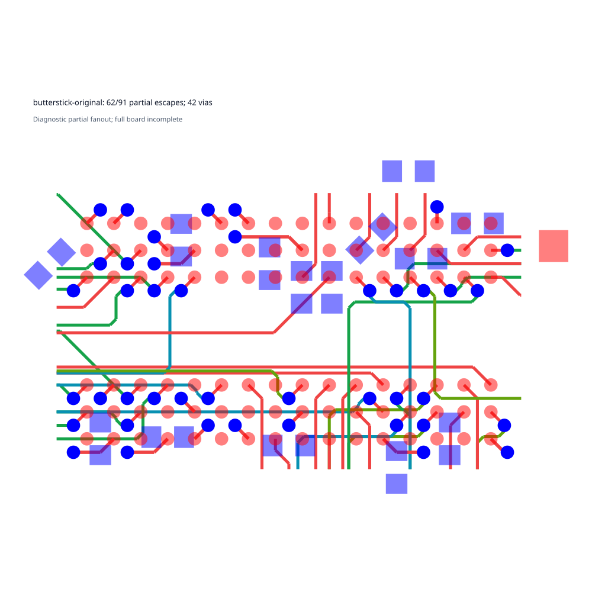
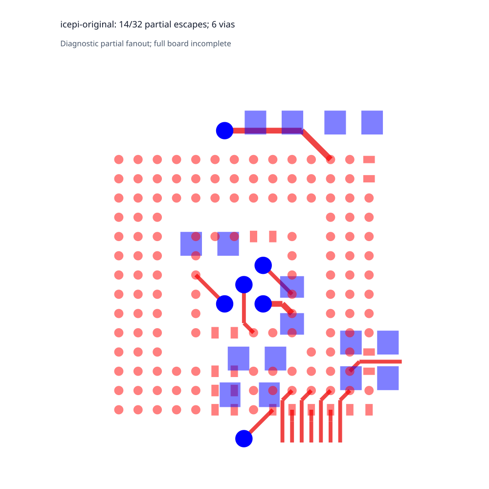
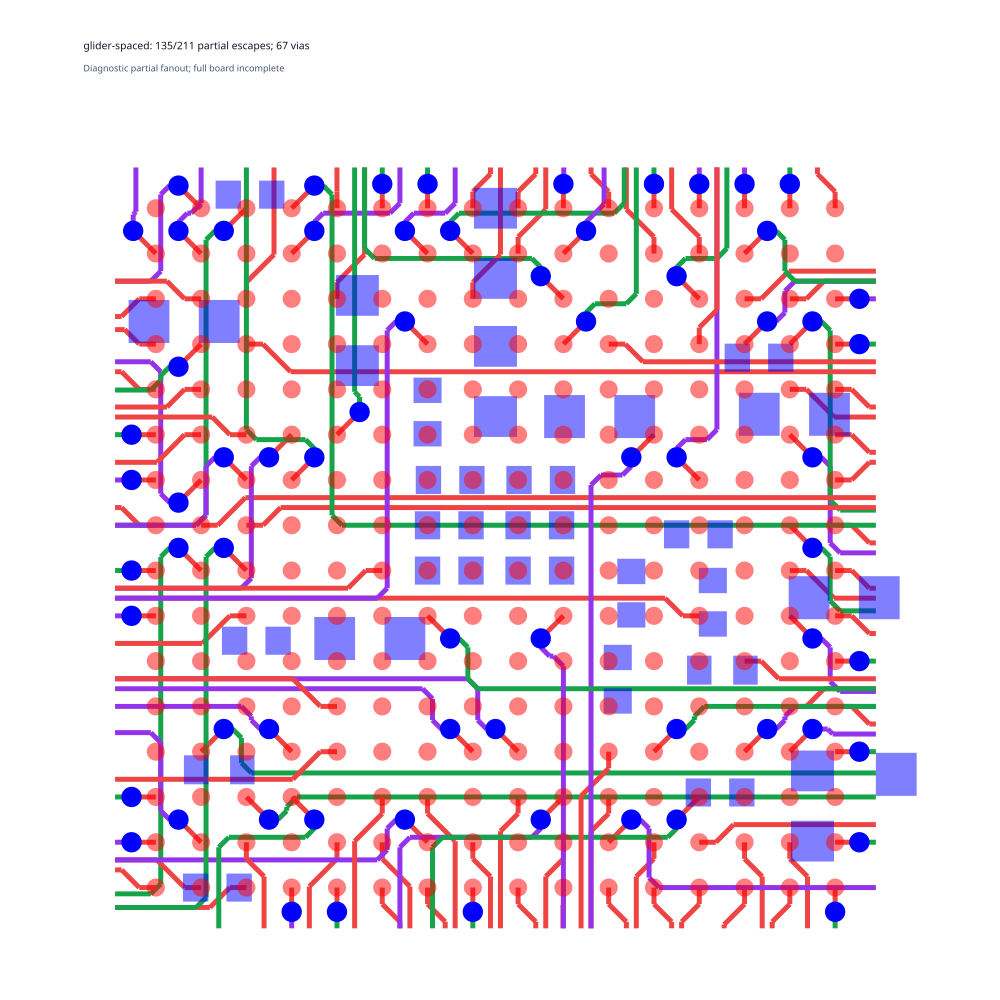
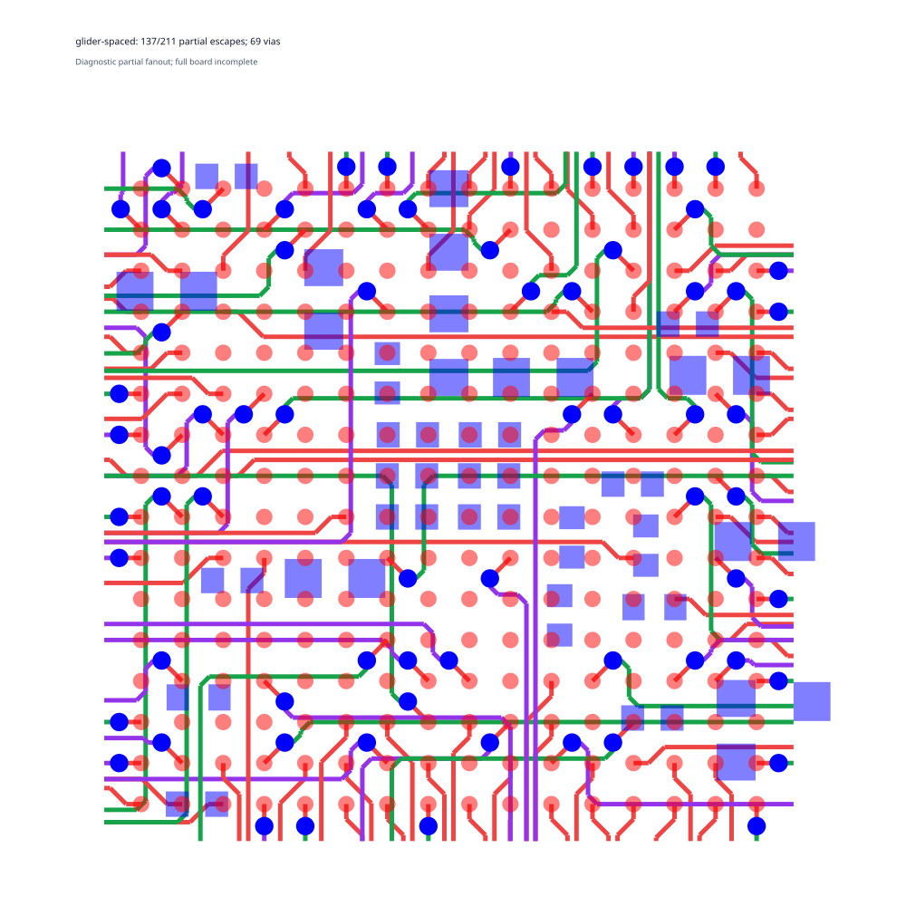

**Latest full-circuit routing analysis — 2026-11-21**

The selected fix uses conservative axis bounds before exact via-to-pad and via-to-via clearance checks. Matched fanout search time falls **10.0%** across four full-circuit captures, including all eight paired comparisons. Plans, output SRJs, vias and all 256 assignment summaries remain identical within each comparison. The native U22 repro reduces exact point/obstacle checks **1,492 → 582** and via/via checks **16 → 2**, with byte-identical copper.

All ten uploaded circuits were rerun through native Core before and after the fix. Complete-board routing remains **0/10**. The blocking stage is fanout, before DDR bus lanes and remaining-net routing.

The baseline is tscircuit **0.0.3272**, Core **0.0.2451** (`f2f498a`), fanout **0.0.100**, capacity autorouter **0.0.1147**, bus lanes **0.0.63**, and winding main `08d8da9`. Core changed only its version and fanout dependency since the previous analysis. The previous via-list fast path is already included in this baseline.

The ZIP and every TSX member are hash-checked. Original traces and vias are removed. Components, physical pads, DDR placement, peripheral spacing, bus membership, trace widths, clearances, via spans and configured budgets are retained. The workflow remains **fanout → DDR bus lanes → remaining nets**. Core is unmodified; the after run replaces two hash-checked fanout clearance modules. The final source differs from the measured prototypes only in whitespace, verified for both modules.

Interception records winding stages, original clearance rejection predicates and every completed fanout assignment. Winding succeeds in **87/88 calls**. Spaced iCE/Pi retains one declared edge-capacity failure: **17.43mm needed, 14.64mm available** under its spacing rules. The ten runs stop in fanout, which prevents evaluation of the updated downstream autorouter on these boards.

The baseline records **29,901,642 accepted-copper rejection events**, plus 350,639 pad/trace, 97,611 pad/via and 123,990 boundary rejections. These count attempted candidate failures. Accepted copper is the dominant recorded rejection reason. The native ButterStick CPU profile attributes 22.3% of sampled ticks to mutual plan clearance and 14.1% to segment/obstacle clearance. Exact geometry work also occurs for many far-apart objects.

| Full circuit | Diagnostic escape connections before → after | Diagnostic vias | Completed assignments |
| --- | ---: | ---: | ---: |
| butterstick-original | 62/91 → 62/91 | 42 → 42 | 256 → 256 |
| butterstick-spaced | 78/91 → 78/91 | 49 → 49 | 256 → 256 |
| glider-original | 86/95 → 86/95 | 58 → 58 | 256 → 256 |
| glider-spaced | 135/211 → 137/211 | 67 → 69 | 30 → 37 |
| h616-original | 109/174 → 109/174 | 74 → 74 | 256 → 256 |
| h616-spaced | 111/174 → 111/174 | 72 → 72 | 162 → 190 |
| icepi-original | 14/32 → 14/32 | 6 → 6 | 256 → 256 |
| icepi-spaced | 77/92 → 77/92 | 37 → 37 | 256 → 256 |
| imx6-original | 9/32 → 9/32 | 7 → 7 | 256 → 256 |
| imx6-spaced | 7/32 → 7/32 | 4 → 4 | 256 → 256 |

Spaced Glider’s two additional escape connections use two additional vias. Across the ten diagnostic partials, escapes rise from 688 to 690 and vias from 416 to 418. The other best partial counts stay unchanged.

All matched completed assignment prefixes agree. 8 pairs of completed searches have identical outputs. Timed results reflect progress under the same configured 600-second budget, including preparation. These captures include instrumentation; quantitative performance below comes from independent native replays.

The 19 nets already connected through retained pours remain connected. Core commits no new PCB trace or via copper while fanout is incomplete. The escape counts describe diagnostic partials.

Each comparison uses fresh Bun processes on the same Blacksmith worker, with two original runs bracketing the fix. Timing covers solving and reading the best partial SRJ; preparation and DRC are outside the timer. All four inputs come from the fresh Core 0.0.2451 captures. The table sums per-input means. It includes two ButterStick comparisons, four iCE/Pi comparisons and one comparison for each i.MX6 variant.

| Full-circuit fanout capture | Before | After | Time reduction |
| --- | ---: | ---: | ---: |
| butterstick-original | 65.22s | 57.82s | 11.4% |
| icepi-original | 4.63s | 4.60s | 0.7% |
| imx6-original | 5.92s | 5.69s | 3.9% |
| imx6-spaced | 8.34s | 7.60s | 8.8% |
| Sum of case means | 84.11s | 75.71s | **10.0%** |

The initial iCE/Pi pilot was 6.1% slower. All three subsequent paired comparisons were faster, averaging 2.8% less time. All four comparisons remain in the reported mean, which is effectively flat for this short case. ButterStick and spaced i.MX6 provide the larger gains. The complete plans, outputs and all 256 assignment summaries match exactly in all eight comparisons, and native DRC passes.

Individual via/pad bounds saved 5.7% and via/via bounds 4.4% in the initial four-case comparison. Rewriting the remaining complex via-list path slowed the total by 1.4%; moving the own-pad check earlier slowed it by 4.2%, including a 29% i.MX6 regression. Those changes are excluded. Checking layers before bounds was slower than checking bounds first in both verification cases. All raw timings, variants and source hashes are retained in the statistics.

The pad bound uses half the absolute width plus half the absolute height, which encloses every rotation of the existing rectangle model and also contains circular pads. Adding the via radius, clearance and `1e-9` gives a conservative axis bound. Via/via bounds use the sum of the two radii and clearance. Outside either axis bound, the existing exact clearance predicate cannot reject the pair. Near pairs retain the original exact distance test and tolerance. Plane-contact handling remains before the pad filter, preserving its contact checks and failure behavior.

The focused repro solves the existing native U22 fixture and validates its actual 14/32 partial escapes and six vias. It counts point/obstacle checks in a full clearance pass and via/via checks in a separate mutual pass after routing. Failed fanout still throws from `getOutput()`. Only the two counters change in its SVG.

| Native U22 before | After |
| --- | --- |
|  |  |

These actual full-circuit partials use native rendering, original pad coordinates and matching viewports. The timed Glider example shows the best partial at the configured budget.

| ButterStick original before | After |
| --- | --- |
|  |  |

| iCE/Pi original before | After |
| --- | --- |
|  |  |

| Glider spaced before | After |
| --- | --- |
|  |  |

All ten constructor inputs, physical pad sets and matched completed assignment prefixes agree. All **20 diagnostic partials pass unmodified native DRC and independent via-in-pad checks** against the full circuits. Complete PCB SVGs are byte-identical. The focused SVG test and typecheck pass. Official repository typecheck and formatting checks pass; all eight native Mac regression shards pass.

[Repro #360](https://github.com/tscircuit/fanout-solver/pull/360), [stacked fix #361](https://github.com/tscircuit/fanout-solver/pull/361), [baseline captures and PCB SVGs](https://github.com/tscircuit/tscircuit-autorouter/actions/runs/44950971733), [after captures and PCB SVGs](https://github.com/tscircuit/tscircuit-autorouter/actions/runs/44953355895), [initial paired comparisons](https://github.com/tscircuit/tscircuit-autorouter/actions/runs/44951945346), [verification comparisons](https://github.com/tscircuit/tscircuit-autorouter/actions/runs/44952597896), [physical audit](https://github.com/tscircuit/tscircuit-autorouter/actions/runs/44953849262), [source checks](https://github.com/tscircuit/tscircuit-autorouter/actions/runs/44953579355), [native regression suite](https://github.com/tscircuit/fanout-solver/actions/runs/44953450528), and [machine-readable statistics](far-via-bounds/summary-statistics.json).
