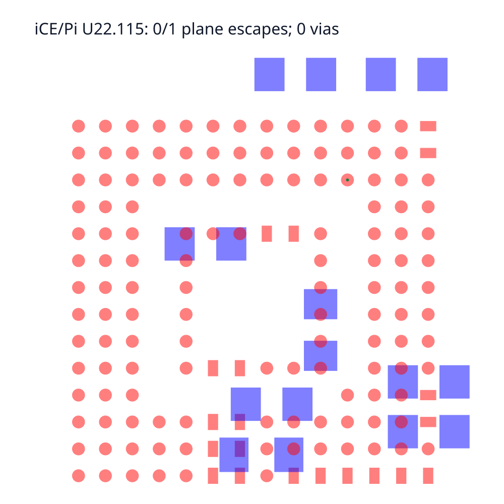
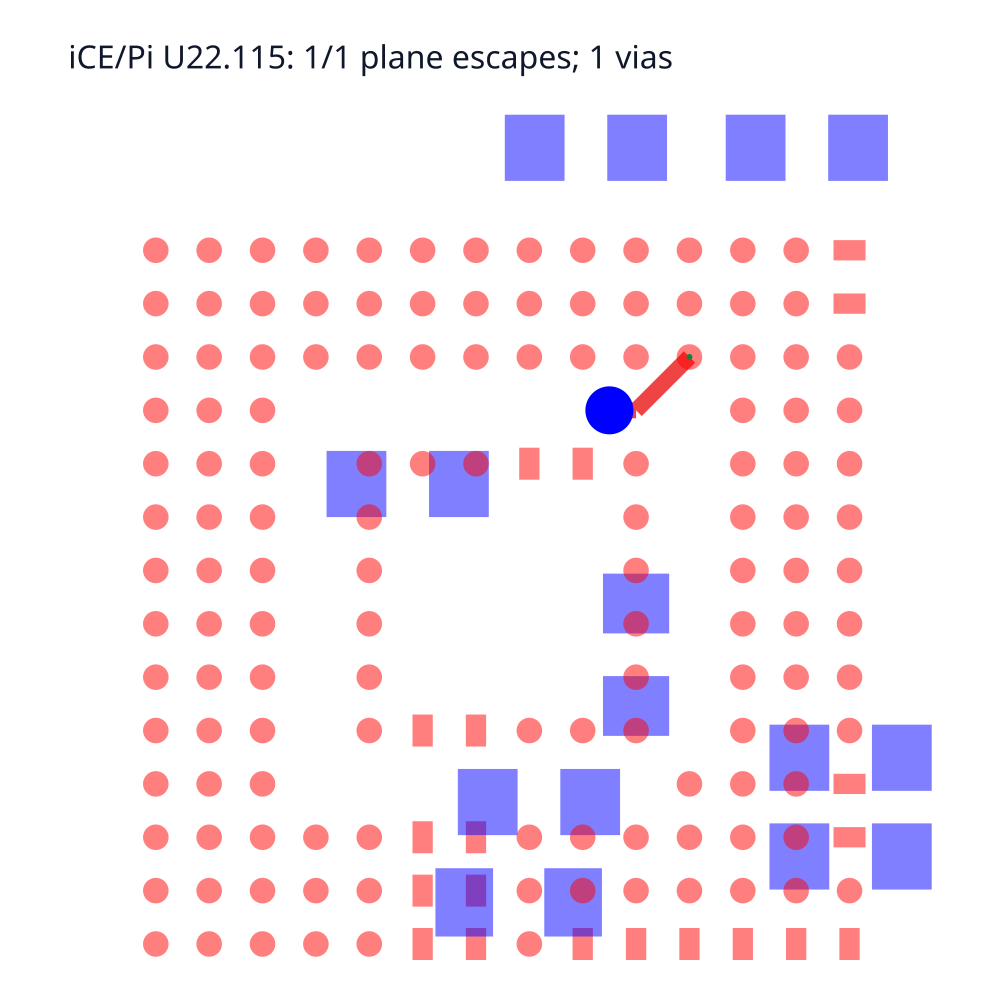
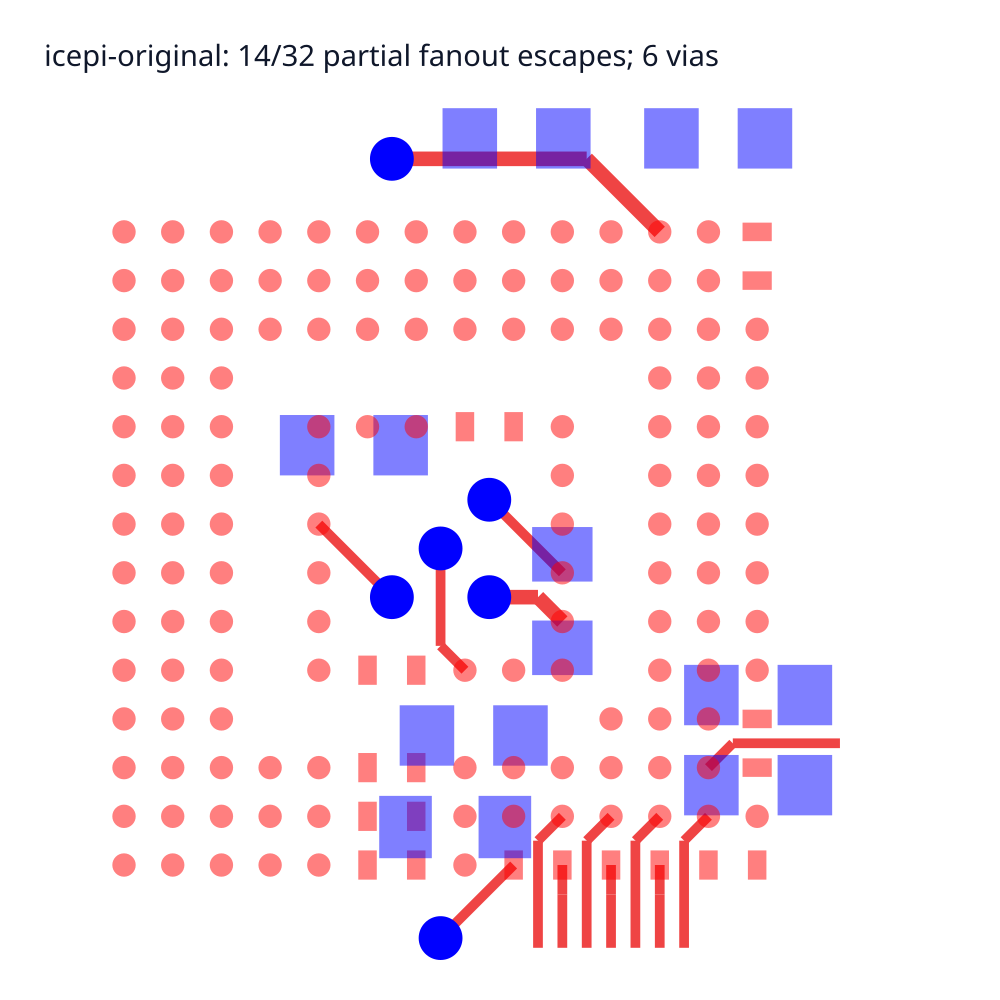
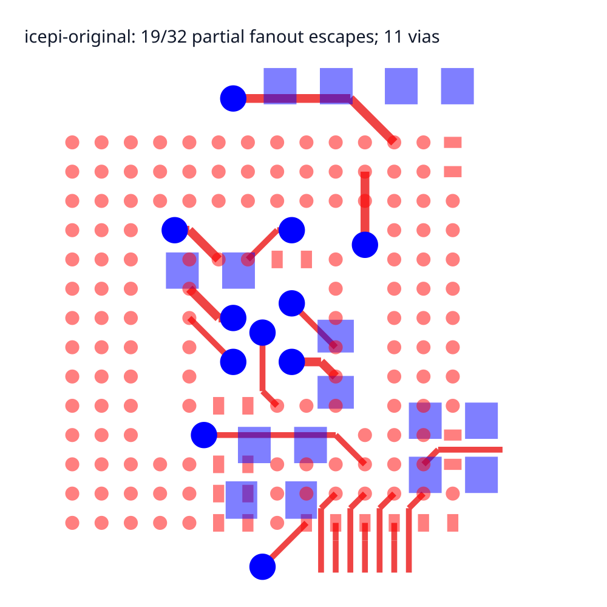
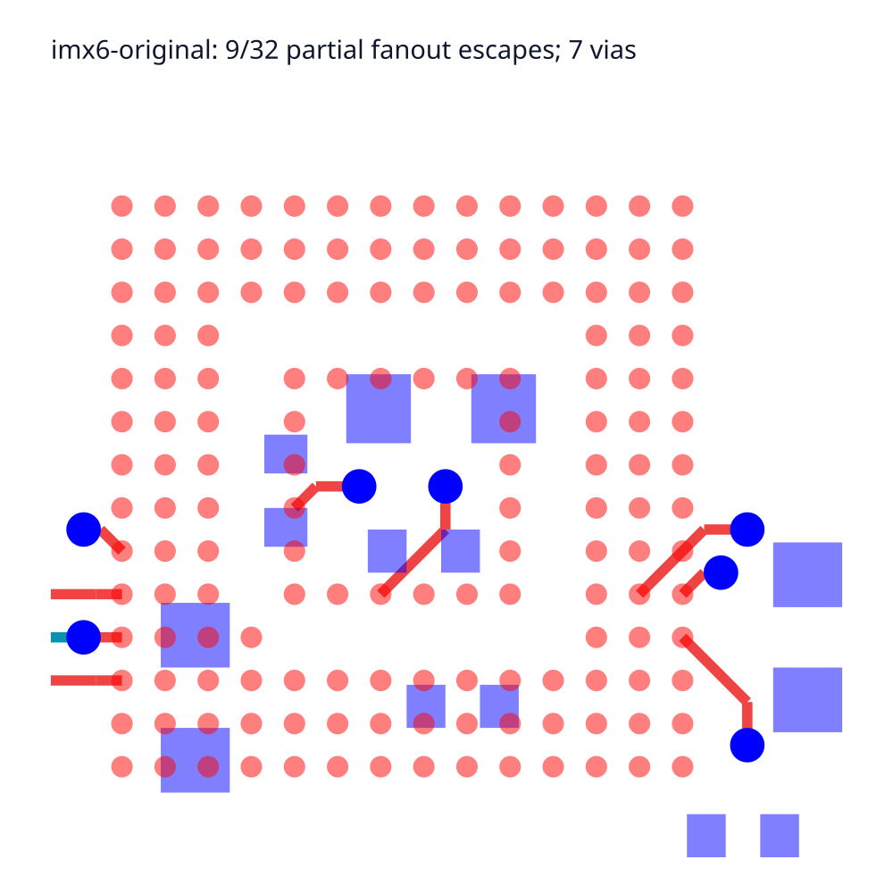
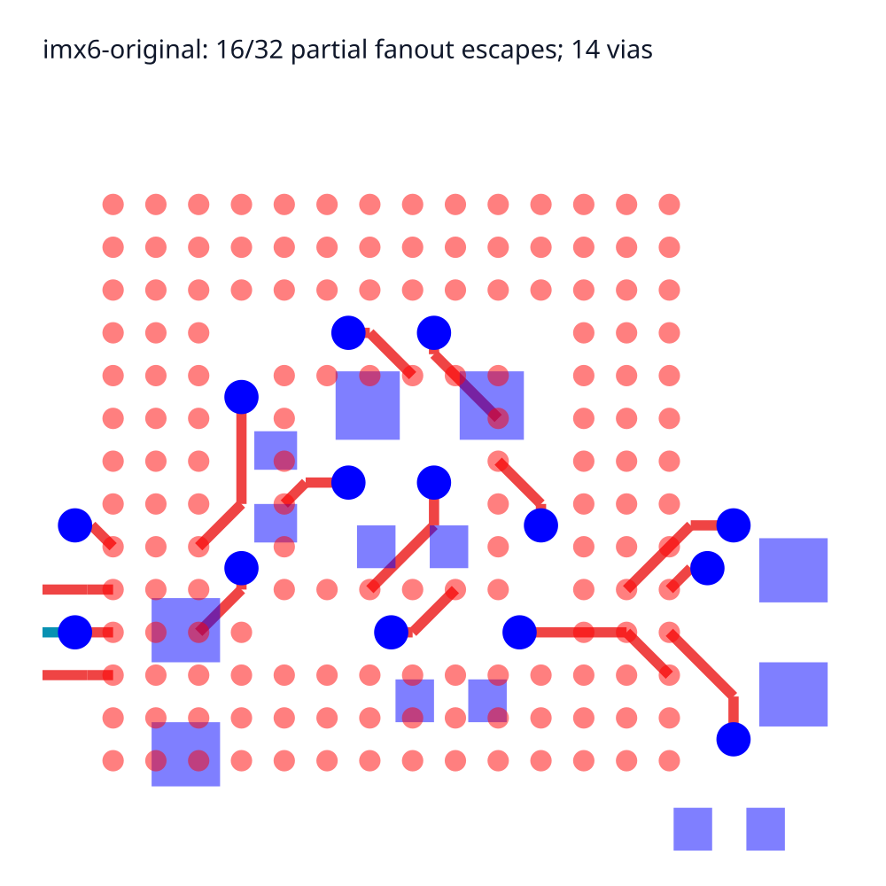

# Interior plane escape completion, latest stack on 22 November 2026

The selected fix adds twelve valid plane escapes on the uploaded full circuits: iCE/Pi U22 goes from 14/32 to 19/32 (+35.7%) and i.MX6 U10 from 9/32 to 16/32 (+77.8%). Neither affected sample loses an existing escape. These are partial fanouts. All ten boards still stop during the first fanout region, so completed full boards, committed routes and downstream DDR routing are unchanged.

The change removes the outward-edge restriction from the existing centered source-escape pass. Its original diagonal candidates still run first. Exact pad, via and routed-copper checks still decide whether the extra candidates are legal. Production changes stay in one source file; there is no new solver, routing strategy, search budget or rule change.

[Baseline repro #368](https://github.com/tscircuit/fanout-solver/pull/368) → [stacked fix #369](https://github.com/tscircuit/fanout-solver/pull/369).

## All ten full-circuit runs

Counts below describe the first attempted fanout region, not complete electrical nets across the board. The comparison uses the work both sides completed for time-limited runs.

| Uploaded sample | Escapes before | Escapes after | Requested fanout connections |
| --- | ---: | ---: | ---: |
| butterstick-original | 62 | 62 | 91 |
| butterstick-spaced | 78 | 78 | 91 |
| glider-original | 86 | 86 | 95 |
| glider-spaced | 135 | 135 | 211 |
| h616-original | 109 | 109 | 174 |
| h616-spaced | 111 | 111 | 174 |
| icepi-original | 14 | 19 | 32 |
| icepi-spaced | 77 | 77 | 92 |
| imx6-original | 9 | 16 | 32 |
| imx6-spaced | 7 | 7 | 32 |

**Matched completed work: 688 → 700 escapes (+1.7%); 67.2% → 68.4% of the 1,024 requests in these first fanout regions. The two affected samples improve 23 → 35 escapes (+52.2%).** Across the eight runs that exhausted all 256 assignments, completion is 442 → 454 (+2.7%).

Glider spaced hit the 600-second budget after 37 baseline assignments and 34 patched assignments. Its raw best result is 137 → 135; the first 34 completed assignment records are exactly equal and both reach 135. H616 spaced completed 196 → 194 assignments and reaches 111 on both sides; its first 194 records and final output are equal. Their raw budget-limited results remain in statistics.json. These are not claimed as completion regressions or improvements.

The two improved regions add twelve vias for twelve additional plane drops: iCE/Pi 6 → 11 and i.MX6 7 → 14. Their existing signal escapes are retained. Original ButterStick and Glider keep the same escape and via counts but select different valid routes: total fanout length increases 186.64 → 188.10 mm (+0.8%) and 214.71 → 218.10 mm (+1.6%).

## Before and after

The focused snapshot uses the native iCE/Pi U22 pin115 and neighboring pads. The routed views below come directly from the before/after full Core captures. Only their display is cropped to the region; validation always uses every input obstacle. Copper-pour reservations are omitted from these pad-field drawings. Red is top copper, blue is bottom copper/vias; a 0.45 mm via is larger than a 0.24 mm BGA pad.

| Before | After |
| --- | --- |
|  |  |
|  |  |
|  |  |

## Intercepted failures

The runner preserves fanout → DDR bus lanes → remaining routing. Read-only hooks record the original rejection predicates, operation timing, every completed assignment, constructor inputs and native solver state. They do not bypass a failed fanout or insert partial routes.

- Winding completes 87/88 captured solves on each side. Spaced iCE/Pi has a separate winding failure: declared edges need 17.43 mm but expose only 14.64 mm.
- Each full-circuit run reaches one fanout solve. All ten stop there; neither DDR bus lanes nor the remaining autorouter runs. The recent downstream autorouter changes cannot account for these observed stops.
- Eight first fanouts exhaust 256 assignments; the other two reach the original time budget.
- Rejected accepted-plan copper dominates the larger regions. Spaced i.MX6 additionally has many pad/via rejections. These counts are rejected candidates, not counts of impossible nets.
- For iCE/Pi and i.MX6, adjacent diagonal via sites are too close to pads. The pad field has unoccupied positions reachable by the existing centered source-path generator, but the outward-edge check excludes them for interior pads. With the original 0.5 mm pitch, 0.24 mm BGA pads, 0.45 mm through vias and 0.1 mm clearance, nearby diagonal sites cannot clear pads. The focused native pin115 repro changes from no route to a legal one-via plane escape through the interior gap.
- With all buses present, pin115 can still lose its channel to other accepted copper. The selected patch improves candidate completeness; it does not solve the remaining reservation conflicts or prove that all remaining requests are impossible.

## Experiments and rejected alternatives

The narrow centered-candidate change was compared with same-net plane-pair merging, their combination and the existing global same-net merge option on exact native inputs. Plane-pair merging alone reaches iCE/Pi 20 and i.MX6 15; combining it with centered candidates reaches 25 and 21, but loses existing signal escapes. Those policy changes are not included.

Turning on global same-net merging produces higher counts while accepting forbidden physical via/pad overlaps. Native electrical DRC still reports success because the overlapped copper is on the same net. An independent geometric check rejects this candidate:

| Sample | Selected patch: escapes / physical via-pad overlaps | Global merge option: escapes / overlaps |
| --- | ---: | ---: |
| iCE/Pi original | 19 / 0 | 26 / 15 |
| i.MX6 original | 16 / 0 | 21 / 10 |
| ButterStick original | 62 / 0 | 65 / 8 |
| i.MX6 spaced | 7 / 0 | 11 / 0 |

The next completion work should address shared copper and route reservations while keeping physical via restrictions independent of electrical net identity. Simply enabling same-net merging is not a valid fix for these samples.

## Reproducibility and validation

- Published tscircuit 0.0.3276; Core 0.0.2457 at e5ac8f88dbf11259f3d602d962d3b11bcfa3bbba; fanout 0.0.102 at main 60eeca2d3b841fe504534c4674525beae1c74f8e; autorouter 0.0.1152; bus lanes 0.0.65; winding 08d8da9d8dbb037eba332e7bfd685063f8805ed4.
- Original ZIP SHA-256: 1991ad1891a953dcd660818aaceb73f7aa42dbf704e677e635753b9159f7a6b7. Source and geometry, including fixed DDR placement in spaced variants, are unchanged.
- All twenty full-circuit captures preserve the expected component counts, pad counts and net membership. All ten fanout constructor inputs, including rules, obstacles, buses and options, are deeply equal before/after.
- All twenty partial outputs pass native copper DRC, independent physical via/pad overlap checks and bus atomicity checks. All ten full-board PCB SVGs are byte-identical because no incomplete fanout is committed.
- The benchmark changes only the condition in route-plane-terminated-bus.ts. The final source differs from that benchmark patch only in the renamed boolean, updated comment and removed unused import; normalizing those yields the exact tested source.
- Final fix c8f000f689da38e29dac8b853f69ac175deec4cf passes all eight official macOS regression shards and their aggregate check. Repro #368 also passes all eight shards, formatting and type checks. Exact source and test code passed the separate type/format run; later commits only update reviewed SVGs. The changed dataset31 case retains all 135 connections, 135 vias and passing native copper DRC.
- Original 600-second budget and 256-assignment cap remain unchanged. Benchmarks use Blacksmith; source checks use Ubuntu and official snapshot regression tests use the repository macOS shards.

[Baseline run](https://github.com/tscircuit/tscircuit-autorouter/actions/runs/44992201437) · [Patched full-circuit run](https://github.com/tscircuit/tscircuit-autorouter/actions/runs/44994334149) · [Independent audit](https://github.com/tscircuit/tscircuit-autorouter/actions/runs/44995280418) · [Rejected merge experiment](https://github.com/tscircuit/tscircuit-autorouter/actions/runs/44995254417) · [Source type/format validation](https://github.com/tscircuit/tscircuit-autorouter/actions/runs/44996047670).

[Final macOS regression suite](https://github.com/tscircuit/fanout-solver/actions/runs/44996945922) · [Native dataset31 snapshot verification](https://github.com/tscircuit/tscircuit-autorouter/actions/runs/44996806745).

Each artifact includes its original full-board pcb.svg, circuit JSON, stage SVGs, inputs, solver states and interception data:

- [butterstick-original](https://github.com/tscircuit/tscircuit-autorouter/actions/runs/44994334149/artifacts/14743086883)
- [butterstick-spaced](https://github.com/tscircuit/tscircuit-autorouter/actions/runs/44994334149/artifacts/14743252913)
- [glider-original](https://github.com/tscircuit/tscircuit-autorouter/actions/runs/44994334149/artifacts/14742734904)
- [glider-spaced](https://github.com/tscircuit/tscircuit-autorouter/actions/runs/44994334149/artifacts/14743801729)
- [h616-original](https://github.com/tscircuit/tscircuit-autorouter/actions/runs/44994334149/artifacts/14743113779)
- [h616-spaced](https://github.com/tscircuit/tscircuit-autorouter/actions/runs/44994334149/artifacts/14742688638)
- [icepi-original](https://github.com/tscircuit/tscircuit-autorouter/actions/runs/44994334149/artifacts/14743705794)
- [icepi-spaced](https://github.com/tscircuit/tscircuit-autorouter/actions/runs/44994334149/artifacts/14742754505)
- [imx6-original](https://github.com/tscircuit/tscircuit-autorouter/actions/runs/44994334149/artifacts/14743201440)
- [imx6-spaced](https://github.com/tscircuit/tscircuit-autorouter/actions/runs/44994334149/artifacts/14743825349)
