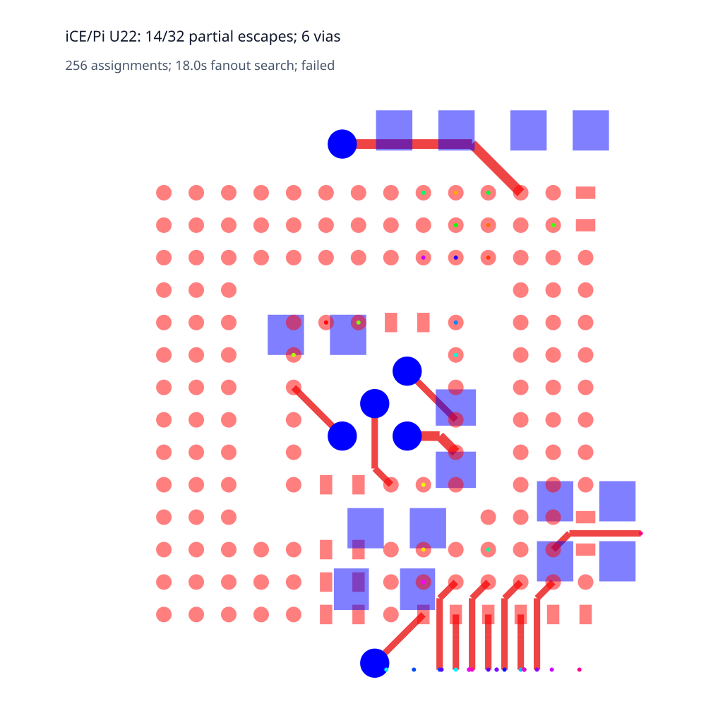
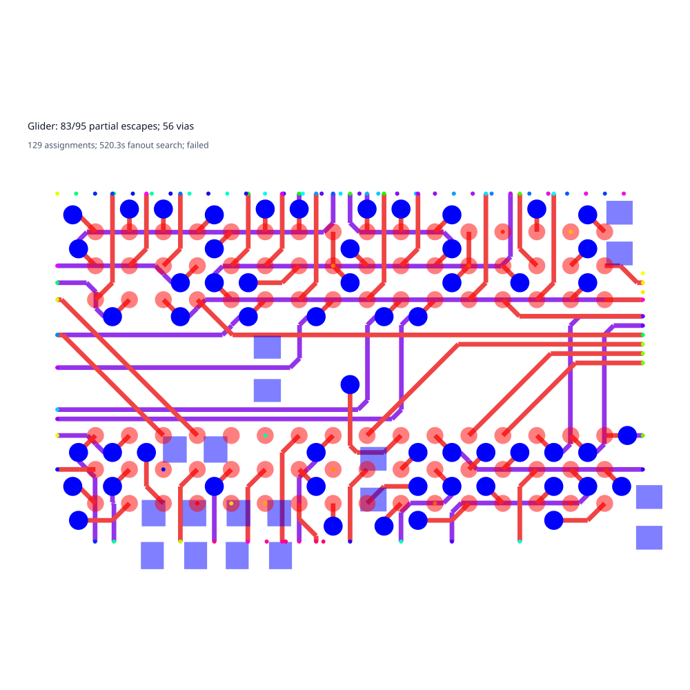
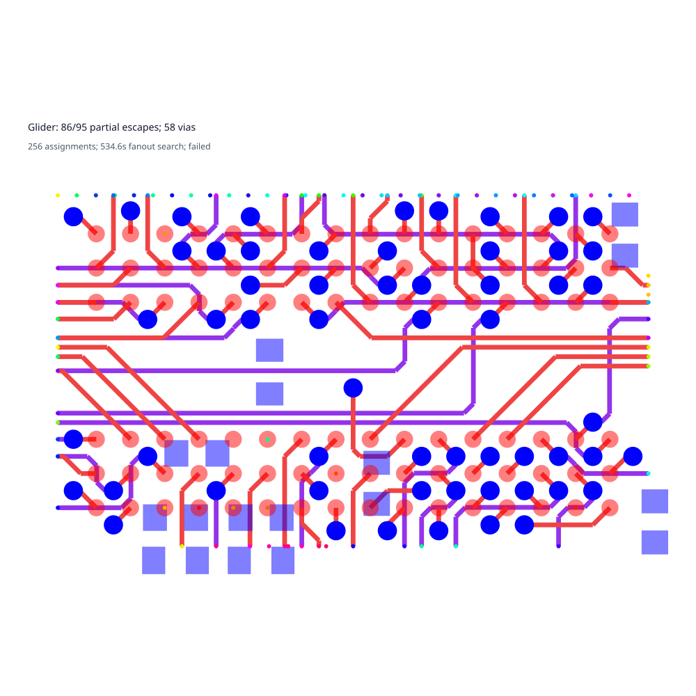

# Latest full-circuit refresh: first-route plane searches

The fix skips repeated singleton-plane geometry checks and replays their blocker-count contributions while finding the first escape. **Fanout search time falls 14.4% across the six samples that finish their searches on both versions** (1115.5s → 954.9s). Their final routed SRJs are identical. All ten complete-board runs still fail before general routing.

| Full-circuit result | Before | After |
| --- | ---: | ---: |
| Complete boards | 0/10 | 0/10 |
| Diagnostic partial fanout escapes | 546/813 | 552/813 |
| Diagnostic vias | 332 | 339 |
| Native partial-copper DRC findings | 0 | 0 |
| Independent via-in-pad findings | 0 | 0 |
| Focused U22 static-clearance lookups | 928 | 424 (54.3% fewer) |

These escapes are diagnostic partials from the first fanout group, not completed board nets or committed PCB traces. All ten PCB SVGs are byte-identical because no fanout group commits successfully. Existing same-net pours still connect 19 board nets in the original fixtures; they are not routing gains.

| Circuit | Partial escapes, before → after | Vias | Completed assignments | Fanout seconds |
| --- | ---: | ---: | ---: | ---: |
| ButterStick original | 62/91 → 62/91 | 42 → 42 | 256 → 256 | 402.4 → 270.9 |
| ButterStick spaced | 78/91 → 78/91 | 41 → 41 | 256 → 256 | 348.6 → 340.6 |
| Glider original | 83/95 → 86/95 | 56 → 58 | 129 → 256 | 520.3 → 534.6 |
| Glider spaced | Not reached | — | — | Winding placement failed |
| H616 original | 105/174 → 108/174 | 67 → 72 | 72 → 141 | 585.0 → 585.1 |
| H616 spaced | 111/174 → 111/174 | 72 → 72 | 96 → 96 | 582.4 → 582.1 |
| iCE/Pi original | 14/32 → 14/32 | 6 → 6 | 256 → 256 | 18.0 → 12.5 |
| iCE/Pi spaced | 77/92 → 77/92 | 37 → 37 | 256 → 256 | 276.0 → 279.0 |
| i.MX6 original | 9/32 → 9/32 | 7 → 7 | 256 → 256 | 30.4 → 20.4 |
| i.MX6 spaced | 7/32 → 7/32 | 4 → 4 | 256 → 256 | 40.0 → 31.4 |

The additional six escapes come with seven extra vias: Glider gains three escapes with two vias, and H616 original gains three with five vias. Their partial wire lengths fall from 215.2 to 214.7mm and 244.0 to 241.6mm, respectively. Spaced iCE/Pi is 1.1% slower in this paired run.

Assignment counts include only completed assignments. The unchanged 600-second execution budget includes board preparation; the process ceiling is 660 seconds. The assignment limit remains 256. Timings above are fanout time, not full-board wall time. Each original/spaced variant is compared against itself; their pour and handoff representations also differ.

The pipeline interception still finds six failed winding placements among 82 calls: ButterStick spaced U4, Glider spaced U1/U12, iCE/Pi spaced U1 and both i.MX6 U7 placements. Their declared edges lack the requested track capacity. Nine boards then reach the first fanout group and stop there. Spaced Glider never reaches fanout: Core proceeds into bus routing after placement fails and exhausts the run budget. No remaining-net routing starts. Some captured BGA sources are enclosed under the supplied pad, trace, clearance and through-via rules.

Interception identified duplicate work in the plane router: a one-pin bus cannot have another connection order, yet a first-route search retried its order four times. The fix uses its sole order in that path and replays the skipped failures’ blocker-count deltas, preserving repair priorities. Bounded alternative enumeration and explicit candidate offsets retain their original behavior. Two broader deduplication experiments changed AM62L snapshots and made one control exceed its 120-second test limit; those variants were rejected. A first-route-only trial also changed ButterStick from 62 to 63 escapes with seven extra vias; that priority side effect was rejected. The final correction preserves the existing native ButterStick and AM62L results without updating their goldens.

| Native iCE/Pi U22 partial, before | After |
| --- | --- |
|  |  |

| Native Glider U12 partial, before | After |
| --- | --- |
|  |  |

The captures retain the original pad geometry, net membership, bus rules, trace widths, clearances and via spans. Constructor inputs match before/after, expected component/pad counts match and membership checks are clear. Every captured partial passes native emitted-copper DRC and the independent via-in-pad check against the full circuit.

Pinned stack: tscircuit 0.0.3259, Core 0.0.2437 (`2445fddec65cd26589533741465ac22639935929`), fanout 0.0.95 and capacity autorouter 0.0.1139. The only after-side production patch is `lib/route-bus/route-plane-terminated-bus.ts` from `893e51d92306eb5a8f669105f1cbe9b8d87f50f3`. The uploaded ZIP SHA-256 is `1991ad1891a953dcd660818aaceb73f7aa42dbf704e677e635753b9159f7a6b7`. Workflow remains fanout → DDR bus lanes → remaining routing.

Evidence: [baseline captures](https://github.com/tscircuit/tscircuit-autorouter/actions/runs/44836464072), [final captures and full PCB SVGs](https://github.com/tscircuit/tscircuit-autorouter/actions/runs/44842738664), [physical audit, typecheck and format check](https://github.com/tscircuit/tscircuit-autorouter/actions/runs/44842896664), [full native regression suite](https://github.com/tscircuit/fanout-solver/actions/runs/44842549901), [machine-readable statistics](plane-order-replay/statistics.json), [repro PR #340](https://github.com/tscircuit/fanout-solver/pull/340) and [stacked fix PR #341](https://github.com/tscircuit/fanout-solver/pull/341).
