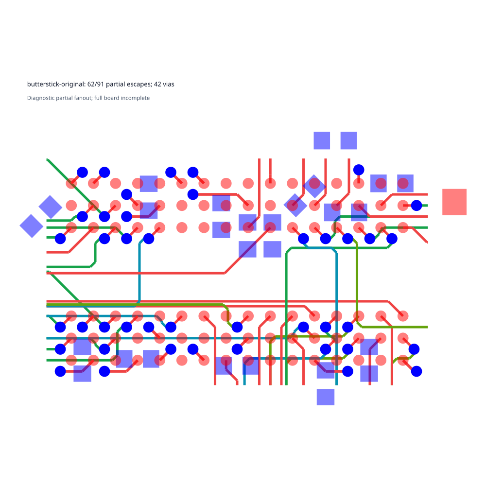
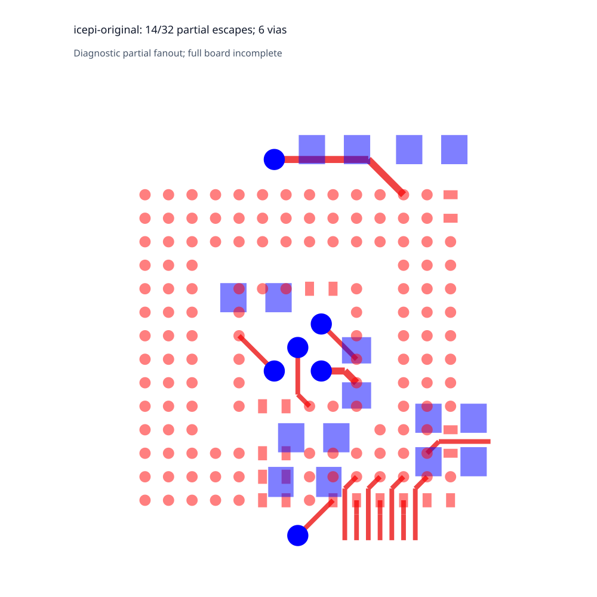
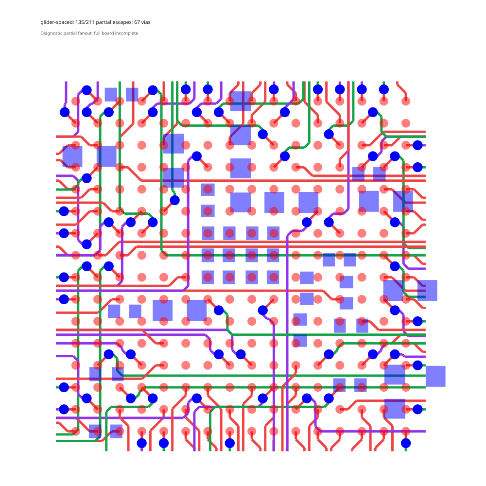

**Latest full-circuit routing analysis — 2026-11-22**

The selected fix reduces matched fanout search time **11.6%** across four full-circuit captures. It adds 11 lines to the existing plane router and reuses the existing static rejection cache. Complete-board routing remains **0/10** before and after.

The baseline uses tscircuit **0.0.3274**, Core **0.0.2455** (`9dc51c4`), fanout **0.0.101**, capacity autorouter **0.0.1148**, bus lanes **0.0.65**, and winding main `08d8da9`. The previous via-clearance guards are included. Core's updated preset handling maps `tscircuit-beta` to `tscircuit`; the autorouter also updates regional search. These ten boards stop in fanout, so they cannot yet evaluate the downstream autorouter and bus-lane changes.

All ten original and spaced TSX samples from the supplied ZIP were rerun through unmodified Core. ZIP/member hashes, components, physical pads, DDR placement, peripheral spacing, bus membership, widths, clearances and via spans are retained. Original routes and vias are removed. The workflow remains **fanout → DDR bus lanes → remaining nets**, with the same 600-second budget including preparation, 660-second external limit and 256-assignment cap. Only the hash-checked plane-router module changes in the after run.

Interception records original clearance rejections, winding stages and every completed fanout assignment. Winding succeeds in **87/88 calls**. Spaced iCE/Pi still reports **17.43mm needed, 14.64mm available** on its declared breakout edges. Every board stops at fanout. The dominant recorded rejection is accepted-route copper: **31,606,764 events**, alongside 351,266 pad/trace, 97,611 pad/via and 124,038 boundary events. These count attempted candidate failures.

The original ButterStick CPU profile assigns approximately **26.3%** of sampled ticks to mutual clearance, **14.4%** to segment/obstacle clearance and **10.4%** to plane routing. The selected change removes repeated static-rejection work during that search; it does not resolve the remaining copper conflicts.

A source path group is scoped to a bus, connection, direction, layer and via handedness. The router already caches each candidate's static clearance result. Once every candidate in a group is known to fail static clearance, generating and scanning that group again cannot produce a route. The fix remembers that negative result. A group with a candidate blocked only by accepted routes stays eligible, because those routes can change. Candidate order, physical rules, blockers, solver failure behavior and emitted copper are preserved. No new solver or routing strategy is added.

| Full-circuit fanout capture | Before | After | Time reduction |
| --- | ---: | ---: | ---: |
| butterstick-original | 57.28s | 50.26s | 12.3% |
| icepi-original | 4.37s | 3.67s | 16.1% |
| imx6-original | 5.52s | 4.45s | 19.4% |
| imx6-spaced | 7.60s | 7.68s | -1.1% |
| Sum of four case means | 74.77s | 66.06s | **11.6%** |

These are **eight comparisons of the exact final source**, two per capture. Each uses fresh Bun processes on the same Blacksmith worker, with two original runs bracketing the fix. Timing covers solving and reading the best partial SRJ; preparation and DRC are outside the timer. Every comparison preserves plans, output SRJs, via counts and all 256 assignment summaries exactly. Spaced i.MX6 measures **1.1% slower** in these two comparisons. The earlier four-case pilot saved 9.3%; it is retained separately because the final source also reuses the existing key prefix.

Other trials did not justify their changes. Endpoint and segment-list reuse produced small, uneven gains. Lazy via collection and lazy path generation did not improve the aggregate. Reusing the spatial index reduced the focused pair-check count from 810 to 31, but slowed iCE/Pi and original i.MX6 by roughly 9% and ButterStick by 54%; it is excluded. Raw trial timings and source hashes remain in the statistics.

| Full circuit | Diagnostic escape connections before → after | Diagnostic vias | Completed assignments |
| --- | ---: | ---: | ---: |
| butterstick-original | 62/91 → 62/91 | 42 → 42 | 256 → 256 |
| butterstick-spaced | 78/91 → 78/91 | 49 → 49 | 256 → 256 |
| glider-original | 86/95 → 86/95 | 58 → 58 | 256 → 256 |
| glider-spaced | 135/211 → 135/211 | 67 → 67 | 34 → 34 |
| h616-original | 109/174 → 109/174 | 74 → 74 | 256 → 256 |
| h616-spaced | 111/174 → 111/174 | 72 → 72 | 194 → 189 |
| icepi-original | 14/32 → 14/32 | 6 → 6 | 256 → 256 |
| icepi-spaced | 77/92 → 77/92 | 37 → 37 | 256 → 256 |
| imx6-original | 9/32 → 9/32 | 7 → 7 | 256 → 256 |
| imx6-spaced | 7/32 → 7/32 | 4 → 4 | 256 → 256 |

Diagnostic partial escapes total **688 → 688**, with **416 → 416 vias**. Timed differences describe progress within the same budget. All matched completed assignment prefixes agree; 8 completed-search output pairs are identical. The 19 nets already connected in the input remain connected. Core commits no new PCB trace or via while fanout is incomplete. Complete-board PCB SVGs are byte-identical.

Timed H616 completes five fewer assignments, so both large timed captures also received a controlled comparison of the same **first 16 completed assignments**. Their original 256-assignment configuration and all physical rules stay unchanged; the benchmark stops stepping at assignment 16. Plans, output SRJs and all 16 assignment summaries match exactly, and native DRC passes. These prefix measurements are separate from the eight complete-search comparisons above.

| First 16 assignments | Before | After | Time reduction |
| --- | ---: | ---: | ---: |
| h616-spaced | 8.48s | 8.36s | 1.4% |
| glider-spaced | 25.65s | 25.21s | 1.7% |

The focused repro routes the actual native U22 pin101 ground escape repeatedly with the same static cache. The repeated search visits **3 → 1 source path groups**, while its route and single via remain byte-identical. Repeated plans match and unmodified native DRC passes. The existing cold-search snapshot adds three group-cache reads (**424 → 427**); only its counter changes. Both SVGs update naturally when the fix is stacked.

| Native U22 before | After |
| --- | --- |
|  |  |

These full-circuit diagnostic partials retain native coordinates, original pads and matching viewports.

| ButterStick original before | After |
| --- | --- |
|  |  |

| iCE/Pi original before | After |
| --- | --- |
|  |  |

| Glider spaced before | After |
| --- | --- |
|  |  |

All ten constructor inputs, physical pad sets and completed assignment prefixes agree. All **20 diagnostic partials pass unmodified native DRC and independent via-in-pad checks** against the full circuits. The focused SVG and strict typecheck pass; repository formatting and typecheck pass. Both PRs pass all eight native Mac regression shards.

[Repro #364](https://github.com/tscircuit/fanout-solver/pull/364), [stacked fix #365](https://github.com/tscircuit/fanout-solver/pull/365), [baseline captures and PCB SVGs](https://github.com/tscircuit/tscircuit-autorouter/actions/runs/44960044216), [after captures and PCB SVGs](https://github.com/tscircuit/tscircuit-autorouter/actions/runs/44962319783), [exact-source comparisons and source checks](https://github.com/tscircuit/tscircuit-autorouter/actions/runs/44962381625), [large-case prefix comparisons](https://github.com/tscircuit/tscircuit-autorouter/actions/runs/44963374179), [physical audit](https://github.com/tscircuit/tscircuit-autorouter/actions/runs/44962437808), [native fix regression suite](https://github.com/tscircuit/fanout-solver/actions/runs/44963121751), and [machine-readable statistics](plane-path-groups/summary-statistics.json).
