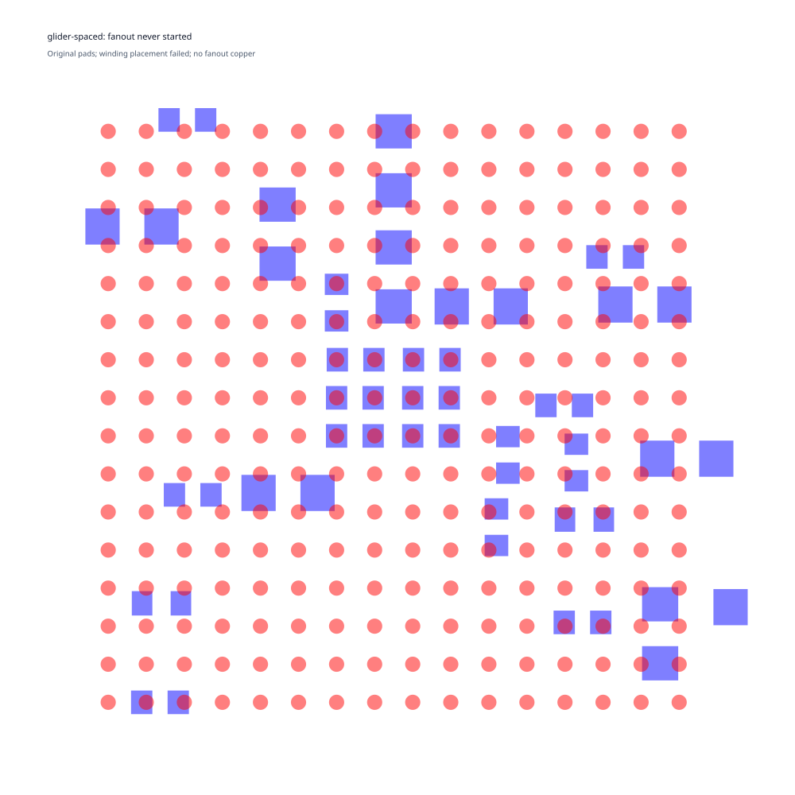
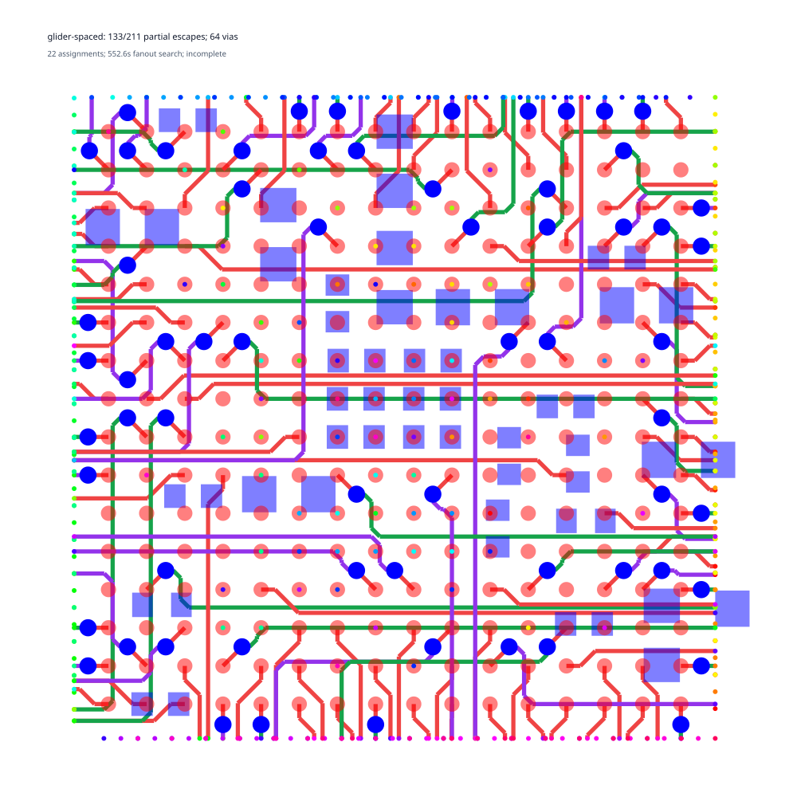

# Full-circuit refresh: correct overfull winding layer assignments

The ten supplied TSX circuits were rerun on **tscircuit 0.0.3267, Core 0.0.2444, autorouter 0.0.1145, fanout 0.0.97 and bus lanes 0.0.63**, the latest published routing stack at the start of this investigation. Routing remains fanout → DDR bus lanes → remaining nets. Original placements, DDR positions, memberships, widths, clearances, via rules and the stripped-copper inputs are preserved.

The most useful verified correction removes **five of six winding placement failures (83.3% fewer)**. The old allocator restarts at the first candidate layer for each bus. On spaced Glider U1, that puts 19 connections on one layer and 17 on another, although 18 on each of the three allowed layers fits. The planner reports an edge that is too short before fanout can start.

The fix retains the existing assignment whenever it fits. For an overfull edge, it moves complete flexible atomic groups to permitted layers with room, starting with the most recently allocated bus. Fixed layers and differential pairs stay intact. Allocation and placement share the existing gate-axis geometry through one small utility. There is no new solver, relaxed geometry rule or failure marked as solved.

| Measurement | Before | After | Change |
| --- | ---: | ---: | ---: |
| Failures among the same 82 winding inputs | 6 | 1 | **83.3% fewer** |
| Previously feasible placement outputs | 76 | 76 identical | Preserved |
| Full circuits reaching fanout | 9/10 | 10/10 | +1 circuit |
| Spaced Glider diagnostic partial | Not reached | 133/211 escapes, 64 vias | Newly reached |
| Other nine circuits: diagnostic escapes | 552/813 | 552/813 | Unchanged |
| Other nine circuits: diagnostic vias | 339 | 347 | +8 on spaced ButterStick |
| Complete boards | 0/10 | 0/10 | Unchanged |

**Whole-board connectivity does not improve yet.** All ten full PCB SVGs remain byte-identical because no complete fanout group commits routing to Core. The 19 connected board nets in both versions were already joined by retained same-net pours. Diagnostic partials are not completed board nets.

| Circuit | Winding failures | Diagnostic escapes | Diagnostic vias |
| --- | ---: | ---: | ---: |
| ButterStick original | 0 → 0 | 62/91 → 62/91 | 42 → 42 |
| ButterStick spaced | 1 → 0 | 78/91 → 78/91 | 41 → 49 |
| Glider original | 0 → 0 | 86/95 → 86/95 | 58 → 58 |
| Glider spaced | 2 → 0 | Not reached → 133/211 | — → 64 |
| H616 original | 0 → 0 | 108/174 → 108/174 | 72 → 72 |
| H616 spaced | 0 → 0 | 111/174 → 111/174 | 72 → 72 |
| iCE/Pi original | 0 → 0 | 14/32 → 14/32 | 6 → 6 |
| iCE/Pi spaced | 1 → 1 | 77/92 → 77/92 | 37 → 37 |
| i.MX6 original | 1 → 0 | 9/32 → 9/32 | 7 → 7 |
| i.MX6 spaced | 1 → 0 | 7/32 → 7/32 | 4 → 4 |

The recovered placements are spaced ButterStick U4 (105 points), spaced Glider U1 and U12 (54 and 45), and U7 in both i.MX6 variants (89 and 90). All 76 previously successful winding outputs are byte-identical. Six additional downstream winding calls now run successfully, giving 87 successful placements out of 88 actual calls. The remaining failure is spaced iCE/Pi, whose declared edge still lacks capacity under its supplied spacing and layer constraints.

## What the intercepted pipeline shows

Before the fix, spaced Glider never reaches fanout; Core continues into bus-lane routing after its winding failures and consumes the budget. The corrected placements let its first full fanout problem run: 211 requested escapes including DDR, peripheral signals and power. The captured best partial reaches 133 escapes. All ten circuits then stop at fanout; remaining-net routing never starts. These samples therefore still do not exercise the newly merged downstream fixed-copper improvements.

The other nine first fanout groups reach the same escape counts. Eight constructor inputs are unchanged, and all 1,753 shared completed assignment summaries for those inputs match. Pad/trace, pad/via, boundary and accepted-copper rejection captures are retained. Those counts describe rejected candidate checks, not emitted DRC errors or counts of failed nets. H616 and the larger Glider searches reach the budget before exhausting all 256 assignments; no runtime speedup is claimed.

Spaced ButterStick is a measured cost: its partial remains 78/91 escapes but grows from 41 to 49 vias. The before input has no coordinated `connectionExitTargets` for DDR byte 1 because placement failed. The corrected input supplies all eight targets. Fanout selects inner2 instead of top for the byte, adding eight vias; the other changed singleton via counts cancel. Its source pad positions and local handoff endpoints stay the same. This is a more constrained input, and the measurement does not establish that eight extra vias are unavoidable. The [per-pad audit](shared-capacity/butterstick-via-cost.json) preserves both option sets and the changed plans.

## Before and after

The [repro PR](https://github.com/tscircuit/winding-breakout-point-solver/pull/9) records the native failed Glider U1 placement. The [stacked fix](https://github.com/tscircuit/winding-breakout-point-solver/pull/10) naturally updates the same snapshot to 54 valid points, 18 per allowed layer.

| Native placement before | After |
| --- | --- |
|  |  |

Actual full-circuit fanout diagnostics for spaced Glider follow. Before has no fanout output: the image shows the original pads, independently verified unchanged. After shows the captured partial copper. Both use the same native renderer and viewport; all 312 shared pad shapes have identical image coordinates. Blue circles are via pads; black dots are endpoint markers. These are intermediate fanout results, not committed whole-board routing.

| Before: fanout never reached | After: 133/211 diagnostic escapes |
| --- | --- |
|  |  |

The corresponding original Glider control remains 86/95 escapes and 58 vias. Its [before](shared-capacity/glider-original-before.svg) and [after](shared-capacity/glider-original-after.svg) preserve the copper.

## Experiments and validation

Unconditional layer balancing recovered the placements but reduced original ButterStick from 62 to 55 escapes, so it was rejected. Restricting the correction to overfull edges preserves every feasible placement. Moving the latest allocated bus first gives spaced Glider 133 escapes with 64 vias, versus 134 with 73 for the earlier-bus-first experiment. The selected result trades one diagnostic escape for nine fewer vias (12.3% fewer). Neither variant completes the board, and neither removes spaced ButterStick's eight-via cost.

All ten circuits were rerun on the current stack. After the final one-line repair-order refinement, the four affected full circuits were rerun; the six unchanged controls retain their complete earlier captures. The final audit combines those captures and independently replays all 82 original winding inputs against the final source. All pad geometry, component/pad counts and net memberships match. All 19 captured before/after fanout partials pass native copper DRC and the independent via-in-pad check, with zero findings.

All 32 winding tests, type checking and the official format check pass without updating the existing QFP or AM62L snapshots. The one-line [Core integration PR #5779](https://github.com/tscircuit/core/pull/5779) pins the private winding dependency to the reviewed fix; all ten Core test shards, types and the dist smoke build pass. Core 0.0.2445, a schematic-only update released during the investigation, is retained on that integration branch.

The unchanged limit is 600 seconds including preparation, a 660-second worker-process ceiling and at most 256 assignments. This is a bounded search comparison, not a proof that the remaining whole boards are unroutable.

Pinned Core for the ten-board runs: `a277cef7ca8c77eca992c7c350419c7eb835250b`. Original winding: `202dbe9eb0088633b6fa094120dba6f2f41f8803`. Final winding: `e39d3db8e9007ac01339c50604e6f9c70260e044`. The four production modules match the rerun source `cabeb4762292e730bd45eb3ffec8314e34fc2b57`; unchanged-control captures used the equivalent feasible-placement path before the last-bus refinement. ZIP SHA-256: `1991ad1891a953dcd660818aaceb73f7aa42dbf704e677e635753b9159f7a6b7`.

Evidence: [latest baseline and full PCB SVGs](https://github.com/tscircuit/tscircuit-autorouter/actions/runs/44897719641), [ten-board correction run](https://github.com/tscircuit/tscircuit-autorouter/actions/runs/44899751288), [final affected-board reruns](https://github.com/tscircuit/tscircuit-autorouter/actions/runs/44900830468), [final physical audit and raw captures](https://github.com/tscircuit/tscircuit-autorouter/actions/runs/44902158884), [winding tests/types/format](https://github.com/tscircuit/tscircuit-autorouter/actions/runs/44901187229), [Core tests](https://github.com/tscircuit/core/actions/runs/44901174762), [Core types](https://github.com/tscircuit/core/actions/runs/44901174836), [Core smoke](https://github.com/tscircuit/core/actions/runs/44901174846), [statistics](shared-capacity/statistics.json).
