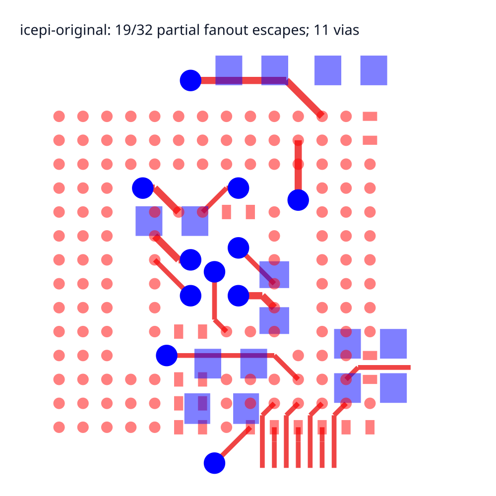
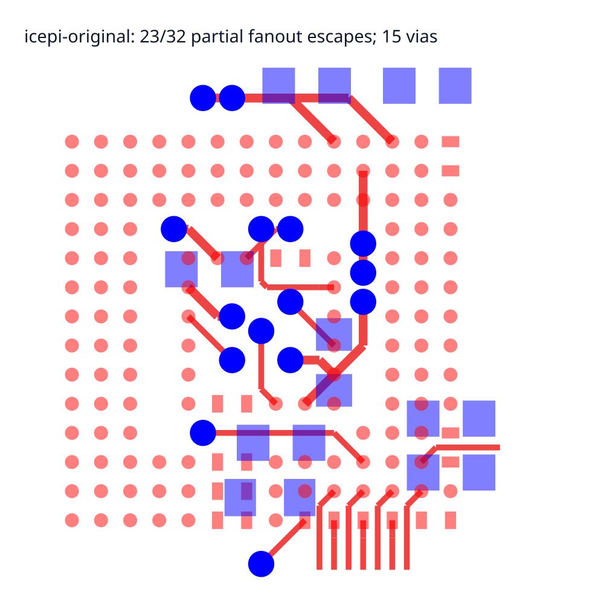

# Native full-circuit rerun: shared plane drops

The latest published Node stack includes fanout #369. This round fixes a separate search rejection: power/ground drops on the same electrical net were treated as unrelated copper, even though their declared plane already connects them.

The final change adds safe plane drops to the best failed assignment after normal assignment search. Existing copper and original assignment decisions remain intact. It reuses `routeBus`, its source escape paths and via candidates; there is no new routing solver, search budget or generic same-net merge option.

At common completed assignment prefixes, partial first-region escapes improve **700 → 719 (+2.7%)** out of 1024 requests. Raw best results are **702 → 719 (+2.4%)**, with **430 → 447** vias in the partial fanouts. Completed full boards remain **0/10 → 0/10**. The ordinary assignment histories are identical over every common completed prefix.

These counts measure pad-to-plane or pad-to-breakout escapes, not newly connected full-board logical nets. The global board copper and connected-net counts remain unchanged.

| Circuit | Requests in first region | Escapes before → after | Vias before → after | Completed assignments before → after | Best at common prefix | Fanout SVGs |
|---|---:|---:|---:|---:|---:|---|
| butterstick-original | 91 | 62 → 63 | 42 → 43 | 256 → 256 | 62 → 63 | [before](butterstick-original-before.svg) · [after](butterstick-original-after.svg) |
| butterstick-spaced | 91 | 78 → 78 | 49 → 49 | 256 → 256 | 78 → 78 | [before](butterstick-spaced-before.svg) · [after](butterstick-spaced-after.svg) |
| glider-original | 95 | 86 → 87 | 58 → 59 | 256 → 256 | 86 → 87 | [before](glider-original-before.svg) · [after](glider-original-after.svg) |
| glider-spaced | 211 | 137 → 135 | 69 → 67 | 36 → 35 | 135 → 135 | [before](glider-spaced-before.svg) · [after](glider-spaced-after.svg) |
| h616-original | 174 | 109 → 119 | 74 → 84 | 256 → 256 | 109 → 119 | [before](h616-original-before.svg) · [after](h616-original-after.svg) |
| h616-spaced | 174 | 111 → 111 | 72 → 72 | 193 → 192 | 111 → 111 | [before](h616-spaced-before.svg) · [after](h616-spaced-after.svg) |
| icepi-original | 32 | 19 → 23 | 11 → 15 | 256 → 256 | 19 → 23 | [before](icepi-original-before.svg) · [after](icepi-original-after.svg) |
| icepi-spaced | 92 | 77 → 77 | 37 → 37 | 256 → 256 | 77 → 77 | [before](icepi-spaced-before.svg) · [after](icepi-spaced-after.svg) |
| imx6-original | 32 | 16 → 19 | 14 → 17 | 256 → 256 | 16 → 19 | [before](imx6-original-before.svg) · [after](imx6-original-after.svg) |
| imx6-spaced | 32 | 7 → 7 | 4 → 4 | 256 → 256 | 7 → 7 | [before](imx6-spaced-before.svg) · [after](imx6-spaced-after.svg) |

Original/spaced budget differences are reported separately from routing gains. `statistics.json` retains the full per-case comparisons, route identities and hashes.

| Full-board PCB | Before | After |
|---|---|---|
| butterstick-original | [PCB SVG](full-boards/before/butterstick-original.svg) | [PCB SVG](full-boards/after/butterstick-original.svg) |
| butterstick-spaced | [PCB SVG](full-boards/before/butterstick-spaced.svg) | [PCB SVG](full-boards/after/butterstick-spaced.svg) |
| glider-original | [PCB SVG](full-boards/before/glider-original.svg) | [PCB SVG](full-boards/after/glider-original.svg) |
| glider-spaced | [PCB SVG](full-boards/before/glider-spaced.svg) | [PCB SVG](full-boards/after/glider-spaced.svg) |
| h616-original | [PCB SVG](full-boards/before/h616-original.svg) | [PCB SVG](full-boards/after/h616-original.svg) |
| h616-spaced | [PCB SVG](full-boards/before/h616-spaced.svg) | [PCB SVG](full-boards/after/h616-spaced.svg) |
| icepi-original | [PCB SVG](full-boards/before/icepi-original.svg) | [PCB SVG](full-boards/after/icepi-original.svg) |
| icepi-spaced | [PCB SVG](full-boards/before/icepi-spaced.svg) | [PCB SVG](full-boards/after/icepi-spaced.svg) |
| imx6-original | [PCB SVG](full-boards/before/imx6-original.svg) | [PCB SVG](full-boards/after/imx6-original.svg) |
| imx6-spaced | [PCB SVG](full-boards/before/imx6-spaced.svg) | [PCB SVG](full-boards/after/imx6-spaced.svg) |

| Routed iCE/Pi before | After |
|---|---|
|  |  |

## Scope and versions

Only the ten uploaded original/spaced H616, ButterStick, Glider, i.MX6 and iCE/Pi full circuits were used. ZIP SHA-256: `1991ad1891a953dcd660818aaceb73f7aa42dbf704e677e635753b9159f7a6b7`. Components, pad membership, placement, DDR placement in spaced samples, widths, clearances, through-via restrictions and via-in-pad restrictions are unchanged. Constructor inputs compare equal before/after.

Published stack: tscircuit **0.0.3277**, Core **0.0.2458** (`c00a55255f10b52a1d39117ee35a636608c27abb`), fanout **0.0.103**, capacity-autorouter **0.0.1152**, bus-lanes **0.0.65**, winding `08d8da9d8dbb037eba332e7bfd685063f8805ed4`.

The npm Core bundle was inspected: its SHA-256 is `8081c48f3d6a581bd9b487b806c3fdd1cc28e72ba2ade73d5a9e9f5df59aeef9`, and the centered escape pass no longer checks `busIsOnOutwardComponentEdge`. Published fanout source SHA-256 is `35a5f6db841e6f1c61614d6eceaef31c5602e02e4ad4595e80f0118be30e3a43`. The Node tscircuit entrypoint reexports that Core implementation. The published browser/worker assets are copied from older standalone bundles and still contain the earlier guard; this Node benchmark does not establish browser inclusion. No release/bump workflow was duplicated.

The baseline is [45006486986](https://github.com/tscircuit/tscircuit-autorouter/actions/runs/45006486986). The final patch run is [45013934138](https://github.com/tscircuit/tscircuit-autorouter/actions/runs/45013934138), source `c19eb7f80f2ddd7b9c21a07d87b8a6ae4c7b9f88`. All runs use Blacksmith, the original cap of 256 assignments, the original 600-second budget, preparation rules and external watchdog. The pipeline remains **fanout → DDR bus lanes → remaining routing**. Failed fanout is never promoted to a successful phase.

## Where the pipeline fails

Winding preparation computes candidate breakout positions before the first fanout region. Every full circuit then stops at its first `FanoutSolver`. DDR bus-lane routing and remaining routing are not reached. The partial fanout is diagnostic copper; Core does not commit it to the board.

The observer intercepts the original static-clearance and mutual-clearance return sites, records rejection geometry, completed assignments and stage time, and leaves candidate order and return values unchanged. Rejection counts describe repeated candidate checks, not distinct failed nets. Full captures, constructor inputs, rejection examples and PCB SVGs are in the baseline/patch run artifacts; `statistics.json` includes the independent audit.

In the baseline, accepted-route copper dominates candidate rejections on nine cases. i.MX6 spaced is different: pad/via checks dominate, with only 7/32 requests escaping. A separate pre-existing iCE/Pi spaced winding preparation reports 17.43 mm of requested breakout width against 14.64 mm of exposed edge. Moving signals or weakening rules would change the dataset and was not used as a fix.

## Root cause and final change

The native iCE/Pi example has 0.45 mm via pads and 0.20 mm drilled holes. Two GND via centers are 0.50 mm apart. Applying unrelated-net copper clearance requires 0.55 mm and rejects them; the actual hole rule requires 0.35 mm. Their same-net copper can touch, and their distinct drilled holes still clear one another.

Only two declared plane drops on the same original electrical net receive this copper-contact permission. Ordinary signals retain their existing merge policy. Via-to-pad checks remain strict on every spanned layer. Via-to-via drill distance uses the actual hole diameters and the maximum configured via-hole/plated-hole clearance. Coincident holes are not treated as one via.

The original assignment search runs unchanged. A finite pass over its remaining plane buses extends the best failed assignment with existing candidates. It adds complete buses only and never replaces accepted routes. A newly complete candidate still passes normalization and full endpoint, layer, length and copper validation. The focused native three-pad repro now completes; complete existing fixtures remain on their original path.

## Experiments rejected

- Inferring local boundary edges activated different routing behavior: ButterStick 62→47 and iCE/Pi 19→18 escapes. Rejected ([45007549560](https://github.com/tscircuit/tscircuit-autorouter/actions/runs/45007549560)). The downstream exit hints are intentional, not stale local endpoints.
- Generic same-net merging requires independent pad and drill guards, and even guarded variants added eight ButterStick vias for two escapes. The global option remains unchanged ([45008072246](https://github.com/tscircuit/tscircuit-autorouter/actions/runs/45008072246)). Earlier unguarded experiments had real via/pad and overlapping-drill violations despite passing electrical DRC.
- Allowing plane contact throughout greedy routing displaced working routes: Glider 86→85 in an early probe. Rejected ([45009643666](https://github.com/tscircuit/tscircuit-autorouter/actions/runs/45009643666)).
- Retrying planes during every assignment produced 31 gained requests but 12 lost existing signals, changed later assignment repairs, and reduced H616 from 256 to 194 completed assignments. Rejected, despite all electrical/physical audits passing ([45011756344](https://github.com/tscircuit/tscircuit-autorouter/actions/runs/45011756344), [audit](https://github.com/tscircuit/tscircuit-autorouter/actions/runs/45012146581)). The final pass happens after the original search to remove that tradeoff.

## Review and validation

[Native repro #372](https://github.com/tscircuit/fanout-solver/pull/372) precedes [stacked fix #373](https://github.com/tscircuit/fanout-solver/pull/373). Their native SVG snapshots update naturally. The focused example selects three real GND requests from the capture and keeps the surrounding native pads and original rules. The full U22 repro retains all 32 native requests.

The all-ten audit checks exact constructor equality, original circuit component/pad counts and net membership, original CUI electrical-net identities, native routed-copper DRC, independent via-to-pad clearance and via-in-pad checks, drilled-hole separation, bus atomicity/layer/direction/via use, endpoint and route structure, retained route geometry, via counts, wire length, assignment histories and final PCB hashes. Unrouted requests remain failures; they are not omitted from the full-board completion measure.

Final validation passed: exact-head source type/format checks and all ten full-circuit jobs in [45013934138](https://github.com/tscircuit/tscircuit-autorouter/actions/runs/45013934138); independent all-ten audit [45014350188](https://github.com/tscircuit/tscircuit-autorouter/actions/runs/45014350188); native macOS eight-shard repro CI [45013663016](https://github.com/tscircuit/fanout-solver/actions/runs/45013663016) and fix CI [45013936224](https://github.com/tscircuit/fanout-solver/actions/runs/45013936224). The AM62L snapshots that changed in the rejected during-search prototype remain unchanged in the final fix.

Full-board PCB SVGs are in `full-boards/before/` and `full-boards/after/`. The uncommitted fanout SVG pairs above them show the actual routing improvement. Full-board SVG hashes remain equal because the first fanout region is still incomplete. These results establish additional safe pad escapes, not a fully routed board or a count of newly connected full-board nets.
