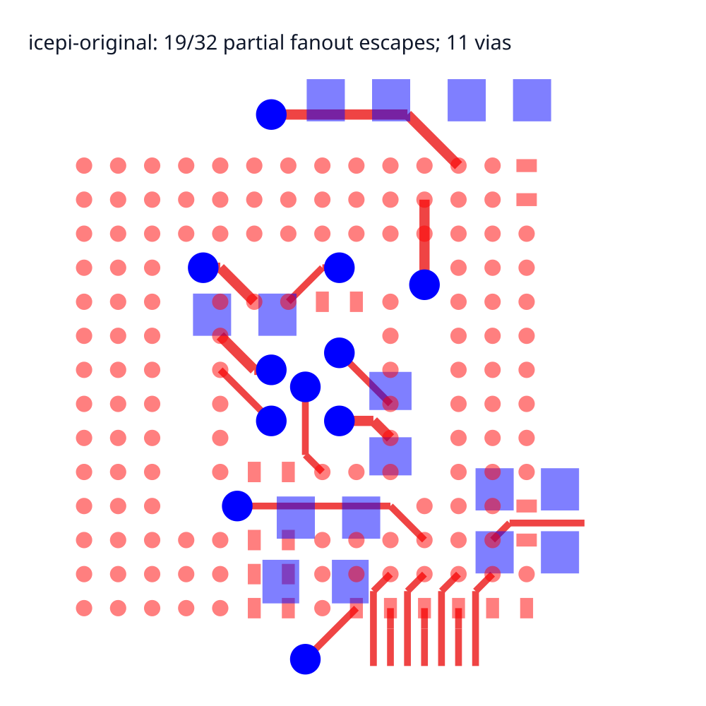
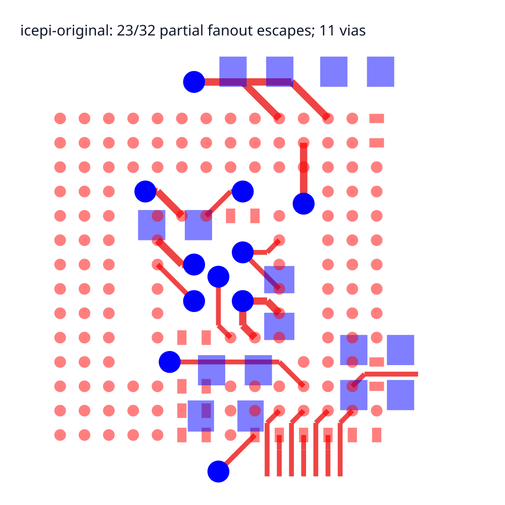

# Reuse existing plane vias: reviewer follow-up to fanout #373

The reviewer correctly identified an unnecessary hole in the three-pad iCE/Pi example. The third GND pad can reach the first pad's existing via under the original manufacturing rules. The revised patch tries that existing via through the current straight/45-degree connector candidates and fixed-site plane router. It emits one source-layer trace to the owned via, rather than a duplicate drill or fabricated via token.

The focused native example now completes **3/3 requests using 2 vias**. The complete 32-request U22 region retains **23 escapes**, reduces **15 → 11 vias**, and shortens routed wire **33.51 → 29.86 mm** compared with the earlier PR implementation. The region still fails as a whole; these are partial escapes.

## Controlled comparison with the previous PR

[Replay run 45022398643](https://github.com/tscircuit/tscircuit-autorouter/actions/runs/45022398643) starts both implementations from exactly the same original best assignment in each of the ten full-circuit captures. It reruns only the final plane recovery pass, isolating this reviewer change from wall-clock assignment-search differences. Previous source: `c19eb7f80f2ddd7b9c21a07d87b8a6ae4c7b9f88`; prototype source: `ee0c50148fb4a8073022bda1c63e1a6902d4b8e7`. Production source `02d798e4357a39804f9744b059baabc3e94b4612` makes variable names clearer and updates the repro assertions/snapshots, with the same routing logic. Final reviewed head `6a87a557fc124b1ce29ffdd2a8a9d530127861e2` additionally updates the affected native ButterStick and U22 repro expectations; its production library is identical.

| Metric, identical captured assignments | Previous PR | Via reuse |
|---|---:|---:|
| Partial first-region escapes | 721/1,024 | 725/1,024 (+0.6%) |
| Physical vias in partial fanouts | 449 | 431 (−4.0%) |
| Total partial fanout wire | 2,390.71 mm | 2,369.79 mm (−0.9%) |
| Lost escapes / longer existing routes | — | 0 / 0 |
| Completed full boards | 0/10 | 0/10 |

The revised pass removes **18 of the earlier recovery’s 19 additional vias**. All four newly reached requests use existing vias. One earlier i.MX6 drop keeps its own via; the newly reached i.MX6 pad shares a different, original via. The [emitted-via ownership check](imx6-via-ownership-proof.json) records the exact request and owner IDs. Relative to the captured published baseline, the complete revised recovery is **702 → 725 escapes (+3.3%)** with **430 → 431 vias**.

| Circuit | Escapes, previous PR → reuse | Vias | Wire, mm |
|---|---:|---:|---:|
| butterstick-original | 63 → 64 | 43 → 42 | 189.63 → 189.63 |
| butterstick-spaced | 78 → 78 | 49 → 49 | 322.27 → 322.27 |
| glider-original | 87 → 89 | 59 → 58 | 219.47 → 220.97 |
| glider-spaced | 137 → 137 | 69 → 69 | 543.63 → 543.63 |
| h616-original | 119 → 119 | 84 → 74 | 272.40 → 253.08 |
| h616-spaced | 111 → 111 | 72 → 72 | 505.07 → 505.07 |
| icepi-original | 23 → 23 | 15 → 11 | 33.51 → 29.86 |
| icepi-spaced | 77 → 77 | 37 → 37 | 276.33 → 276.33 |
| imx6-original | 19 → 20 | 17 → 15 | 21.43 → 21.97 |
| imx6-spaced | 7 → 7 | 4 → 4 | 6.97 → 6.97 |

The ten replay jobs pass native copper DRC, original plane endpoint connectivity, structural validation, independent via/pad clearance, via-in-pad and drill separation, original CUI net identity, bus atomicity and serialized physical-via counts. Plans from the original captured assignments remain byte-for-byte intact. Every reused endpoint is checked against an actual owned via on the same electrical net, declared plane and source layer. [Full replay summaries](review373-controlled-results.json) retain each check and connection-level comparison.

## Fresh full-pipeline results

The original Blacksmith workflow was rerun from Core `c00a55255f10b52a1d39117ee35a636608c27abb`, using the exact revised source, in [45022986170](https://github.com/tscircuit/tscircuit-autorouter/actions/runs/45022986170). The original limits remain 256 assignments and 600 seconds, with the original preparation and external watchdog rules.

| Metric | Published baseline | Revised recovery |
|---|---:|---:|
| Escapes at common completed assignment work | 700/1024 | 723/1024 (+3.3%) |
| Raw best partial escapes | 702 | 723 |
| Physical vias in raw partial fanouts | 430 | 429 |
| Completed full circuits | 0/10 | 0/10 |

| Circuit | Requests | Raw escapes before → after | Vias | Assignments | Escapes at common work | Native SVGs |
|---|---:|---:|---:|---:|---:|---|
| butterstick-original | 91 | 62 → 64 | 42 → 42 | 256 → 256 | 62 → 64 | [before](butterstick-original-before.svg) · [after](butterstick-original-after.svg) |
| butterstick-spaced | 91 | 78 → 78 | 49 → 49 | 256 → 256 | 78 → 78 | [before](butterstick-spaced-before.svg) · [after](butterstick-spaced-after.svg) |
| glider-original | 95 | 86 → 89 | 58 → 58 | 256 → 256 | 86 → 89 | [before](glider-original-before.svg) · [after](glider-original-after.svg) |
| glider-spaced | 211 | 137 → 135 | 69 → 67 | 36 → 35 | 135 → 135 | [before](glider-spaced-before.svg) · [after](glider-spaced-after.svg) |
| h616-original | 174 | 109 → 119 | 74 → 74 | 256 → 256 | 109 → 119 | [before](h616-original-before.svg) · [after](h616-original-after.svg) |
| h616-spaced | 174 | 111 → 111 | 72 → 72 | 193 → 193 | 111 → 111 | [before](h616-spaced-before.svg) · [after](h616-spaced-after.svg) |
| icepi-original | 32 | 19 → 23 | 11 → 11 | 256 → 256 | 19 → 23 | [before](icepi-original-before.svg) · [after](icepi-original-after.svg) |
| icepi-spaced | 92 | 77 → 77 | 37 → 37 | 256 → 256 | 77 → 77 | [before](icepi-spaced-before.svg) · [after](icepi-spaced-after.svg) |
| imx6-original | 32 | 16 → 20 | 14 → 15 | 256 → 256 | 16 → 20 | [before](imx6-original-before.svg) · [after](imx6-original-after.svg) |
| imx6-spaced | 32 | 7 → 7 | 4 → 4 | 256 → 256 | 7 → 7 | [before](imx6-spaced-before.svg) · [after](imx6-spaced-after.svg) |

Glider spaced completes 36 → 35 assignments before timeout: raw best escapes are 137 → 135, with 9 before-only and 7 after-only requests; both runs reach 135 at common completed work. H616 spaced completes 193 assignments in both runs with 111 escapes. Timed cases are reported separately; the raw outputs are not described as equivalent completed work. Original assignment histories match exactly at every common completed prefix. The frozen comparison above isolates the via-reuse behavior. `statistics.json` retains raw gained/lost identities, all structural checks, length, circuit/pad counts, connected full-board nets and exact PCB hashes.

## Scope and failure locations

Only the ten uploaded original/spaced H616, ButterStick, Glider, i.MX6 and iCE/Pi full circuits are used. Archive SHA-256: `1991ad1891a953dcd660818aaceb73f7aa42dbf704e677e635753b9159f7a6b7`. All original components, pads, nets, widths, clearances, placements, fixed DDR placement, through-via and via-in-pad restrictions are preserved. Constructor arguments are equal before/after and source files are verified against the uploaded archive.

The published baseline remains tscircuit **0.0.3277**, Core **0.0.2458**, fanout **0.0.103**, capacity-autorouter **0.0.1152**, bus-lanes **0.0.65**, winding `08d8da9d8dbb037eba332e7bfd685063f8805ed4`. No release or bump workflow is duplicated. The previous [release verification and pipeline report](../shared-plane-drops/analysis.md) explains the bundled Node implementation.

The pipeline remains **fanout → DDR bus lanes → remaining routing**. All ten full boards still stop at their first incomplete fanout region. DDR bus lanes and remaining routing are not reached, and partial copper is not committed as a successful fanout. Full PCB SVGs and connected-board-net counts remain unchanged. The improvement is additional valid pad escapes with fewer holes; it does not complete a board.

The original observer captures static/mutual-clearance rejection sites, rejection geometry and completed assignments without changing decisions. Repeated accepted-route copper checks remain the principal rejection category in most regions; i.MX6 spaced remains dominated by pad/via restrictions. Rejection counts and preparation failures are retained in `statistics.json` and the raw run captures. The reviewer fix addresses a concrete missing candidate: a nearby same-net plane via already exists, but the recovery previously considered drilling another hole instead of connecting to it.

The ordinary assignment search is unchanged. Reuse is tried only in the existing final recovery pass; each complete bus either reuses existing vias for every connection or falls back to its owned-via candidate. A reuse candidate must pass the existing static/mutual checks, preserve the plane endpoint, avoid adding vias and avoid lengthening an available original candidate. The shortest valid existing connector wins. There is no new parallel solver, arbitrary radius/repair budget, global merge permission, placement change or relaxed manufacturing rule.

## Validation and visuals

[Repro #372](https://github.com/tscircuit/fanout-solver/pull/372) remains the base of [fix #373](https://github.com/tscircuit/fanout-solver/pull/373). Native focused and complete U22 SVG snapshots update naturally in the stacked fix. Existing performance repro assertions/snapshots are updated to the actual eleven-via output.

Exact-head type/format checks pass. All eight native macOS test shards pass in [45025005681](https://github.com/tscircuit/fanout-solver/actions/runs/45025005681). The [independent all-ten full-pipeline audit](https://github.com/tscircuit/tscircuit-autorouter/actions/runs/45023168296) passes constructor equality, original component/pad/net membership, CUI electrical-net identity, native copper DRC, independent pad/drill restrictions, physical reused-via ownership, bus atomicity, plane endpoints, route correctness and common-prefix assignment histories. Original geometry is retained for every equal-256-assignment comparison. Via and wire-length measurements are reported, including raw timed differences.

| Original focused repro | Revised fix |
|---|---|
|  |  |

| Native iCE/Pi before | After |
|---|---|
|  |  |

| Full-board PCB | Before | After |
|---|---|---|
| butterstick-original | [PCB SVG](full-boards/before/butterstick-original.svg) | [PCB SVG](full-boards/after/butterstick-original.svg) |
| butterstick-spaced | [PCB SVG](full-boards/before/butterstick-spaced.svg) | [PCB SVG](full-boards/after/butterstick-spaced.svg) |
| glider-original | [PCB SVG](full-boards/before/glider-original.svg) | [PCB SVG](full-boards/after/glider-original.svg) |
| glider-spaced | [PCB SVG](full-boards/before/glider-spaced.svg) | [PCB SVG](full-boards/after/glider-spaced.svg) |
| h616-original | [PCB SVG](full-boards/before/h616-original.svg) | [PCB SVG](full-boards/after/h616-original.svg) |
| h616-spaced | [PCB SVG](full-boards/before/h616-spaced.svg) | [PCB SVG](full-boards/after/h616-spaced.svg) |
| icepi-original | [PCB SVG](full-boards/before/icepi-original.svg) | [PCB SVG](full-boards/after/icepi-original.svg) |
| icepi-spaced | [PCB SVG](full-boards/before/icepi-spaced.svg) | [PCB SVG](full-boards/after/icepi-spaced.svg) |
| imx6-original | [PCB SVG](full-boards/before/imx6-original.svg) | [PCB SVG](full-boards/after/imx6-original.svg) |
| imx6-spaced | [PCB SVG](full-boards/before/imx6-spaced.svg) | [PCB SVG](full-boards/after/imx6-spaced.svg) |
