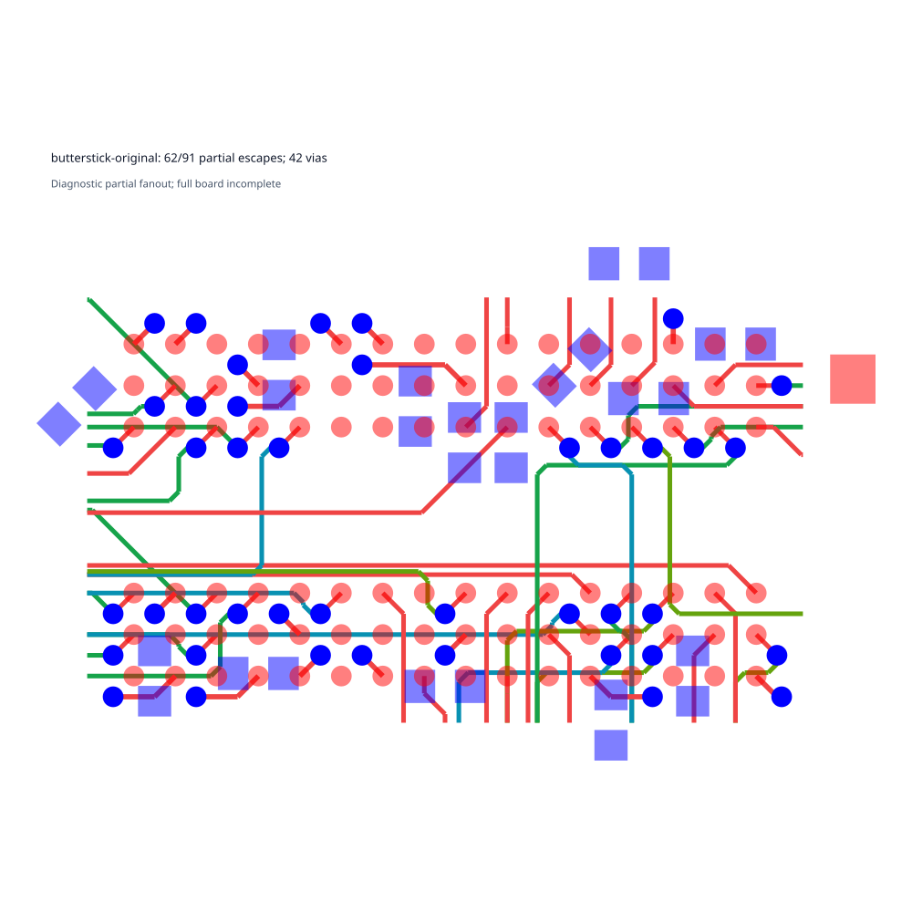
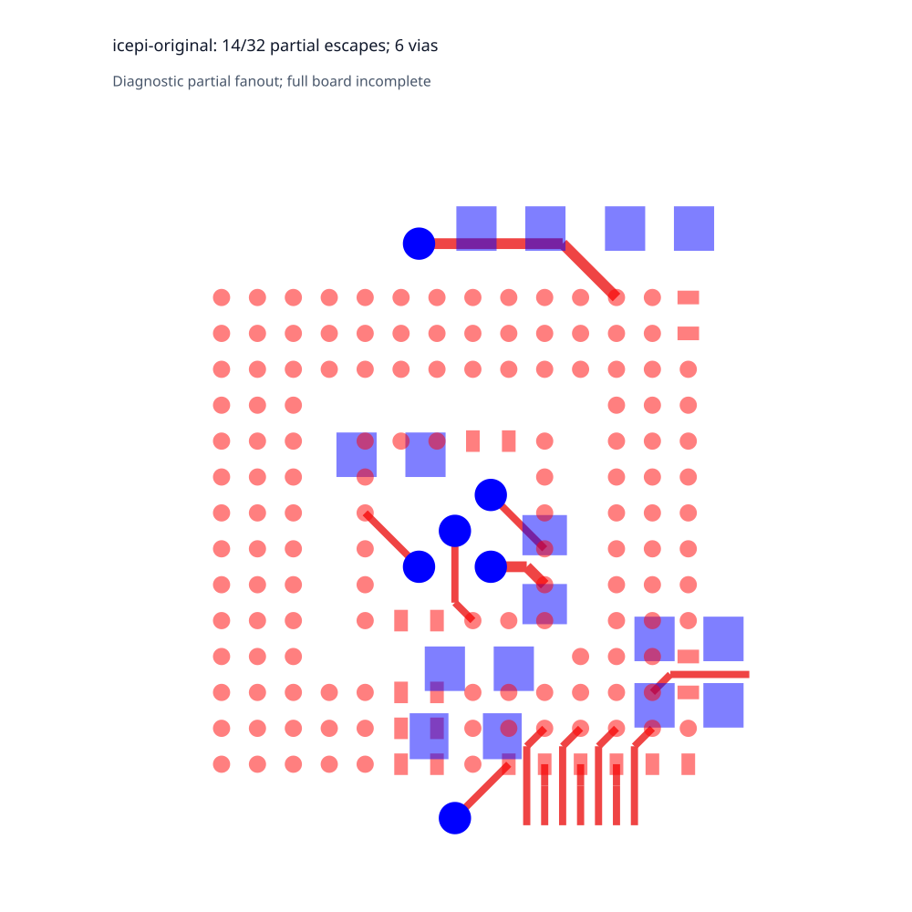
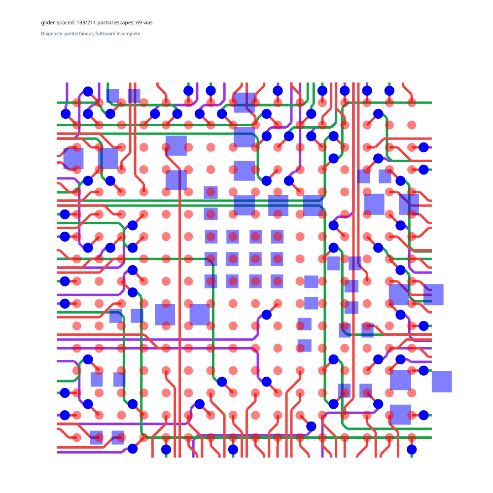
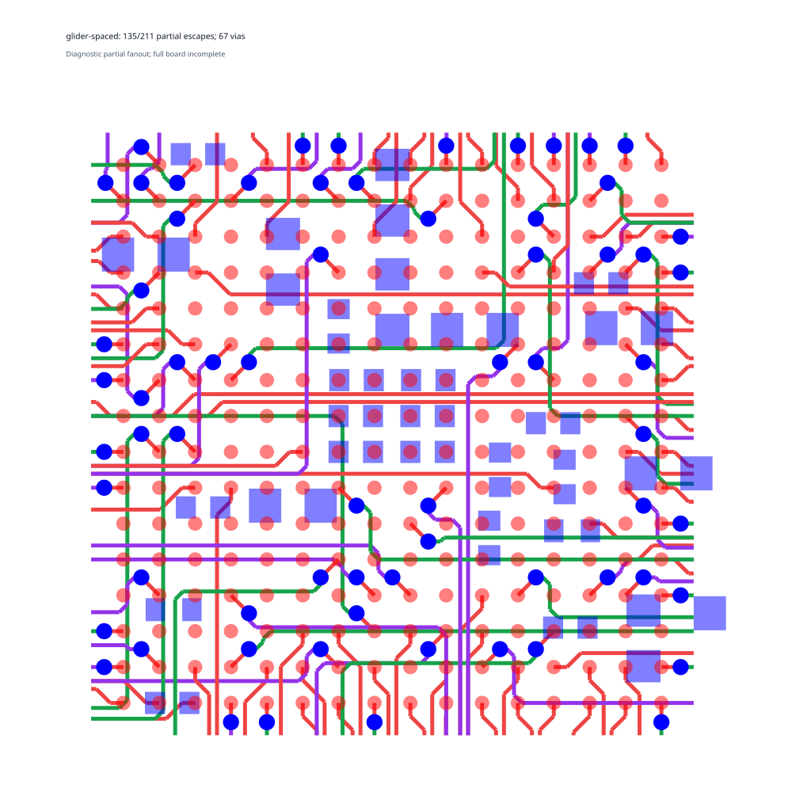

# Latest full-circuit routing analysis — 2026-11-21

The selected fix adds a conservative via-to-trace bounds filter before the existing exact clearance check. **Matched fanout search time falls 16.2%** across three full-circuit captures. The original plans, output SRJs, vias and all 256 assignment summaries remain identical. The native U22 repro performs **244 → 2 exact point-to-segment checks** in a mutual-clearance pass, with byte-identical copper.

All ten uploaded circuits were rerun through native Core before and after the fix. Complete-board routing remains **0/10**. This is a search-cost improvement; routing failures remain visible.

## Latest release and pipeline

The baseline is tscircuit **0.0.3270**, Core **0.0.2448** (`52472c3`), fanout **0.0.98**, capacity autorouter **0.0.1145**, bus lanes **0.0.63**, and winding main `08d8da9`. The release includes the previous boundary-cache fix; its earlier gains are already in this baseline. Core changed only its version and fanout dependency since the previous analysis.

The ZIP and every TSX member are hash-checked. Original routes and vias are removed. All components, pads, DDR placement, peripheral spacing, bus membership, widths, clearances, via spans and budgets are retained. The workflow remains **fanout → DDR bus lanes → remaining nets**. Core is unmodified; the after run replaces one fanout source module with the hash-checked proposed fix. The final rebase changes only repro typing and formatting; production code is byte-identical to the full-circuit patch.

Interception records winding stages, original clearance rejection predicates and every completed fanout assignment. Winding succeeds in **87/88 calls**. Spaced iCE/Pi still has one declared edge-capacity failure: **17.43mm needed, 14.64mm available** under its spacing rules. All ten boards stop in fanout before DDR bus lanes and general routing.

The baseline records **26,107,079 accepted-copper rejection events**. These count candidate failures, not unique connections. Mutual clearance also spends time measuring many far-apart vias and traces. The new bounds filter removes that unnecessary exact work while retaining the original layer check, precise distance predicate and blocker accounting.

| Full circuit | Diagnostic escape connections before → after | Diagnostic vias | Completed assignments |
| --- | ---: | ---: | ---: |
| butterstick-original | 62/91 → 62/91 | 42 → 42 | 256 → 256 |
| butterstick-spaced | 78/91 → 78/91 | 49 → 49 | 256 → 256 |
| glider-original | 86/95 → 86/95 | 58 → 58 | 256 → 256 |
| glider-spaced | 133/211 → 135/211 | 69 → 67 | 24 → 27 |
| h616-original | 108/174 → 109/174 | 72 → 74 | 186 → 231 |
| h616-spaced | 111/174 → 111/174 | 72 → 72 | 119 → 146 |
| icepi-original | 14/32 → 14/32 | 6 → 6 | 256 → 256 |
| icepi-spaced | 77/92 → 77/92 | 37 → 37 | 256 → 256 |
| imx6-original | 9/32 → 9/32 | 7 → 7 | 256 → 256 |
| imx6-spaced | 7/32 → 7/32 | 4 → 4 | 256 → 256 |

Spaced Glider and both H616 baseline searches reach the unchanged 600-second budget, including preparation. Their best partial results depend on search progress; all matched completed assignment prefixes agree. Seven baseline searches finish all 256 assignments. The 19 nets already joined through retained pours stay connected. No new PCB route copper is committed.

## Matched performance

Each case uses fresh Bun processes on one Blacksmith worker. Before is the mean of two original runs bracketing the change. Timing covers solving and reading the best partial SRJ; preparation and DRC are outside the timer. Exact equality checks cover plans, output and all assignment summaries. The audit verifies that all three performance inputs are identical to the fresh Core 0.0.2448 constructor captures.

| Full-circuit fanout capture | Before | After | Time reduction |
| --- | ---: | ---: | ---: |
| butterstick-original | 75.42s | 61.60s | 18.3% |
| icepi-original | 4.30s | 4.31s | -0.3% |
| imx6-original | 5.31s | 5.38s | -1.2% |
| Total | 85.03s | 71.28s | **16.2%** |

The gain comes from ButterStick. The two smaller cases vary by at most 1.2% against their bracketing baseline means. Separate via-pair bounds and via-array allocation experiments preserved routes but saved less total time; those changes are excluded.

The filter expands the segment centerline bounds by the via radius, half the trace width, clearance and `1e-9`. An axis gap larger than that cannot violate clearance. Pairs inside those conservative bounds still receive the original exact distance test with its original tolerance. Numerical probes cover three via/trace rule sets, near-threshold gaps and both argument orientations.

## Before and after

The focused repro reuses the native U22 capture, solves its actual partial, validates DRC and checks that failed fanout still throws from `getOutput()`. Its SVG changes only the exact-check counter.

| Focused native repro before | After |
| --- | --- |
|  |  |

These actual full-circuit partials use native rendering, original pad coordinates and matching viewports. Completed-search examples preserve the same copper. The timed Glider comparison records its best partial at the shared budget.

| ButterStick original before | After |
| --- | --- |
|  |  |

| iCE/Pi original before | After |
| --- | --- |
|  |  |

| Glider spaced before | After |
| --- | --- |
|  |  |

## Validation and evidence

All ten constructor inputs and physical pad sets are unchanged, and all matched completed assignment histories agree. All 7 pairs of completed searches have identical outputs. All **20 diagnostic partials pass the unmodified native DRC and independent via-in-pad checks** against the full circuits. Complete PCB SVGs are byte-identical. Typecheck and format checks pass; native CI is linked below.

[Repro #352](https://github.com/tscircuit/fanout-solver/pull/352), [stacked fix #353](https://github.com/tscircuit/fanout-solver/pull/353), [baseline captures and PCB SVGs](https://github.com/tscircuit/tscircuit-autorouter/actions/runs/44922636724), [after captures and PCB SVGs](https://github.com/tscircuit/tscircuit-autorouter/actions/runs/44924496636), [paired benchmark](https://github.com/tscircuit/tscircuit-autorouter/actions/runs/44922896980), [physical audit](https://github.com/tscircuit/tscircuit-autorouter/actions/runs/44925147232), [source checks](https://github.com/tscircuit/tscircuit-autorouter/actions/runs/44924999533), [native regression suite](https://github.com/tscircuit/fanout-solver/actions/runs/44924809061), and [machine-readable statistics](via-bounds/summary-statistics.json).
