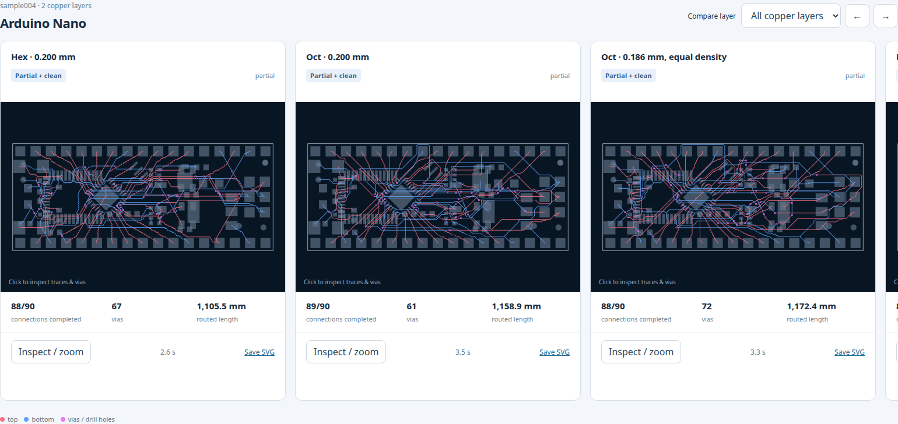

# Hexagonal / octagonal grid routing on SRJ18

This experiment compares one breakout → nearest physical tree → multilayer A*
router on six-direction hexagonal and eight-direction octagonal grids. It is
isolated from the production autorouter pipeline.

Open **[gallery.html](gallery.html)** in a browser. It is a standalone offline
page with the aggregate table, a per-board completion matrix, and one horizontal
row of nine router cards for each of the 16 boards. All copper layers, drilled
vias, zoom, and SVG export are available. Images use the recorded output
coordinates, widths, and layers; they do not infer missing routes.

## Recorded results

Dataset: [`tscircuit/dataset-srj18@b38e23cb1941`](https://github.com/tscircuit/dataset-srj18/tree/b38e23cb1941084d1f77c935699eff425a902db5).
The 702 single-terminal records are excluded, leaving 2,194 routing requests
across 16 boards. Different requests can share one electrical net; the independent
evaluator also records physical electrical-net completion.

| Router | Physically connected requests | Complete boards | Complete + clean boards |
| --- | ---: | ---: | ---: |
| Hex, 0.200 mm | 2,102 / 2,194 (95.8%) | 5 | 5 |
| Oct, 0.200 mm | 2,084 / 2,194 (95.0%) | 5 | 5 |
| Oct, 0.186 mm, equal density | 2,088 / 2,194 (95.2%) | 5 | 5 |
| Hex, 0.100 mm | 1,877 / 2,194 (85.6%) | 1 | 1 |
| Oct, 0.093 mm, equal density | 1,883 / 2,194 (85.8%) | 1 | 1 |
| tscircuit, default edge rule | 1,518 / 2,194 (69.2%) | 10 | 2 |
| tscircuit, 0.1 mm edge rule | 976 / 2,194 (44.5%) | 5 | 2 |
| FreeRouting, strict width, fanout disabled | 1,942 / 2,194 (88.5%) | 8 | 8 |
| FreeRouting, normal fanout | 1,898 / 2,194 (86.5%) | 5 | 0 |

At equal grid density, octagonal routing shortens summed routed length **1.86%**
on the **1,019 electrical nets completed by both** grids, with completion lower
by 0.64 percentage points. Equal-pitch oct shortens common-net length 0.99%.
Finer grids reduce completion under the same cap. FreeRouting completes more
clean boards and uses 36.6% less routed length on the 931 electrical nets it and
hex both complete. The prototype does not yet justify replacing FreeRouting.

## Conditions and limits

- 60-second caps, 0.1 mm trace width / copper clearance / board-edge margin,
  0.3 mm through vias. tscircuit's default edge rule is tested separately.
- tscircuit baseline: `@tscircuit/capacity-autorouter@0.0.983`, local pipeline 9,
  effort 1, cache/network disabled. Eight of 16 pipelines time out in each
  variant. Unstitched internal fragments are not counted as final copper.
- FreeRouting 2.5.0 uses DSN generated from the same unrouted SRJ. Its internal
  cap excludes startup/export overhead. Synthetic one-pad components can affect
  fanout; samples 001 and 005 each need one synthetic terminal at missing-pad
  geometry. No routed KiCad source traces are used.
- The normal FreeRouting fanout path emits sub-minimum widths even when automatic
  neckdown is disabled. The strict run disables fanout in the unmodified official
  JAR. See [diagnostic](freerouting/fanout-width-diagnostic.json) and
  [upstream insertion code](https://github.com/freerouting/freerouting/blob/v2.5.0/src/main/java/app/freerouting/autoroute/path/FoundConnectionInserter.java#L243).
- Both grid variants share net order, breakouts, geometry checks, and a 2 mm via
  penalty. There is no rip-up/shove. Candidate breakouts and tree goals are
  capped. Separate SRJ records do not share a persistent canonical-net tree,
  which can add redundant copper. Only one lattice origin/orientation is tested.
- Routing uses concurrent workers on one host and one run per configuration.
  These are exploratory capped results, without a statistical runtime claim.
- “Clean” means the independent Shapely SRJ geometry checks pass. Existing pad
  conflicts are separated; this is not a complete fabrication DRC. Length is
  summed polyline length and can count overlapping same-net routes more than once.

The recorded bundle retains all 144 routed outputs and independent evaluations,
with original input bytes and checksums. [Reproduction commands](REPRODUCE.txt)
restore the data without rerouting. Future benchmark executions follow the
repository's Blacksmith policy.
