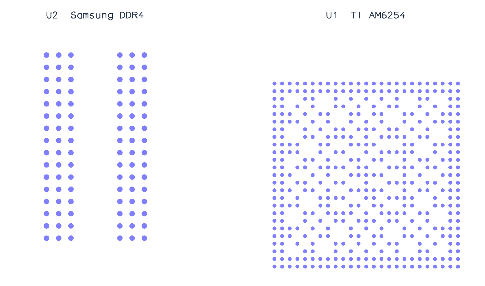
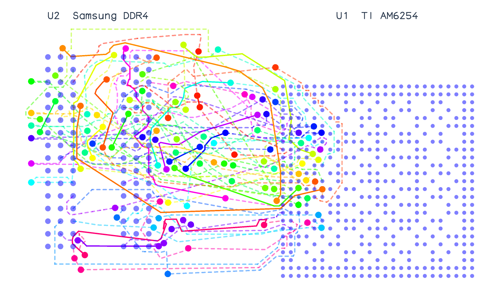

# BeaglePlay Rev A2 DDR4 routing repro

The source is the [production BeaglePlay Rev A2 Allegro layout][layout] at
revision `7a59a98ae27dc4fd9e2bd8975ff90cdb44a366ea`. The [BOM][bom] identifies
U1 as TI AM6254ATCGHAALW and U2 as Samsung K4AAG165WA-BCWE. Both BGAs are on
the bottom and have 425 and 96 pads respectively.

Source board SHA-256:
`f326c4494161ef9d68fa36bc8196f3e3cc47fcc679c3fa0179b6197947dbfb3d`.
Derived routing input SHA-256:
`13a215e571f90e31da4fbf2a7712064d0141a6a1bf6253206c42b30f3d0b9942`.
The layout is © 2023 Seeed Technology Co., Ltd and BeagleBoard.org Foundation,
under [CC BY 4.0][license]. See `LICENSE.hardware.txt`.

## Routing input

- **51 signal nets, 102 terminals.** Each net connects one AM6254 ball to one
  DDR4 ball. The two-footprint repro omits resistor branches, supply and
  reference rails, and signals without a terminal on both BGAs. The fixture
  preserves the CAD ball names on all 521 pads and ties each DDR terminal to
  its pad by port ID for continuity checks.
- **Native pad placement and eight-layer copper order.** KiCad 10.0's Allegro
  importer reads the board. The export translates the board outline to the
  origin and flips the CAD Y axis. The input contains all 521 pads on U1 and
  U2 at their original positions and diameters. The original routing bounds
  are 80.00238 mm square. The outline drops duplicate edge drawings and
  approximates each corner arc with eight chords.
- **Route from fresh copper.** Existing tracks, vias, and pours are removed.
  All eight copper layers retain their physical indexes. From top to bottom
  they are `TOP`, `LYR2_GND`, `LYR3`, `LAY4_PWR1`, `LAY5_PWR2`, `LAY6`,
  `LYR7_GND`, and `BOTTOM`. The source signal routes use layers 1, 3, 6, and 8.
  This input does not reserve the plane layers or model dielectric thickness.
- **Geometry from source copper.** The narrowest drawn DDR track is
  0.08128 mm and the DDR vias are 0.4064 mm with 0.2032 mm drills. The fixture
  uses 0.081 mm trace-to-pad clearance and 0.090 mm via-to-pad clearance,
  rounded down from the closest measured foreign DDR copper at the BGAs.
  Via-in-pad and blind/buried vias are disabled. The imported layout did
  not supply timing constraints to encode as bus or differential-pair rules.

## Run the repro

Open `bug-reports/beagleplay-am6254-ddr4` in React Cosmos with `bun run start`,
or run Pipeline 9 from the repository root:

```sh
bun scripts/run-sample.ts --pipeline 9 --effort 1 \
  --srj-path fixtures/bug-reports/beagleplay-am6254-ddr4/input.srj.json
```

## Routing snapshots

The routed snapshot shows the final Pipeline 9 export with the joint repair
publication check, based on autorouter `0.0.1124` (`d88899c`). At effort 1
with Bun `1.3.14` and the cache disabled, it exported 51 connected traces
and 114 vias. Both the reference and relaxed DRC checks report zero findings
using all 521 pads, 102 ports, and the fixture's 0.081 mm clearance.

The `d88899c` base run left 0.032 mm between `DDR_PARITY` and `DDR_A7` at
U1. The routed snapshot measures 0.954 mm for that pair. The original
`0.0.1117` repro left 0.037 mm between `DDR_PARITY` and `DDR_A6` at U1.
Its report included 102 false endpoint warnings caused by missing pad
records. Trace colors identify nets across all eight overlaid layers.





[layout]: https://github.com/beagleboard/beagleplay/blob/7a59a98ae27dc4fd9e2bd8975ff90cdb44a366ea/Design/20230215_beagleplayv022_10.brd
[bom]: https://github.com/beagleboard/beagleplay/blob/7a59a98ae27dc4fd9e2bd8975ff90cdb44a366ea/BeaglePlay_bom.csv
[license]: https://github.com/beagleboard/beagleplay/blob/7a59a98ae27dc4fd9e2bd8975ff90cdb44a366ea/LICENSE
