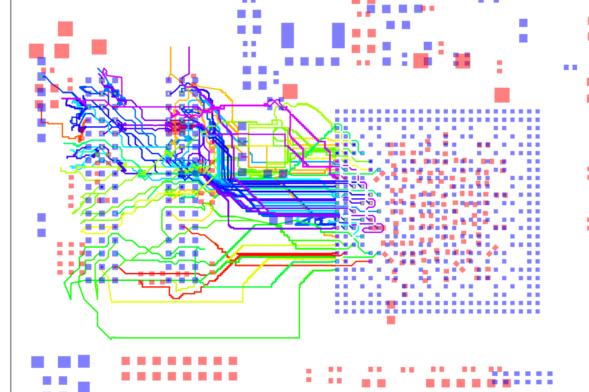

# BeaglePlay Rev A2 DDR4 routing repro

The source is the [production BeaglePlay Rev A2 Allegro layout][layout] at
revision `7a59a98ae27dc4fd9e2bd8975ff90cdb44a366ea`. The [BOM][bom] identifies
U1 as TI AM6254ATCGHAALW and U2 as Samsung K4AAG165WA-BCWE. Both BGAs are on
the bottom and have 425 and 96 pads respectively.

Source board SHA-256:
`f326c4494161ef9d68fa36bc8196f3e3cc47fcc679c3fa0179b6197947dbfb3d`.
Derived routing input SHA-256:
`e1376318e357cb73a2ba0373c9629a3f900afd5562e21b3b31ea4c3c500cd157`.
The layout is © 2023 Seeed Technology Co., Ltd and BeagleBoard.org Foundation,
under [CC BY 4.0][license]. See `LICENSE.hardware.txt`.

## Routing input

- **52 signal nets, 111 terminals.** The fixture includes the 51 `DDR_*`
  signals shared by U1 and U2 plus `DDR_TEN` and its two pull resistors.
  Shared-net resistor branches remain on the clock, alert, CKE, and reset nets.
  The DDR supply and reference rails and other board nets are outside this
  signal-routing pass.
- **Native pad placement and eight-layer copper order.** KiCad 10.0's Allegro
  importer reads the board. The export translates the board outline to the
  origin and flips the CAD Y axis. It preserves pad centers and sides from all
  846 footprints with pad or hole geometry as 2,994 obstacles. The outline
  drops duplicate edge drawings and approximates each corner arc with eight
  chords. Round pads retain their diameters. The rectangular bounds of oval
  and rounded pads approximate those shapes in Simple Route JSON.
- **Route from fresh copper.** Existing tracks, vias, and pours are removed.
  All eight copper layers retain their physical indexes. From top to bottom
  they are `TOP`, `LYR2_GND`, `LYR3`, `LAY4_PWR1`, `LAY5_PWR2`, `LAY6`,
  `LYR7_GND`, and `BOTTOM`. The source signal routes use layers 1, 3, 6, and 8.
  This input does not reserve the plane layers or model dielectric thickness.
- **Geometry from source copper.** The narrowest drawn DDR track is
  0.08128 mm and the DDR vias are 0.4064 mm with 0.2032 mm drills. The fixture
  uses 0.081 mm trace-to-pad clearance and 0.090 mm via-to-pad clearance,
  rounded down from the closest measured foreign DDR copper at the BGAs.
  Via-in-pad and blind/buried vias are disabled. The imported layout did
  not supply timing constraints to encode as bus or differential-pair rules.

## Run the repro

Open `bug-reports/beagleplay-am6254-ddr4` in React Cosmos with `bun run start`,
or run Pipeline 9 from the repository root:

```sh
bun scripts/run-sample.ts --pipeline 9 --effort 1 \
  --srj-path fixtures/bug-reports/beagleplay-am6254-ddr4/input.srj.json
```

## Baseline observation

Local Pipeline 9 run on autorouter `0.0.1111` (`5548af1`), Bun `1.3.14`,
effort 1 with no cache. Global path planning completed at about 83 seconds.
Detailed routing finished at about 224 seconds and handed off to
`highDensityForceImproveSolver`. That stage was still active after the
300-second budget and the run was interrupted after about 325 seconds.
Route stitching, final export, and DRC were never reached.

A second run on the same revision captured the DDR area after detailed routing.
Colors identify nets across the overlaid copper layers. The lines show trace
fragments before stitching.



[layout]: https://github.com/beagleboard/beagleplay/blob/7a59a98ae27dc4fd9e2bd8975ff90cdb44a366ea/Design/20230215_beagleplayv022_10.brd
[bom]: https://github.com/beagleboard/beagleplay/blob/7a59a98ae27dc4fd9e2bd8975ff90cdb44a366ea/BeaglePlay_bom.csv
[license]: https://github.com/beagleboard/beagleplay/blob/7a59a98ae27dc4fd9e2bd8975ff90cdb44a366ea/LICENSE
