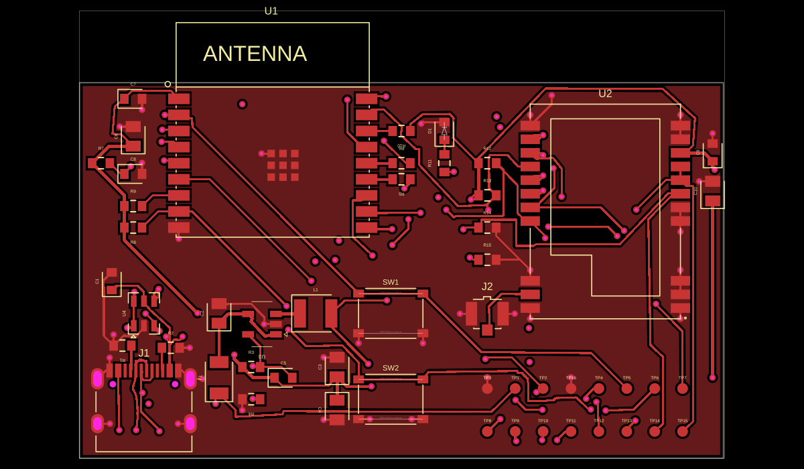

# LoRaLink V1 exported trace and via clearance failures

The supplied `@tsci_mohan-bee.loralink-v1.circuit.json` contains a routed
60 × 35 mm, four-layer board with 52 PCB components, 29 source nets,
121 PCB traces, 113 vias, and seven copper pours. Eight PCB errors are
recorded in the export. All eight can be detected again from its geometry
after removing the saved error and warning elements.

This is a captured-output companion to the live-board reproduction in
[PR #2948](https://github.com/tscircuit/tscircuit-autorouter/pull/2948)
and the escape-via fix proposed in
[PR #2949](https://github.com/tscircuit/tscircuit-autorouter/pull/2949).
It preserves this particular export independently of subsequent rerouting.
It does not establish whether either PR produces or fixes this exact output.

## Reproduce

From the repository root, after installing dependencies:

```sh
bun test tests/repro/loralink-v1-export-clearance.test.ts --timeout 9999999
```

The passing characterization test removes saved diagnostics, then runs
`checkEachPcbTraceNonOverlapping`, `checkViaTraceClearance`,
`checkViaPadClearance`, and `checkHoleTraceClearance`. It checks the affected
object IDs and measured clearances rather than trusting the exported messages.
It does not call the autorouter or assert that routing has been fixed.

## Expected and actual behavior

Expected: different-net traces, vias, and pads do not accidentally contact,
and routed copper respects the board's declared clearance rules.

Actual: the following recorded violations are reproducible with
`@tscircuit/checks` 0.0.233 on autorouter base
`65522c89c370d4b4f9f69e1a79af58de641752bc`.

| Violation | Affected objects | Measured gap | Required gap |
| --- | --- | --- | --- |
| Trace–via contact | LORA_BUSY `source_net_20_mst1_0` / `pcb_via_87` | contact | no contact |
| Trace–via contact | LORA_BUSY `source_net_20_mst1_0` / `pcb_via_84` | contact | no contact |
| Trace–via contact | VBUS `source_net_1_mst2_0` / `pcb_via_82` | contact | no contact |
| Via–trace clearance | `pcb_via_17` / GND `source_net_0_mst42_0` | 0.027978 mm | 0.15 mm |
| Via–trace clearance | `pcb_via_95` / USB_DP `source_net_8_mst3_0` | 0.129992 mm | 0.15 mm |
| Via–trace clearance | `pcb_via_98` / UART_TX `source_net_25_0` | 0.093330 mm | 0.15 mm |
| Via–pad contact | `pcb_via_7` / TP2 `pcb_smtpad_141` | 0 mm | 0.1 mm |
| Trace–hole clearance | VBUS `source_net_1_mst1_0` / `pcb_hole_0` | 0.117721 mm | 0.2 mm |

The two LORA_BUSY contacts are near (11.888502, -4.499332) and
(11.914984, 0.040512) mm. The VBUS contact is near
(-19.567785, -7.047820) mm. The TP2 contact is near
(12.800310, -11.218890) mm.

The current checker also reports additional via–trace and via–pad findings
not stored in the export. The test deliberately checks the eight recorded
findings as a subset; it does not claim these are all current DRC errors.
The via–pad checker uses `min_pad_edge_to_pad_edge_clearance=0.1`;
the board separately declares `min_via_edge_to_pad_edge_clearance=0.25`.
No rules are overridden in the test.

## Board preview

This is the actual captured top-layer PCB rendered with `circuit-to-svg`,
with diagnostic text hidden for readability. It is an orientation aid, not a view
of every layer or proof of all eight violations.



## Provenance and limits

`loralink-v1.circuit.json` is a byte-for-byte copy of the supplied file.
Its SHA-256 is
`27bc46b3c7565862ef1522f9dd16c308ca4e08db8ec94cd6e43c02fed1516121`.

The export does not identify the generating core/autorouter version,
pipeline, effort, cache state, or original routing input. No solver-stage
root cause is asserted. A current-pipeline regression requires capturing
that input or rerendering the original source. This PR adds evidence and a
repeatable geometry check only; it changes no routing code or schematic output.
