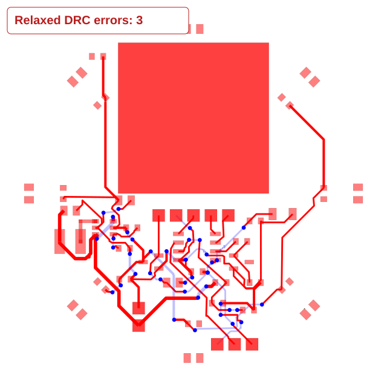

# Luma LED power phase emits invalid copper after reporting success

This is a reproduction-only report. It does not change the router or correct
the output. It captures the power-routing phase of a 56 mm circular,
two-layer, single-AA motion light with eight LEDs and a radar keepout.

## Reproduce

```sh
bun install
bun test tests/bugs/luma-led-power-phase.test.ts tests/bugs/luma-led-power-phase-reported-output.test.ts --timeout 9999999
```

The first test freshly runs `AutoroutingPipelineSolver9_PreloadedTraceGraph`
with cache disabled and effort 1. It characterizes the current bug: the input
passes declared-clearance DRC and has no via-in-pad errors, but the solved
output introduces both. These assertions intentionally document the failure;
a fix should change them to require clean output. The second test checks the
frozen reported output independently of future routing changes.

The sibling `.fixture.tsx` opens the same input in the existing Cosmos pipeline
debugger. Select this fixture after `bun run start`; it explicitly creates
Pipeline 9 with cache disabled.

## Exact SRJ input

`luma-led-power-phase.srj.json` is copied byte-for-byte from the CLI's
`phase-2.input.simple-route.json`, captured with:

```sh
tsci build --disable-parts-engine --autorouter-debug --autorouter-dump-srj all --autorouter-timeout 60s
```

The capture used CLI 0.1.2352, core 0.0.2166 and capacity-autorouter 0.0.985.
It comes from an isolated copy of the board before the subsequent manual
routing and LED-resistor placement correction. It is not SRJ reconstructed
from the final corrected Circuit JSON, or a saved-route replay posing as a
fresh routing failure.

The four source phases were: saved switching-node escape (0), automatically
routed control/feedback (1), automatic power (2), and automatic LEDs (3).
The captured power input includes all physical pads, the circular outline,
the two-layer radar keepout and the preceding control copper:

| Field | Captured content |
|---|---|
| Layers | 2 |
| Connections to route | 4: VBAT, GND, VLED, V3V3 |
| Obstacles | 97 |
| Preloaded traces | 12 |
| Circular outline vertices | 180 |
| Trace-to-pad copper clearance | 0.2 mm |
| Via copper / drill | 0.6 / 0.3 mm |

The SRJ omits `allowViaInPad`; its documented default is false. No field,
connection, obstacle, or preloaded route was edited to create this input.
The existing SRJ includes prior-phase copper; no board TSX, component package,
network request or manual routing correction is needed to replay the bug.

Input SHA-256:
`8b2a1be8072e242340b9b9ba3a6f9fccce6cde11d4f35dccfef534f2d0485486`.

## Observed on current main

Reproduced on `bc19466787f0228de4fca144a2d06be3100c1551`
(package 0.0.989, checks 0.0.255), macOS arm64, Bun 1.3.14.
Pipeline 9 returns `solved=true`, `failed=false`, `error=null`.

| Check | Before the power phase | After the power phase |
|---|---:|---:|
| Declared-rule reference DRC errors | 0 | 3 |
| Via drill overlapping SMD pad | 0 | 3 |

Reference DRC uses the existing `evaluateRelaxedDrc` helper with the SRJ's
declared trace-to-pad and via-hole clearances passed explicitly, rather than
the benchmark's relaxed 0.1 mm trace default. `checkViasInPads` evaluates the
result separately because the reference helper does not include that
placement check. The snapshot's three-error overlay therefore counts the
pad-to-trace failures, not the three additional drill/pad overlaps.

The emitted UPDI trace explicitly replaces its preloaded trace using
`__replaces_pcb_trace_id`. That changed geometry introduces the two left-side
MCU clearance errors. These are not errors already present in the input.

| Output trace | SMD pad | Measured gap | Required |
|---|---|---:|---:|
| UPDI (`source_net_10_0`) | MCU PA3_ADC (`pcb_smtpad_17`) | 0.190967 mm | 0.2 mm |
| UPDI (`source_net_10_0`) | MCU GND (`pcb_smtpad_18`) | 0.190933 mm | 0.2 mm |
| GND (`source_net_1_mst13_0`) | MCU PA6_LED (`pcb_smtpad_12`) | 0.190385 mm | 0.2 mm |

The three via drills overlap these SMD pads:

| Via center, mm | Pad center, mm | Pad |
|---|---|---|
| (2.71, -10.06) | (3.20, -9.71) | MCU VDD |
| (3.42, -9.75) | (3.20, -9.71) | MCU VDD |
| (3.97, -16.08) | (4.33, -16.00) | R_BAT_BOTTOM pin 2 |

`luma-led-power-phase.reported-output.json` is the unmodified return from
`solver.getOutputSimplifiedPcbTraces()` on that main commit. It includes
explicit replacements, so the standard helper combines it with preloaded
copper without duplicating the replaced traces. Its SHA-256 is
`fc077e10b74d20fccd001651247a8332d58361fba8fb9bb9a1523bfe490f3022`.

## Snapshot

This is the power phase, not the final LED phase. It shows the actual pads, radar keepout, preloaded control copper and newly
emitted power copper. The circular outline is retained in the SRJ; the
standard snapshot helper does not draw that outline. The unpopulated LED branches belong to the following phase.



Expected behavior is to preserve the declared clearances and disallow
via-in-pad while routing or adjusting prior-phase copper, or report failure
instead of returning a successful invalid result. This report demonstrates
the behavior; it does not claim which internal repair stage causes it.

## Validation

The two focused repro tests, library build and TypeScript check pass locally.
The snapshot was rendered and visually inspected. A broader `bun test` run
hit the existing `benchmark-networked-lane-stability.test.ts` and
`benchmark-networked-snapshot-abort-cleanup.test.ts` tests, which read Linux’s
`/proc/self/status` and fail with ENOENT on macOS. That run was stopped after
these unrelated failures; a complete Linux suite has not been verified.
