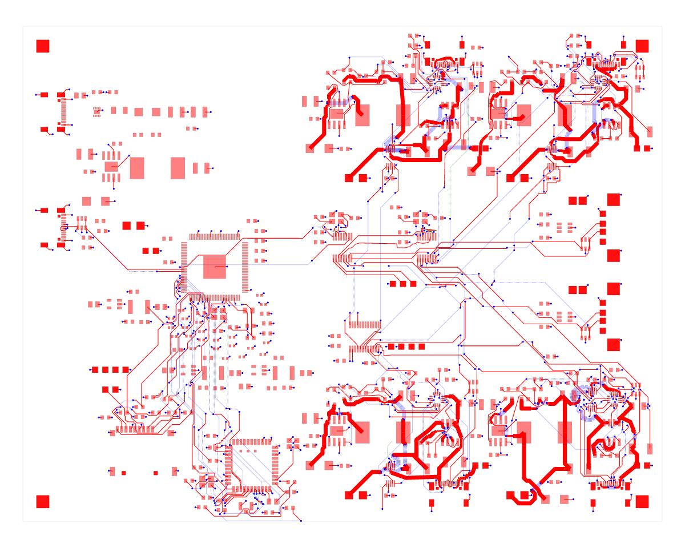
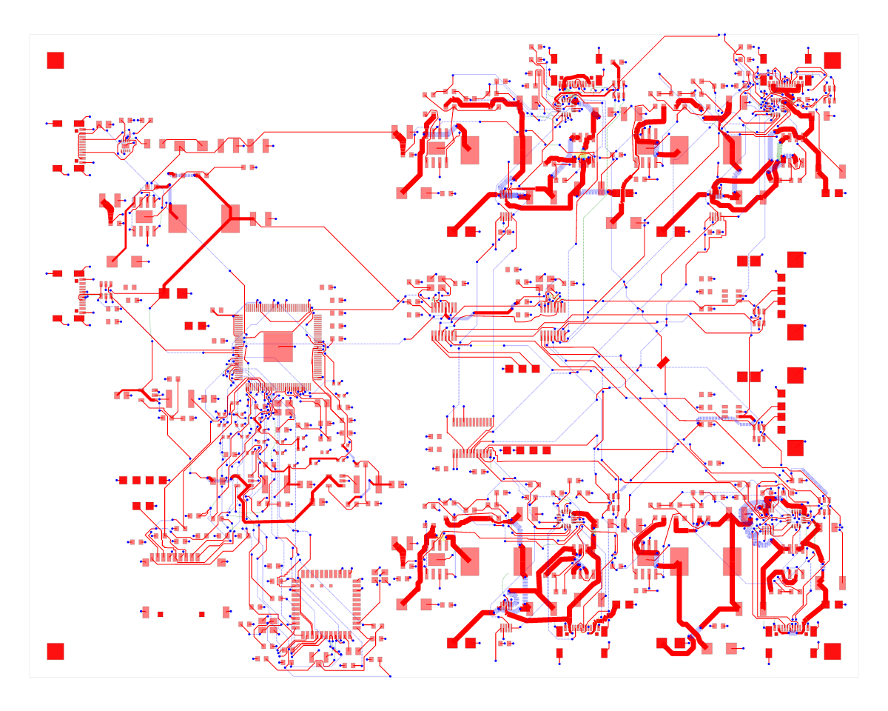
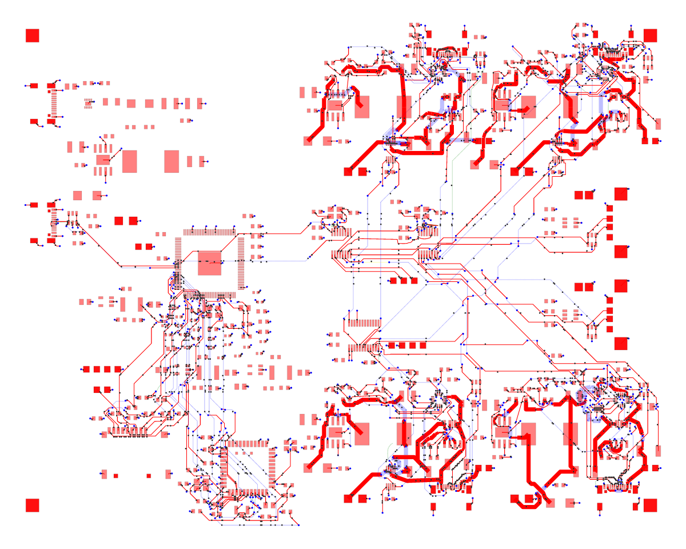

# Motherboard power-distribution phase reproduction

Tracks [#3342](https://github.com/tscircuit/tscircuit-autorouter/issues/3342).
The fixture is a complete phase input, including existing copper, with no need to compile the motherboard or run preceding phases.

```sh
bun install --frozen-lockfile
bun scripts/build-solver-workers.ts
bun tests/bugs/bugreport3342/repro.ts --inspect
bun tests/bugs/bugreport3342/repro.ts
```

Use Bun >= 1.4.2. The runner uses this checkout's source, two workers, effort 1 and no cache provider. A separate supervisor terminates the child after 120 seconds with exit 124, even if a synchronous stage blocks progress timers. This is a manually invoked reproduction, not a slow timed CI test.

For a complete attempt, increase the budget with `TIMEOUT_SECONDS=4500`. A successful run writes `/tmp/motherboard-power-phase-output.srj.json`; override with `OUTPUT_PATH`. Progress samples include phase, elapsed wall time, iteration count and solved/failed state. Debug rendering is off by default; `DEBUG_PREVIEW=1` requests `solver.preview()` every 250 ms to investigate its overhead separately.

## Input and captured evidence

The four-layer 160 x 124 mm input has 21 connections, 1,280 obstacles and 638 preloaded traces. It retains two copper-pour reservations, nominal connection widths up to 2.5 mm, and the original prohibition on blind/buried vias and via-in-pad. Gzip fixtures are checked against their decompressed SHA-256 by the loader.

`captured-output.srj.json.gz` is the original phase's output: 761 traces, with 196 preloaded trace IDs having changed route geometry. This is not by itself a bug; Pipeline9 intentionally supports regional modification of preloaded copper. The captured output is not a golden correctness expectation.

`original-bounded-run.jsonl` was recorded using published capacity-autorouter 0.0.1012 and solver-utils 0.0.23 on macOS arm64, Bun 1.4.2, without visualization or caching. It timed out at 120 seconds. Its last sample was `uniformPortDistributionSolver` at 84.986 seconds; that sample does not establish where execution was at termination.

The earlier integrated run had about 66 minutes between adjacent phase-cache writes. That is only an estimate including intervening overhead, not a CPU profile. Other host jobs, core's 250 ms debug previews, and periodic serialization of large progress graphics are confounders. Later integrated runs reused the cache. The motherboard's subsequent DRC errors are not attributed to this phase without a phase-level before/after check.

## Visual snapshots

| Phase input (638 preloaded traces) | Captured routed output (761 traces) |
| --- | --- |
|  |  |

These board views render the exact stored input and historical output with the
same board outline. The captured output is context for the bug, not a claim of
DRC correctness or a newly completed full-route run.



Black markers show reserved boundary ports, with lines to their copper
projection points. `motherboard-power-preload-visual.test.ts` runs the real input
through the live preload stage and compares this SVG against the baseline. It
also checks all serialized boundary geometry and assignments by SHA-256, covering
details that cannot be resolved in the overview. This is the stage changed by
the spatial-index fix; the board snapshots alone would not test that fix.

Run the visual checks without updating snapshots:

```sh
bun test tests/bugs/bugreport3342/motherboard-power-phase-visual.test.ts tests/bugs/bugreport3342/motherboard-power-preload-visual.test.ts --timeout 9999999
```

The SVG baselines are under `tests/bugs/bugreport3342/__snapshots__/motherboard-power-*`.
The PNGs above are rendered from those SVGs with `@resvg/resvg-js` for GitHub
preview. Baselines are generated on the reproduction branch and inherited
unchanged by the fix branch.
