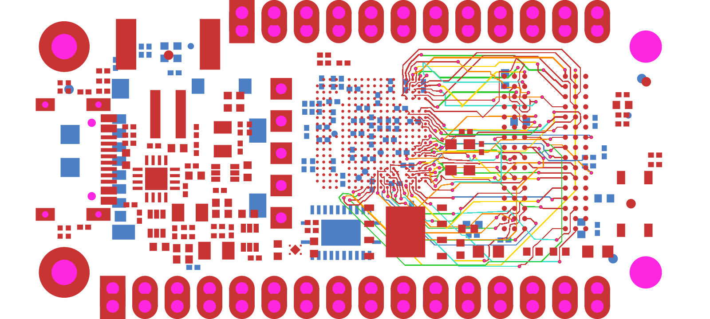

# OrangeCrab DDR clearance repro

This is the complete captured DDR signal network of the real OrangeCrab rev 0.2.1: an ECP5 FPGA (U3) connected to an MT41K64M16 DDR3 RAM (U4). It has **50 nets, 102 original endpoints, 893 obstacles and six copper layers**. Both three-terminal clock nets retain their passive endpoints.

The input is SRJ36 sample004, captured from [the original KiCad board](https://github.com/orangecrab-fpga/orangecrab-hardware/blob/c511d569fe2af39467041f888bc231020f40c6ac/hardware/orangecrab_r0.2.1/OrangeCrab.kicad_pcb). Source hashes, pad approximations and extraction scope are recorded in [provenance.json](./provenance.json). Existing routed copper was removed; component placement, DDR endpoints, obstacles, six-layer stack and declared clearances were preserved. No timing or impedance constraints are encoded, so this verifies connectivity and copper clearance, not DDR timing closure.

```sh
bun test tests/features/real-ddr-orangecrab.test.ts --timeout 9999999
```

The test checks all 50 nets and 102 endpoints, records reference DRC errors and physical drill/pad overlaps, and snapshots the actual emitted Circuit JSON with `circuit-to-svg`. The fix changes the measured counts and routed-copper snapshot; the input remains identical.



[Full routed SVG](../../features/__snapshots__/real-ddr-orangecrab.snap.svg) · [Measured counts](../../features/__snapshots__/real-ddr-orangecrab.test.ts.snap)
