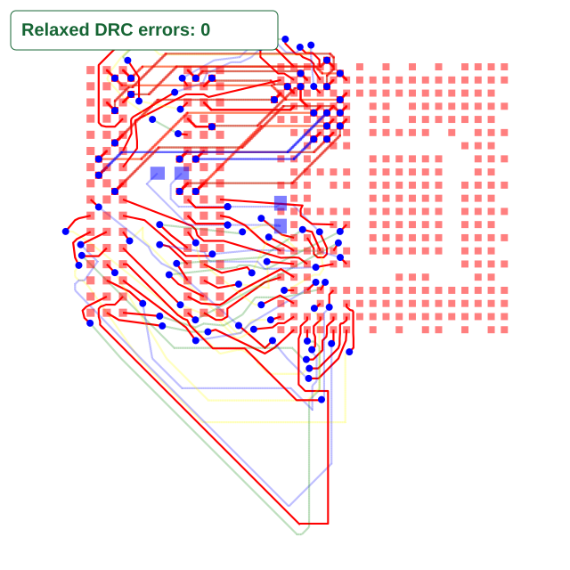

Native DDR subsystem from [Allwinner H616 Devboard](https://github.com/Kononenko-K/Allwinner_H616_Devboard/blob/94fe1071ff3d7c2e6a227a3e4dfccb6acae305c4/Hardware/H616_DDR3/H616_devboard.kicad_pcb).

The TSX preserves all 384 pads on U1, U2, R4 and C7, their placements,
four copper layers, 0.093/0.0975 mm trace widths, 0.35/0.15 mm vias,
0.1 mm clearance and no via-in-pad. It requests all 53 DDR signals,
routing sixteen DQ signals before the remaining 37. DDR timing is not qualified.

The captured input comes from tscircuit 0.0.3125, Core 0.0.2310,
capacity-autorouter 0.0.1064 and bus-lanes-solver 0.0.49, without caches.
The original board's existing copper is removed before routing.

The baseline connects 53/53 signals but has five physical errors: SCAS
contacts DQ5, two DM0 vias are too close to DQ11, and two strobe/mask
trace clearances are insufficient. The SVG test restores the sixteen actual
earlier DQ routes for drawing and independent DRC; the solver receives Core's
unchanged remaining-phase request, with those routes represented as obstacles.



Regenerate the routing snapshot from the repository root:

```sh
BUN_UPDATE_SNAPSHOTS=1 bun test tests/repro/pipeline9-h616-native-ddr-clearance.test.ts --timeout 9999999
```

To route the native TSX through Core with this checkout's Pipeline9:

```sh
cd tests/repro/h616-native-ddr-clearance
bun install
bun run render
```

The data-byte phases use the pinned published runtime. The remaining phase uses
the checkout's solver. The renderer writes the actual Circuit JSON, board SVG
and Core's error list. The same test and TSX run on the stacked fix.
