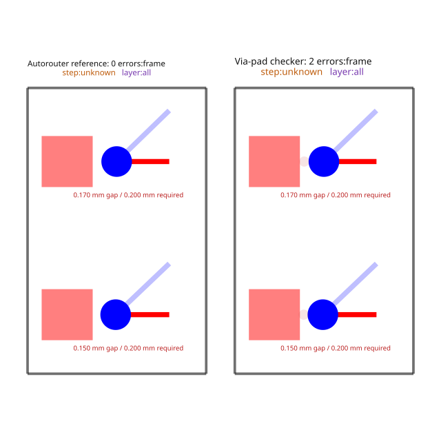

# Via-to-pad reference DRC reproduction

Related issue: https://github.com/tscircuit/tscircuit-autorouter/issues/3130

This is a reduced reproduction of the missing via-to-pad check in the
autorouter's reference DRC. It is not a reproduction of the reporter's complete
QFP board or its reported 96 violations; that board input was not supplied.
The routes are explicit test geometry, not freshly generated pipeline output.

Two unrelated top-layer pads sit beside 0.6 mm copper / 0.3 mm drill vias.
Their copper gaps are independently measured as 0.15 mm and 0.17 mm against
the declared 0.20 mm `minPadEdgeToPadEdgeClearance`. The narrower traces meet
their separate 0.10 mm clearance rule.

On main at `f0d84e20b6fb0c21e78d35651c75d67a72f39507`, with checks 0.0.255:

- `evaluateRelaxedDrc` reports zero errors.
- `checkViaPadClearance`, on exactly the same converted Circuit JSON, reports
  both violations with their measured gaps, pad/via identities and locations.

The snapshot draws the same physical geometry for both checks. Its counts and
measurements come from the evaluated results. The repro commit characterizes
the current mismatch; the stacked fix must change the reference assertion to
require both errors and map their vias back to the affected routes.

```sh
bun test tests/repro/issue3130-via-pad-clearance.test.ts --timeout 9999999
```


